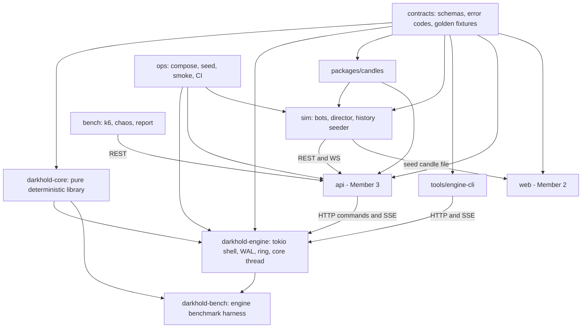
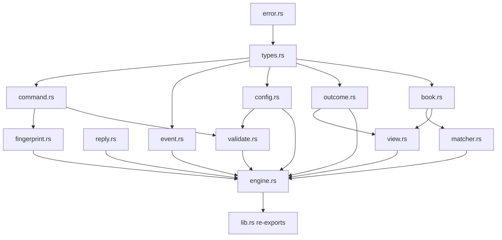
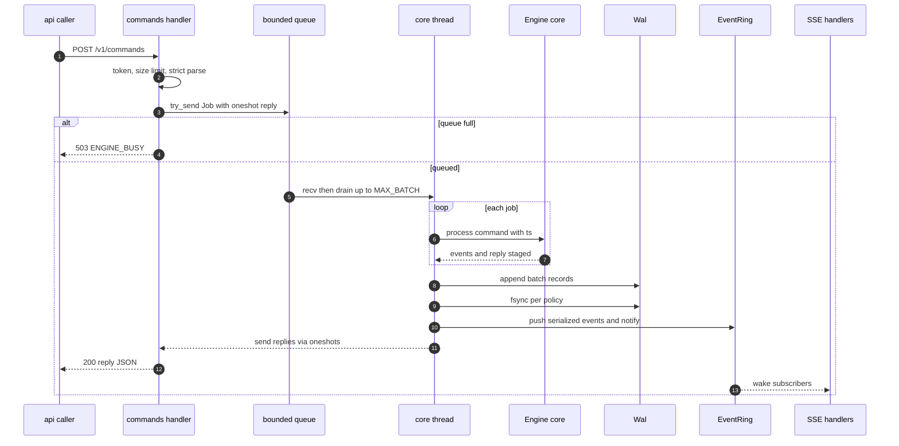
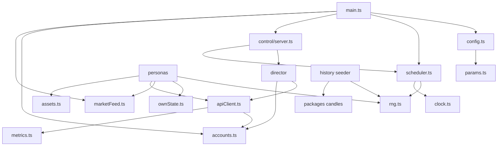
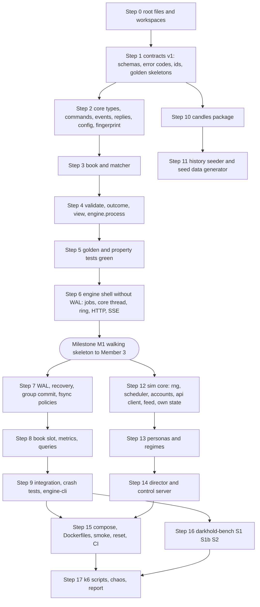

# MEMBER 1 — COMPLETE CODING PLAN (SINGLE SOURCE OF TRUTH)
## The Darkhold Exchange: engine, contracts, candles, simulator, benchmarks, ops

> **Audience:** a coding agent (and Member 1) who will implement everything below without making new design decisions.
> **This document contains no source code.** It specifies files, logic, wire formats, constants, and tests precisely enough to implement directly.
> **Authority order if documents disagree:** this document, then the main blueprint, then the Member 1 guide.
> Values labeled *illustrative* are pinned defaults chosen here so nobody has to decide. They are configurable, not measured results.

---

## 0. Rules for the implementer

1. **Follow the spec literally.** Do not add features, endpoints, fields, crates, or packages that are not listed.
2. **If something is ambiguous:** use the value in Section 17 (pinned defaults). If it is not there, choose the simplest behavior that keeps the engine deterministic and record it in `docs/DECISIONS.md` as one line. Never block.
3. **Never panic on input.** Bad input produces a typed rejection or HTTP 400, never a crash. Internal invariant violations abort the process (Section 4.2.4).
4. **Determinism is non-negotiable** inside `darkhold-core` (Section 2, rule D1 to D8).
5. **Every file below has a Tests line.** A file is not done until its tests exist and pass.
6. **Contracts first.** Schemas and golden fixtures (Section 7) are written before the code that must satisfy them.
7. **No dependencies beyond the listed ones.** Pin exact versions in lockfiles.
8. **No network access, database access, or wall-clock reads inside `darkhold-core`.**
9. **Keep files small and single-purpose.** If a file spec below says "does X", it must not also do Y.
10. **Integers only on the wire for money and quantity**, and every integer must be at most 2^53 − 1 (Section 2).

---

## 1. Scope map, repository layout, dependencies

### 1.1 What Member 1 delivers

| Deliverable | Location | Consumed by |
|---|---|---|
| Matching engine (Rust) | `engine/` | Member 3's `api` (HTTP commands, SSE events) |
| Contracts (schemas, error codes, golden fixtures, generated TS types) | `contracts/` | Everyone |
| Candle aggregation library (TypeScript) | `packages/candles/` | Member 3 (consumer), `sim` seeder, Member 2 mocks |
| Market simulator, scenario director, history seeder | `sim/` | Demo, Member 2 (fixtures), Member 3 (seed) |
| Benchmark harness, k6 scripts, chaos scripts, report generator | `engine/crates/darkhold-bench/`, `bench/` | Evidence for judging |
| Compose, Dockerfiles, seed data generator, reset runbook, CI, smoke test | `ops/`, `.github/` | Everyone |
| Developer CLI for the engine | `tools/engine-cli/` | Member 1, Member 3 debugging |
| Monorepo root files | repo root | Everyone |

### 1.2 Repository layout (Member 1 files marked with a star)

```text
darkhold/
  package.json                     * npm workspaces root
  tsconfig.base.json               * shared TS settings
  .nvmrc  .editorconfig  .gitignore  README.md   *
  contracts/                       *
    VERSION  CHANGELOG.md  package.json
    error-codes.json
    schemas/
      command.submit-order.schema.json
      command.cancel-order.schema.json
      command.configure-asset.schema.json
      command.asset-status.schema.json        (halt and resume)
      reply.command.schema.json
      event.envelope.schema.json              (oneOf all event types)
      book.snapshot.schema.json
      sse.hello.schema.json
      order.outcome.schema.json
      open-orders.schema.json
      error.envelope.schema.json
      health.schema.json
      seeded-candles.schema.json
      candle.schema.json
    fixtures/
      engine/scenarios/S01-... to S24-....json   (golden scenarios)
      engine/errors/*.json
      market/candles.seeded.json                 (generated, committed)
    scripts/
      validate-fixtures.mjs
      generate-types.mjs
    generated/types.ts                           (generated, committed)
  engine/                          *
    Cargo.toml  rust-toolchain.toml  Cargo.lock  README.md
    crates/
      darkhold-core/
      darkhold-engine/
      darkhold-bench/
  packages/
    candles/                       *
  sim/                             *
  bench/                           *
  tools/
    engine-cli/                    *
  ops/                             *
    docker-compose.yml  docker-compose.dev.yml  .env.example
    engine.Dockerfile  sim.Dockerfile
    seed/  scripts/  RUNBOOK.md
  .github/workflows/ci.yml         *
  docs/DECISIONS.md                *
  api/                             (Member 3)
  web/                             (Member 2)
```

### 1.3 Component dependency graph



---

## 2. Crucial decisions register (all pinned)

### 2.1 Determinism rules (inside `darkhold-core`)

| # | Rule |
|---|---|
| D1 | No floating point anywhere |
| D2 | No wall-clock reads. `ts` is an input parameter |
| D3 | No randomness. The epoch string is an input parameter |
| D4 | No threads, no async, no I/O, no logging side effects that affect behavior |
| D5 | Matching code may only iterate ordered structures (ordered maps, FIFO queues, vectors). Hash maps are used for point lookups only |
| D6 | Any listing that exposes hash-map content must be explicitly sorted before returning |
| D7 | Serialization is by derived structs with stable field order. Tests compare parsed JSON values, not strings |
| D8 | Replaying the same commands with the same `ts` values into a fresh engine with the same epoch yields identical events and replies, including `trade_id` |

### 2.2 Data decisions

| # | Decision | Value |
|---|---|---|
| 1 | Price, quantity, seq, timestamp types | `u64`, minor units, integers |
| 2 | Maximum value of any price, quantity, notional, seq, ts on the wire | **9007199254740991** (2^53 − 1) so Node can read them exactly. Called `MAX_SAFE` |
| 3 | Notional check | `price × qty` computed with checked multiplication. Reject `NOTIONAL_OVERFLOW` on overflow or if result exceeds `MAX_SAFE` |
| 4 | `order_id` | UUID, canonical lowercase hyphenated string, generated by Member 3, validated at parse |
| 5 | `user_id` | Opaque string, 1 to 64 characters, printable ASCII, no whitespace, validated at parse |
| 6 | `asset` | String matching `^[A-Z0-9_-]{1,32}$`, validated at parse |
| 7 | `engine_epoch` | String `e-` plus 8 lowercase hex characters, generated when a new WAL is created |
| 8 | `seq` | Starts at 1. One per **event**. Global across assets. No gaps. Replies and queries do not consume seq |
| 9 | `trade_id` | `{engine_epoch}:{seq of the TradeExecuted event}` |
| 10 | `ts` | Milliseconds since Unix epoch, assigned when the core thread dequeues a command. Clamped nondecreasing |
| 11 | Price on MARKET orders | The `price` field carries the **protection price**, required, and the order is treated as IOC at that price |
| 12 | Time in force | LIMIT may be GTC or IOC. MARKET must be IOC |
| 13 | Trade price | Always the maker's resting price |
| 14 | Self-trade prevention | Cancel the incoming remainder, reason `SELF_TRADE_PREVENTED`. Earlier fills of that command stay |
| 15 | Fingerprint | FNV-1a 64-bit over the canonical string `asset|user_id|side|type|tif|qty|price` |
| 16 | Duplicate `order_id` | Same fingerprint returns the stored original reply with `duplicate: true` and no events. Different fingerprint returns `REJECTED ORDER_ID_REUSED`, no events |
| 17 | Rejections | Every validation rejection of a submit emits an `OrderRejected` event (consumes seq) and records an outcome |
| 18 | Reply HTTP status | HTTP 200 for every processed command, including business rejections. Transport problems use 4xx or 5xx |
| 19 | Book snapshot events | Unsequenced, conflated, not in WAL, not in ring, not replayed |
| 20 | Single core thread | One thread owns all assets |
| 21 | WAL content | Every command that was processed, with its assigned `ts`. Never events |
| 22 | Release rule | Replies and events are released only after the WAL write (and fsync per policy) of their batch |
| 23 | Fail-fast | Any WAL I/O error or internal invariant violation aborts the process |
| 24 | Outcome map retention | Unbounded in the MVP. Warn in logs at 2,000,000 entries |
| 25 | Currency of examples | Minor units (for example 10000 equals 100.00) |

### 2.3 Enumerations (exact wire spellings)

| Enum | Values |
|---|---|
| `side` | `BUY`, `SELL` |
| `type` | `LIMIT`, `MARKET` |
| `tif` | `GTC`, `IOC` |
| `asset status` | `ACTIVE`, `HALTED` |
| `order status` | `OPEN`, `PARTIALLY_FILLED`, `FILLED`, `CANCELED`, `REJECTED` |
| `cancel command reason` | `USER`, `POLICY_BREACH`, `ADMIN` |
| `cancel event reason` | `USER`, `POLICY_BREACH`, `ADMIN`, `IOC_REMAINDER`, `NO_LIQUIDITY`, `SELF_TRADE_PREVENTED` |
| `cancel reply status` | `CANCELED`, `ALREADY_CANCELED`, `ALREADY_FILLED`, `UNKNOWN_ORDER` |
| `submit reply status` | `ACCEPTED`, `REJECTED` |
| `admin reply status` | `OK`, `NOOP`, `REJECTED` |
| `reject codes` | `UNKNOWN_ASSET`, `ASSET_HALTED`, `INVALID_QTY`, `INVALID_PRICE`, `PRICE_NOT_ON_TICK`, `PRICE_ABOVE_COLLAR`, `NOTIONAL_OVERFLOW`, `INVALID_TIF`, `ORDER_ID_REUSED`, `INVALID_CONFIG` |
| `transport error codes` | `VALIDATION_FAILED`, `UNAUTHENTICATED`, `NOT_FOUND`, `PAYLOAD_TOO_LARGE`, `ENGINE_BUSY`, `ENGINE_UNAVAILABLE`, `COMMAND_TIMEOUT`, `EPOCH_MISMATCH`, `AFTER_IN_FUTURE`, `GONE`, `TOO_MANY_SUBSCRIBERS`, `INTERNAL` |

---

## 3. Canonical wire contracts

All JSON is UTF-8. Field names are lowercase snake_case. Unknown fields in commands are rejected with HTTP 400 `VALIDATION_FAILED`.

### 3.1 Commands (`POST /v1/commands`, one object per request, discriminated by `type`)

**SubmitOrder**

| Field | Type | Rule |
|---|---|---|
| `type` | `"SubmitOrder"` | |
| `order_id` | uuid string | |
| `asset` | string | pattern above |
| `user_id` | string | |
| `side` | enum | |
| `order_type` | enum `LIMIT` or `MARKET` | (the field is `order_type` to avoid clashing with the discriminator) |
| `tif` | enum | |
| `qty` | integer | 1 to MAX_SAFE (further limits in validation) |
| `price` | integer | 1 to MAX_SAFE. Protection price when MARKET |

Example: `{"type":"SubmitOrder","order_id":"0b6d5c2e-7c1a-4b9f-8f0a-2f3e9d1a4c11","asset":"DFEST-WKND","user_id":"u-1","side":"BUY","order_type":"LIMIT","tif":"GTC","qty":5,"price":10000}`

**CancelOrder:** `type`, `order_id`, `reason` (`USER` | `POLICY_BREACH` | `ADMIN`).

**ConfigureAsset:** `type`, `asset`, `tick_size`, `min_qty`, `max_qty`, `collar_max_price` (integer or null), `status` (`ACTIVE` | `HALTED`).

**HaltAsset / ResumeAsset:** `type`, `asset`.

### 3.2 Replies (body of the 200 response to `POST /v1/commands`)

| Field | Type | Meaning |
|---|---|---|
| `status` | enum (per command kind) | |
| `order_id` | uuid or absent | Echo for submit and cancel |
| `asset` | string or absent | Echo for admin commands |
| `code` | reject code or absent | Present when `REJECTED` |
| `seq` | integer or null | `seq` of the first event produced by this command, null if none |
| `last_seq` | integer | Engine stream position after this command (for duplicates: the original `last_seq`) |
| `remaining_qty` | integer or absent | Present for cancel status `CANCELED` |
| `engine_epoch` | string | |
| `duplicate` | boolean | True when the stored original was returned or the cancel was a repeat |

Example (partial fill ack): `{"status":"ACCEPTED","order_id":"...","seq":3,"last_seq":6,"engine_epoch":"e-test0001","duplicate":false}`

### 3.3 Events (SSE `event:` name equals `type`; `id:` equals `seq`)

Every event has: `type`, `engine_epoch`, `seq`, `ts`, `asset`.

| Event type | Additional fields |
|---|---|
| `AssetConfigured` | `tick_size`, `min_qty`, `max_qty`, `collar_max_price` (nullable), `status` |
| `AssetHalted` | none |
| `AssetResumed` | none |
| `OrderAccepted` | `order_id`, `user_id`, `side`, `order_type`, `tif`, `price`, `qty` |
| `OrderRejected` | `order_id`, `user_id`, `code` |
| `TradeExecuted` | `trade_id`, `price`, `qty`, `buy_order_id`, `sell_order_id`, `buy_user_id`, `sell_user_id`, `maker_order_id`, `taker_order_id`, `taker_side`, `buy_remaining`, `sell_remaining` |
| `OrderPartiallyFilled` | `order_id`, `user_id`, `filled_qty` (cumulative), `remaining_qty` |
| `OrderFilled` | `order_id`, `user_id`, `filled_qty` (equals original qty) |
| `OrderCanceled` | `order_id`, `user_id`, `filled_qty`, `remaining_qty`, `reason` |

Example `TradeExecuted`: `{"type":"TradeExecuted","engine_epoch":"e-test0001","seq":4,"ts":1002,"asset":"TEST-A","trade_id":"e-test0001:4","price":100,"qty":5,"buy_order_id":"...B","sell_order_id":"...A","buy_user_id":"U2","sell_user_id":"U1","maker_order_id":"...A","taker_order_id":"...B","taker_side":"BUY","buy_remaining":3,"sell_remaining":0}`

**Fixed event order inside one submit command.**
1. `OrderAccepted` (or `OrderRejected` and stop).
2. For each fill in matching order: `TradeExecuted`, then the **maker's** status event (`OrderFilled` if remaining is zero, else `OrderPartiallyFilled`).
3. Taker final event, exactly one of: `OrderFilled` (remaining zero), `OrderPartiallyFilled` (remainder rests and at least one fill occurred), `OrderCanceled` (IOC remainder, no liquidity, or self-trade prevention). A fully resting order with no fills emits no taker event beyond `OrderAccepted`.

**Cancel command:** at most one `OrderCanceled` event. Repeats and no-ops emit nothing.
**Admin commands:** `AssetConfigured` always on configure. `AssetHalted` and `AssetResumed` only if the status actually changed (otherwise reply `NOOP`).

### 3.4 Book snapshot (`event: book` on SSE, and body of `GET /v1/books/:asset`)

`{"asset":"...","engine_epoch":"...","as_of_seq":123,"ts":1700000000000,"depth":15,"bids":[{"price":100,"qty":7,"orders":2}],"asks":[...],"best_bid":100,"best_ask":101,"spread":1}`
`best_bid`, `best_ask`, `spread` are null when not computable. Bids sorted price descending, asks ascending, limited to `depth` levels. `qty` is level `total_qty`, `orders` is level `live_count`.

### 3.5 Order outcome (`GET /v1/orders/:order_id`)

`order_id`, `asset`, `user_id`, `side`, `order_type`, `tif`, `price`, `qty`, `filled_qty`, `remaining_qty`, `status`, `reject_code` (nullable), `cancel_reason` (nullable), `first_seq` (nullable), `engine_epoch`, `as_of_seq`. Unknown order: HTTP 404 `NOT_FOUND`.

### 3.6 Open orders (`GET /v1/open-orders`, optional `?asset=`)

`engine_epoch`, `as_of_seq`, `orders`: array of `order_id`, `asset`, `user_id`, `side`, `price`, `qty`, `filled_qty`, `remaining_qty`, `accept_seq`. Sorted by `asset` ascending, then `accept_seq` ascending.

### 3.7 SSE protocol (`GET /v1/events`)

Query parameters: `after` (integer, optional), `epoch` (string, optional).

| Step | Rule |
|---|---|
| 1 | Validate token (header `X-Engine-Token`) |
| 2 | If `epoch` present and differs from current epoch: HTTP 409 `EPOCH_MISMATCH` with `details.current_epoch` |
| 3 | `after` defaults to current published `seq` (live only). If `after` is greater than current: HTTP 409 `AFTER_IN_FUTURE` with `details.current_seq` and `details.current_epoch` |
| 4 | If `after + 1` is less than `ring_start_seq` (or ring is empty and `after` is less than current): HTTP 410 `GONE` with `details.ring_start_seq` |
| 5 | If subscriber count is at maximum: HTTP 503 `TOO_MANY_SUBSCRIBERS` |
| 6 | Send `event: hello` (no id): `engine_epoch`, `current_seq`, `ring_start_seq`, `assets` (array of `asset` and `status`), `server_time` |
| 7 | Send the latest `book` snapshots for all assets |
| 8 | Send all ring events with `seq > after` in order, `id:` equals `seq`, `event:` equals type, `data:` the JSON |
| 9 | Loop: wait for new published `seq`, or new book snapshot version, or heartbeat timer. Send new events, new book snapshots (`event: book`, no id), and a comment line `: hb` every heartbeat interval when idle |
| 10 | If the subscriber's cursor falls out of the ring: send `event: gone` with `ring_start_seq` and close |

### 3.8 Errors (transport level)

`{"error":{"code":"VALIDATION_FAILED","message":"human text","details":{}}}`

| HTTP | Code | When |
|---|---|---|
| 400 | `VALIDATION_FAILED` | Malformed JSON, unknown field, wrong type, bad enum, bad uuid, bad asset or user id format |
| 401 | `UNAUTHENTICATED` | Missing or wrong `X-Engine-Token` |
| 404 | `NOT_FOUND` | Unknown order or asset on query |
| 409 | `EPOCH_MISMATCH` / `AFTER_IN_FUTURE` | SSE guards |
| 410 | `GONE` | SSE resume point too old |
| 413 | `PAYLOAD_TOO_LARGE` | Body over limit |
| 503 | `ENGINE_BUSY` | Command queue full. Header `Retry-After: 1` |
| 503 | `ENGINE_UNAVAILABLE` | Core thread not alive |
| 503 | `TOO_MANY_SUBSCRIBERS` | SSE cap |
| 504 | `COMMAND_TIMEOUT` | Reply not received within timeout. **The command may still execute** |
| 500 | `INTERNAL` | Unexpected |

### 3.9 Health and metrics

`GET /healthz` (no auth): `{"status":"ok","engine_epoch":"...","seq":123,"uptime_s":42}`. HTTP 503 with status `down` if the core thread is dead.

`GET /metrics` (auth) JSON keys:

| Key | Content |
|---|---|
| `engine_epoch`, `seq`, `ring_start_seq`, `ring_len`, `uptime_s` | identifiers |
| `queue.depth`, `queue.capacity` | command queue |
| `commands.total`, `commands.by_type` | counts |
| `events.total` | counts |
| `rejects.by_code`, `cancels.by_outcome` | counts |
| `latency_us.queue_wait`, `latency_us.process`, `latency_us.wal`, `latency_us.total` | each `{count,min,p50,p95,p99,max}` |
| `batch.size` | `{count,min,p50,p95,p99,max}` |
| `wal.bytes`, `wal.fsync_policy`, `wal.fsync_count` | durability |
| `sse.subscribers`, `sse.slowest_lag` | stream health |
| `books` | per asset `{bids_levels, asks_levels, resting_orders}` |
| `outcomes.count` | map size |

### 3.10 WAL file format

File: `{WAL_DIR}/commands.wal`.

Record framing (all integers little endian): `[length u32][crc32 u32][type u8][payload bytes]`
- `length` is the payload length (excluding type). Maximum 1 MiB, larger is corruption.
- `crc32` covers the `type` byte followed by the payload.
- Type `0x01` header: payload JSON `{"magic":"DKWAL","version":1,"engine_epoch":"...","created_at_ms":...}`. Must be the first record.
- Type `0x02` command: payload JSON `{"ts":1002,"cmd":{...command JSON identical to HTTP form...}}`.

---

## 4. Engine specification (`engine/`)

### 4.1 `crates/darkhold-core` (pure library)

**`Cargo.toml`.** Dependencies: `serde` (derive), `serde_json`, `uuid` (serde), `thiserror`. Dev-dependencies: `proptest`, `jsonschema`, `rand` and `rand_pcg` (only for tests), `criterion` (benches). No tokio, no I/O crates.



#### `src/types.rs`
- **Purpose:** shared primitive types and enums.
- **Logic:** type aliases `Price`, `Qty`, `Seq`, `TsMs` all `u64`. Constant `MAX_SAFE = 9007199254740991`. Validated newtypes `AssetId` (pattern check), `UserId` (length and character check), `OrderId` (wraps `Uuid`, serialized as lowercase hyphenated string). Enums from Section 2.3, serialized with exact wire spellings (`SCREAMING_SNAKE_CASE`). Each newtype has `parse` plus custom `Deserialize` that fails with a clear message (surfaces as HTTP 400).
- **Needs:** serde, uuid.
- **Provides:** every other file.
- **Tests:** accept and reject examples for each newtype pattern, enum spelling round trips.

#### `src/error.rs`
- **Purpose:** typed parse and internal errors.
- **Logic:** `ParseError` (message), `InvariantViolation` (message). No error carries behavior.
- **Provides:** `types.rs`, `engine.rs`.
- **Tests:** none beyond compile.

#### `src/command.rs`
- **Purpose:** `Command` enum and payload structs exactly as Section 3.1.
- **Logic:** internally tagged by `type`. Every payload struct rejects unknown fields. `CancelReason` for commands only allows `USER`, `POLICY_BREACH`, `ADMIN`. `Command::kind()` returns a short static string for metrics (`submit`, `cancel`, `configure`, `halt`, `resume`).
- **Provides:** `engine.rs`, WAL (serialization), HTTP (deserialization), tests.
- **Tests:** parse each example, reject unknown field, reject bad enum, round trip.

#### `src/config.rs`
- **Purpose:** `AssetConfig`: `tick_size`, `min_qty`, `max_qty`, `collar_max_price` (Option), `status`.
- **Logic:** `validate_config` returns `INVALID_CONFIG` when `tick_size == 0`, `min_qty == 0`, `max_qty < min_qty`, `collar_max_price == Some(0)`, or any value above `MAX_SAFE`.
- **Provides:** `engine.rs`, `validate.rs`.
- **Tests:** each invalid case.

#### `src/event.rs`
- **Purpose:** event bodies and the envelope (Section 3.3).
- **Logic:** `EventBody` internally tagged enum, one variant per event type. `EventEnvelope { engine_epoch, seq, ts, asset, body }` where common fields serialize first and `body` is flattened. Serialization only (deserialization is only needed in tests, use `serde_json::Value`). Provide `to_json_string` helper.
- **Provides:** `engine.rs`, ring, SSE, golden tests.
- **Tests:** serialize every variant and validate against `contracts/schemas/event.envelope.schema.json`.

#### `src/reply.rs`
- **Purpose:** `CommandReply` structure (Section 3.2) with constructors `submit_accepted`, `submit_rejected`, `cancel_result`, `admin_result`.
- **Logic:** plain data with serialization that omits absent optional fields and always includes `seq` (null when none), `last_seq`, `engine_epoch`, `duplicate`.
- **Provides:** `engine.rs`, HTTP handler, outcome storage (stored reply fields).
- **Tests:** serialization shape against `reply.command.schema.json`.

#### `src/fingerprint.rs`
- **Purpose:** deterministic order fingerprint.
- **Logic:** build the canonical string `asset|user_id|side|order_type|tif|qty|price` with enum wire spellings and decimal integers, hash with FNV-1a 64 (offset basis `14695981039346656037`, prime `1099511628211`), return `u64`. Not `DefaultHasher`.
- **Provides:** `engine.rs` (dedup).
- **Tests:** fixed known input gives fixed known hash (hard-coded in test), different qty changes hash.

#### `src/outcome.rs`
- **Purpose:** per-order record that backs dedup, cancel replies, and queries.
- **Fields:** `order_id`, `asset`, `user_id`, `side`, `order_type`, `tif`, `price`, `qty`, `filled_qty`, `remaining_qty`, `status`, `reject_code`, `cancel_reason`, `fingerprint`, `first_seq` (Option), `submit_last_seq`.
- **Logic:** helper methods `apply_fill(qty)` (increases `filled_qty`, decreases `remaining_qty`, status becomes `PARTIALLY_FILLED` or `FILLED`), `mark_canceled(reason)`, `to_view`. Invariant: `filled_qty + remaining_qty == qty` unless `CANCELED` or `REJECTED` (then `remaining_qty` keeps the unfilled amount at cancel time, and for `REJECTED` equals `qty` with `filled_qty == 0`).
- **Provides:** `engine.rs`, `view.rs`.
- **Tests:** transitions and invariant.

#### `src/book.rs`
- **Purpose:** the order book for one asset. Pure data structure, no matching policy.
- **Structures:**
  - `RestingOrder { order_id, user_id, side, price, remaining, accept_seq }`
  - `PriceLevel { price, total_qty, live_count, queue }` where `queue` is a FIFO of `OrderId`
  - `AssetBook { asset, config, bids, asks, index }` with `bids` and `asks` as ordered maps keyed by price, and `index` a hash map from `OrderId` to `RestingOrder`
- **Operations and exact logic:**
  1. `best_bid()`: highest key of `bids`. `best_ask()`: lowest key of `asks`.
  2. `insert_resting(order)`: add to `index`. Get or create the level on the order's side. Push id to the back of the queue. `total_qty += remaining`. `live_count += 1`.
  3. `remove(order_id) -> Option<RestingOrder>` (used by cancel): remove from `index`. On its level: `total_qty -= remaining`, `live_count -= 1`. If `live_count == 0` delete the level. Otherwise, if `queue.len() > 2 * live_count + 32`, compact the queue by retaining only ids present in `index` (**tombstone compaction**). Leave the id in the queue otherwise (lazy tombstone).
  4. `front_live(side, price) -> Option<OrderId>`: pop front ids that are not in `index` (tombstones). Return the first live id without removing it. If the level has no live orders after popping, delete the level and return `None`.
  5. `reduce_maker(order_id, qty)`: decrease the order's `remaining` and the level `total_qty`. If `remaining` hits zero: remove from `index`, pop it from the front of the queue (it must be at the front because it was just matched), `live_count -= 1`, delete level if `live_count == 0`.
  6. `depth(side, n) -> Vec<(price, total_qty, live_count)>`: bids from highest descending, asks from lowest ascending, at most `n` levels.
  7. `open_orders() -> Vec<RestingOrder>`: collect from `index`, **sorted by `accept_seq` ascending** (determinism rule D6).
  8. `check_invariants() -> Result<(), String>`: book not crossed (`best_bid < best_ask` when both exist), every level `total_qty` equals the sum of `remaining` of live orders at that price, every `live_count` is correct, every index entry appears in exactly one level queue, no empty levels.
- **Needs:** `types.rs`, `config.rs`.
- **Provides:** `matcher.rs`, `engine.rs`, `view.rs`.
- **Tests:** each operation, tombstone skipping, compaction trigger and result, `check_invariants` after random operations.

#### `src/matcher.rs`
- **Purpose:** match one incoming order against a book. Pure function over `AssetBook`, produces a result, emits no events.
- **Input:** mutable book, incoming order (`order_id`, `user_id`, `side`, `price`, `remaining`), nothing else.
- **Output:** `MatchResult { fills: Vec<Fill>, incoming_remaining, stp_hit }` where `Fill { maker_order_id, maker_user_id, price, qty, maker_remaining_after }`.
- **Exact algorithm:**
  1. Loop.
  2. Look at the opposite side best price. If none, stop.
  3. Check crossing: BUY crosses if `best_ask <= incoming.price`. SELL crosses if `best_bid >= incoming.price`. If not crossing, stop.
  4. Get `front_live` at that price. If `None`, continue the loop (the level was deleted).
  5. Look up the maker in `index`. If `maker.user_id == incoming.user_id`: set `stp_hit = true`, stop.
  6. `q = min(incoming.remaining, maker.remaining)`. Trade price is the maker's price.
  7. Record the fill. Call `reduce_maker(maker_id, q)`. `incoming.remaining -= q`.
  8. If `incoming.remaining == 0`, stop. Otherwise continue.
- **Provides:** `engine.rs`.
- **Tests:** each of scenarios S02 to S08 and S17, S18, S23 at the matcher level, FIFO and price priority, STP leaves earlier fills in place.

#### `src/validate.rs`
- **Purpose:** submit validation returning the first failing code.
- **Exact order of checks:**
  1. Asset known, else `UNKNOWN_ASSET`.
  2. Asset status `ACTIVE`, else `ASSET_HALTED`.
  3. `order_type == MARKET` and `tif != IOC`: `INVALID_TIF`.
  4. `qty >= min_qty` and `qty <= max_qty` (and `<= MAX_SAFE`), else `INVALID_QTY`.
  5. `price >= 1` and `price <= MAX_SAFE`, else `INVALID_PRICE`.
  6. `price % tick_size == 0`, else `PRICE_NOT_ON_TICK`.
  7. If `collar_max_price` is set and `price > collar`: `PRICE_ABOVE_COLLAR`.
  8. `price.checked_mul(qty)` is `Some(n)` and `n <= MAX_SAFE`, else `NOTIONAL_OVERFLOW`.
- **Provides:** `engine.rs`.
- **Tests:** one test per code, plus ordering test (a command failing multiple checks reports the first).

#### `src/view.rs`
- **Purpose:** read models.
- **Logic:** `BookView` (Section 3.4 without `ts`), `OrderView` (Section 3.5), `OpenOrderView` (Section 3.6 entries). Builders take the book or outcome plus `as_of_seq` and epoch. `spread = best_ask - best_bid` when both exist.
- **Provides:** `engine.rs`, HTTP queries, snapshot ticker.
- **Tests:** empty book, one-sided book, depth truncation, ordering.

#### `src/engine.rs`
- **Purpose:** the deterministic state machine. Entry point `process`.
- **State:** `epoch`, `next_seq` (starts at 1), `last_ts`, `assets` (ordered map `AssetId` to `AssetBook`), `outcomes` (hash map `OrderId` to `Outcome`), `dirty_assets` (ordered set).
- **Public API:**
  - `Engine::new(epoch)`.
  - `process(command, ts) -> Processed { ts_used, events, reply }`.
  - `book_view(asset, depth)`, `open_orders(filter)`, `order_view(order_id)`.
  - `last_seq()` (equals `next_seq - 1`), `epoch()`, `asset_statuses()`.
  - `take_dirty_assets()` returns and clears the dirty set in sorted order.
  - `check_invariants()` runs all book checks plus outcome consistency (used by tests, and by the core thread every N commands when `PARANOID=1`).
- **`process` logic:**
  1. `ts_used = max(ts, last_ts)`. `last_ts = ts_used`.
  2. Dispatch on command type.
- **Submit logic (exact):**
  1. Compute fingerprint. If `order_id` exists in `outcomes`: if fingerprints equal, return the stored original reply fields with `duplicate = true`, no events. If different, return `REJECTED` with code `ORDER_ID_REUSED`, `seq = null`, `last_seq = current last_seq`, no events, **do not touch** the existing outcome.
  2. Run `validate`. On failure: emit `OrderRejected`, create an `Outcome` with status `REJECTED`, `reject_code`, `first_seq` = that event's seq, `submit_last_seq` = same. Reply `REJECTED` with code, `seq`, `last_seq`.
  3. Otherwise emit `OrderAccepted` (record `first_seq`). Create `Outcome` status `OPEN`, `remaining_qty = qty`.
  4. Run `matcher` against the asset's book.
  5. For each fill in order: emit `TradeExecuted` (compute `buy_*` and `sell_*` fields from sides, `buy_remaining` and `sell_remaining` after the fill, `taker_side` is the incoming side, `trade_id = epoch:seq`). Update the maker outcome with `apply_fill`. Emit maker status event: `OrderFilled` if the maker's remaining is zero, else `OrderPartiallyFilled` with cumulative `filled_qty` from the maker outcome. Update the taker outcome with `apply_fill`.
  6. Taker disposition, in this order of checks:
     a. If `incoming_remaining == 0`: emit `OrderFilled` for the taker.
     b. Else if `stp_hit`: emit `OrderCanceled` with reason `SELF_TRADE_PREVENTED`, `remaining_qty = incoming_remaining`, mark outcome `CANCELED`.
     c. Else if `tif == GTC` (LIMIT): insert into the book as a resting order with `accept_seq = first_seq`. If at least one fill happened emit `OrderPartiallyFilled` for the taker. Outcome stays `OPEN` or `PARTIALLY_FILLED`.
     d. Else (IOC): emit `OrderCanceled` with reason `NO_LIQUIDITY` if no fills happened, otherwise `IOC_REMAINDER`, `remaining_qty = incoming_remaining`, mark outcome `CANCELED`.
  7. Set `submit_last_seq` to the last emitted seq and store it on the outcome. Reply `ACCEPTED` with `seq = first_seq`, `last_seq`.
  8. Mark the asset dirty.
- **Cancel logic (exact):**
  1. Look up the outcome. If missing, or status `REJECTED`: reply `UNKNOWN_ORDER`, no events.
  2. Status `FILLED`: reply `ALREADY_FILLED`, no events.
  3. Status `CANCELED`: reply `ALREADY_CANCELED`, `duplicate = true`, no events.
  4. Otherwise it is resting: remove from the book, emit `OrderCanceled` with the command's reason, `filled_qty` and `remaining_qty` from the outcome, mark `CANCELED`, mark the asset dirty. Reply `CANCELED` with `remaining_qty`, `seq`, `last_seq`. Cancel is allowed on halted assets.
- **Configure logic:** validate config (`INVALID_CONFIG` reply `REJECTED`, no event). Create the book if the asset is new, otherwise replace the config only (resting orders untouched). Emit `AssetConfigured`. Reply `OK`. Mark dirty.
- **Halt / Resume logic:** unknown asset: reply `REJECTED UNKNOWN_ASSET`, no event. If the status already matches: reply `NOOP`, no event. Otherwise change status, emit `AssetHalted` or `AssetResumed`, reply `OK`, mark dirty.
- **Emit helper:** takes body and asset, assigns `seq = next_seq`, increments, stamps `ts_used` and epoch, appends to the local events vector.
- **Provides:** everything in `darkhold-engine`, tests, bench.
- **Tests:** golden scenarios S01 to S24, property tests, reference model test (Section 14).

#### `src/lib.rs`
Re-exports the public items listed under `engine.rs` plus types, commands, events, replies, views.

#### Core tests directory `tests/`
- `support/mod.rs`: helpers to build commands, fixed epoch `e-test0001`, event normalization to `serde_json::Value`, golden loader.
- `support/reference.rs`: naive reference implementation (Section 14.3).
- `golden.rs`: loads every file in `contracts/fixtures/engine/scenarios/`, replays, compares replies and events as parsed JSON. Env `UPDATE_GOLDEN=1` rewrites expected sections (used only to create files; every generated file must be hand-reviewed against Section 5).
- `scenarios.rs`: targeted tests not expressible as goldens (tombstone compaction with thousands of cancels, large qty limits).
- `properties.rs`: proptest properties (Section 14.2).
- `model.rs`: random commands against the engine and the reference, event bodies must match.
- `replay.rs`: determinism rule D8.
- `schemas.rs`: validate emitted events, replies, views against `contracts/schemas/`.
- `benches/matching.rs`: criterion micro benchmarks (rest, cross, cancel).

### 4.2 `crates/darkhold-engine` (binary plus library)

**`Cargo.toml`.** Library and binary in one crate (`lib.rs` exposes modules so `darkhold-bench` can reuse them). Dependencies: `darkhold-core`, `tokio` (rt-multi-thread, macros, sync, time, signal, net), `axum` (0.7), `tower`, `tower-http` (trace, limit), `serde`, `serde_json`, `crossbeam-channel`, `parking_lot`, `uuid` (v4), `crc32fast`, `hdrhistogram`, `tracing`, `tracing-subscriber` (json, env-filter), `thiserror`, `anyhow`, `async-stream`, `futures-util`, `subtle`. Dev: `tempfile`, `reqwest` (json, stream), `proptest`, `jsonschema`. Release profile: `panic = "abort"`, `lto = "thin"`, `codegen-units = 1`.

#### 4.2.1 Runtime picture



#### `src/main.rs`
- **Purpose:** wiring only.
- **Logic (boot sequence):**
  1. Parse config (`config.rs`). Fail fast with a clear message if `ENGINE_TOKEN` is missing.
  2. Initialize tracing (`LOG_FORMAT`, `LOG_LEVEL`).
  3. Call `recovery::recover` to obtain the engine, WAL writer, filled ring, and stats. Log the recovery summary (records replayed, events regenerated, last seq, epoch, truncated bytes, duration).
  4. Create metrics, snapshot slot, command queue, shared state.
  5. Spawn the core thread (`core_thread::spawn`).
  6. Publish an initial snapshot for every asset.
  7. Build the axum router (`http::router`) and serve on `ENGINE_BIND`.
  8. On SIGTERM or SIGINT: stop accepting, send `Shutdown` job, wait for the core thread to drain and flush the WAL, exit 0.
- **Needs:** all modules.
- **Provides:** the executable.
- **Tests:** covered by integration tests.

#### `src/config.rs`
- **Purpose:** typed environment parsing with the pinned defaults in Section 15.
- **Logic:** read each variable, apply default, validate ranges (queue capacity at least 16, max batch at least 1, ring capacity at least 1000, depth between 1 and 100), return a `Config` struct. `FsyncPolicy` enum `Always | Batch | Off`.
- **Tests:** defaults, invalid values rejected, policy parsing.

#### `src/jobs.rs`
- **Purpose:** message types between shell and core thread.
- **Logic:** `Job` enum with variants `Command { cmd, enqueued_at, reply_tx }`, `Query { kind, enqueued_at, reply_tx }`, `Shutdown { ack_tx }`. `QueryKind` enum: `Book { asset, depth }`, `Order { order_id }`, `OpenOrders { asset: Option }`. `QueryReply` enum matching each kind (including `NotFound`).
- **Provides:** `core_thread.rs`, `http/*`, bench.

#### `src/core_thread.rs`
- **Purpose:** the sequencer loop. The only place that owns the `Engine`.
- **Logic (loop, exact):**
  1. `recv_timeout(SNAPSHOT_TICK_MS)` on the queue. On timeout go to step 9.
  2. On receiving a job, drain up to `MAX_BATCH - 1` more with `try_recv`.
  3. Record queue wait for each job (`enqueued_at` to now).
  4. For each job in order:
     - `Command`: get `ts` from `time::now_ms()`. Time `engine.process(cmd, ts)`. Keep `Processed` (events, reply, and the exact command plus `ts_used` for the WAL).
     - `Query`: answer from engine state into a staged reply (does not touch WAL or seq).
     - `Shutdown`: set a flag, stop reading more jobs this batch.
  5. Build WAL records for every processed command (type `0x02`, `ts_used` and the command JSON). If policy is `Always`: write and fsync **per command** (so each command is durable before the next is processed). Otherwise concatenate and perform one write for the batch, then fsync once if policy is `Batch`, or not at all if `Off`.
  6. On any WAL error: log at error level with the last command and **abort the process**.
  7. Serialize all staged events to strings and push to the ring in order. Update the published `seq` watch channel once for the batch.
  8. Send all replies through their oneshot senders (ignore send failures from timed-out callers). Update metrics (batch size, latency histograms, counters).
  9. If `SNAPSHOT_TICK_MS` has elapsed since the last tick: for each asset from `engine.take_dirty_assets()`, build a `BookView` with `SNAPSHOT_DEPTH`, serialize, store in the snapshot slot, notify.
  10. If `PARANOID=1` and `commands_processed % 100000 == 0`: run `engine.check_invariants()`, abort on failure.
  11. If `Shutdown` was received: fsync the WAL, send the ack, exit the loop.
- **Panic behavior:** installs a panic hook (in `main`) that logs the panic message and the last command, then aborts.
- **Needs:** `darkhold-core`, `wal`, `ring`, `book_slot`, `metrics`, `jobs`, `time`.
- **Provides:** all replies and published events.
- **Tests:** batch semantics with a fake WAL sink, release-after-durable ordering test (replies never sent before the WAL call returned), `Always` policy performs one fsync per command, shutdown drains the queue.

#### `src/time.rs`
- **Purpose:** the only wall-clock read. `now_ms()` returns milliseconds since the Unix epoch, capped to `MAX_SAFE`.
- **Provides:** `core_thread.rs`.

#### `src/wal.rs`
- **Purpose:** write-ahead command log.
- **Logic:**
  1. `Wal::create(dir, epoch)`: create directory if needed, create `commands.wal` (fail if it exists), write the header record, fsync the file, fsync the directory.
  2. `Wal::open_for_append(path)`: open append mode (used after recovery).
  3. `read_all(path) -> Result<WalContents>`: read the header and all command records using the Section 3.10 framing. Stop at the first incomplete or checksum-failing record. Return the valid records, the byte offset of the end of the last valid record, and the number of discarded trailing bytes. A **bad or missing header in an existing non-empty file is fatal** (the operator must move the file).
  4. `truncate_to(offset)`: `set_len` to the offset, fsync.
  5. `append_batch(bytes)`: write all bytes, update `bytes_written`.
  6. `sync()`: `sync_data`, increment `fsync_count`, record latency in metrics.
- **Needs:** `crc32fast`, `serde_json`, filesystem.
- **Provides:** `recovery.rs`, `core_thread.rs`.
- **Tests:** round trip, torn tail (cut file mid-record) truncated and valid prefix preserved, flipped bit detected, oversize length treated as corruption, empty file means fresh create, bad header fatal.

#### `src/recovery.rs`
- **Purpose:** build engine state from disk at boot.
- **Logic:**
  1. If `commands.wal` does not exist (or is zero bytes): generate a new epoch (`e-` plus 8 hex characters from a random uuid), create the WAL, return a fresh `Engine`, an empty ring, and note `fresh = true`.
  2. Otherwise `read_all`. If discarded bytes exist: log a warning with the count and call `truncate_to`.
  3. Create `Engine::new(epoch_from_header)`.
  4. For each command record: parse JSON, call `engine.process(cmd, ts)`. If `ts_used != ts` log a warning (clock regression in the file). Serialize the events and push them to the ring (the ring drops oldest beyond capacity).
  5. Return the engine, the WAL opened for append, the ring, and stats.
  6. Unknown record type or JSON parse failure of a valid-checksum record: fatal error.
- **Needs:** `wal`, `ring`, core.
- **Provides:** `main.rs`.
- **Tests:** replay equality against a live run (same events and same final book), fresh start creates a new epoch, restart after clean shutdown keeps the epoch, torn tail recovery.

#### `src/ring.rs`
- **Purpose:** bounded in-memory log of serialized sequenced events for SSE resume.
- **Structure:** `RwLock` around a deque of `(seq, Arc<str>)` entries, capacity `RING_CAPACITY`, plus `published_seq` and a `tokio::sync::watch` channel carrying the latest published seq.
- **Operations:**
  - `push_batch(entries)`: append in order, evict oldest beyond capacity, update `published_seq`, notify watch.
  - `start_seq()`: seq of the oldest retained event, or `published_seq + 1` if empty.
  - `read_after(after, max) -> ReadResult`: `Events(vec)` for entries with `seq > after` (up to `max`), `Gone { start_seq }` if `after + 1 < start_seq` (when the ring is non-empty) or if empty and `after < published_seq`, `UpToDate` if nothing newer.
  - `len()`.
- **Notes:** lookup uses the contiguity of seq (index = `seq - first_seq`) so reads are O(max).
- **Needs:** `tokio::sync::watch`, `parking_lot`.
- **Provides:** `core_thread.rs`, `recovery.rs`, `http/events.rs`, metrics.
- **Tests:** eviction, `Gone` boundaries (exactly `after + 1 == start_seq` is allowed), concurrent reader while writer pushes, empty ring behavior.

#### `src/book_slot.rs`
- **Purpose:** latest book snapshot per asset.
- **Structure:** `RwLock` around a map asset to `(version, Arc<str>)` plus a `watch` channel carrying a global version counter.
- **Operations:** `store(asset, json)` (increments the asset version and the global counter, notifies), `snapshot_all()` returns a sorted list of `(asset, version, json)`, `changed_since(&mut last_versions)` returns entries newer than the subscriber's versions and updates them.
- **Provides:** `core_thread.rs`, `http/events.rs`.
- **Tests:** version increments, per-subscriber change detection.

#### `src/metrics.rs`
- **Purpose:** counters and histograms with a JSON snapshot for `/metrics`.
- **Logic:** a `Mutex` around: command counters by kind, event total, reject-by-code map, cancel-by-outcome map, four HDR histograms (microseconds: queue wait, process, wal, total) with 3 significant digits and a maximum of 60 seconds, batch size histogram, fsync count, wal bytes. Atomics for gauges (`sse_subscribers`, `core_alive`, `outcomes_count`). `snapshot_json(extra)` builds Section 3.9, reading queue depth and ring values passed in.
- **Provides:** `core_thread.rs`, `http/health.rs`.
- **Tests:** percentile output shape validated against a fixture.

#### `src/state.rs`
- **Purpose:** shared `AppState` for handlers: command `Sender<Job>`, `Config`, ring, book slot, metrics, `core_alive` flag, epoch string.

#### `src/shutdown.rs`
- **Purpose:** future that resolves on SIGTERM or SIGINT.

#### `src/http/mod.rs`
- **Purpose:** router assembly.
- **Logic:** routes:
  - `POST /v1/commands`, `GET /v1/books/:asset`, `GET /v1/orders/:order_id`, `GET /v1/open-orders`: wrapped with auth, body limit (`MAX_BODY_BYTES`), concurrency limit (2048).
  - `GET /v1/events`: auth only, **no concurrency limit** (long lived).
  - `GET /metrics`: auth.
  - `GET /healthz`: no auth.
  - Trace layer logging method, path, status, latency at debug level (no per-request info logs).

#### `src/http/auth.rs`
- **Purpose:** token middleware.
- **Logic:** read `X-Engine-Token`, compare with `ENGINE_TOKEN` using constant-time comparison (`subtle`). Missing or wrong yields 401 `UNAUTHENTICATED`.

#### `src/http/errors.rs`
- **Purpose:** map errors to the Section 3.8 envelope and status codes. Implements `IntoResponse` for a local `ApiError`. Adds `Retry-After: 1` for `ENGINE_BUSY`.

#### `src/http/commands.rs`
- **Purpose:** `POST /v1/commands`.
- **Logic:**
  1. Body extractor with the size limit. Deserialize into `Command` strictly. Failure: 400 `VALIDATION_FAILED` with the parse message.
  2. If `core_alive` is false: 503 `ENGINE_UNAVAILABLE`.
  3. Create oneshot. `try_send` a `Job::Command` (with `Instant::now()`). Full: 503 `ENGINE_BUSY` and increment a busy counter.
  4. Await the oneshot with `COMMAND_TIMEOUT_MS`. Timeout: 504 `COMMAND_TIMEOUT`.
  5. Return 200 with the reply JSON.
- **Tests:** tiny queue returns 503, bad JSON 400, unknown field 400, timeout path with a stalled core (test hook), happy path.

#### `src/http/queries.rs`
- **Purpose:** the three read endpoints via `Job::Query`.
- **Logic:** `GET /v1/books/:asset?depth=` (default and max from config, clamp), `GET /v1/orders/:order_id`, `GET /v1/open-orders?asset=`. Validate path parameters with the same parsers (400 on invalid). Unknown asset or order: 404 `NOT_FOUND`. Same queue-full and timeout handling as commands.

#### `src/http/events.rs`
- **Purpose:** SSE endpoint, Section 3.7 exactly.
- **Logic:** apply guards (epoch, after in future, gone, subscriber cap). Increment the subscriber gauge (decrement on drop via a guard object). Build the stream: `hello`, current books, then loop with `tokio::select!` over ring watch, book watch, heartbeat interval. Each iteration reads up to 500 events from the ring (`read_after`) and writes them, advancing the cursor. If `Gone`: send `event: gone` and end. Per-subscriber state is only the cursor and book versions (no buffers). Update `sse.slowest_lag` metric as `published_seq - cursor` maximum observed.
- **Tests:** resume after N receives only later events, epoch mismatch 409, gone 410, future 409, heartbeat arrives, subscriber cap 503, two subscribers receive identical events, slow reader does not grow memory (stream backpressure).

#### `src/http/health.rs`
- **Purpose:** `/healthz` and `/metrics`.

#### Engine integration tests (`tests/`)
- `wal_tests.rs`, `recovery_tests.rs`, `ring_tests.rs` (as listed).
- `http_tests.rs`: spin up the server on an ephemeral port with a temp dir, exercise every route.
- `sse_tests.rs`: as listed.
- `crash_tests.rs`: spawn the release binary, send a seeded command stream, `SIGKILL` at random points (5 iterations in CI, 50 locally), restart, compare `GET /v1/open-orders` and `GET /v1/orders/:id` against an in-process `Engine` fed with exactly the acknowledged commands. Any acknowledged command must be reflected. Unacknowledged commands may or may not be.

### 4.3 `crates/darkhold-bench`

**Purpose:** engine-only benchmarks (S1, S1b, S2).

| File | Logic |
|---|---|
| `Cargo.toml` | Dependencies: `darkhold-core`, `darkhold-engine` (library), `tokio`, `reqwest`, `clap`, `rand`, `rand_pcg`, `hdrhistogram`, `serde`, `serde_json`, `tempfile` |
| `src/main.rs` | `clap` subcommands: `core`, `core-wal`, `http`. Common flags: `--seed`, `--commands`, `--assets`, `--users`, `--duration-secs`, `--warmup-secs`, `--fsync`, `--out` |
| `src/gen.rs` | Seeded command generator (below) |
| `src/runner_core.rs` | S1: build an `Engine`, feed generated commands in a loop with a fixed timestamp counter. Measure per-command latency with `Instant`. Report commands per second and percentiles |
| `src/runner_core_wal.rs` | S1b: use the real core thread, WAL, ring in a temp dir. N producer threads submit jobs through the real queue. Measure end to end per job latency. Run once per fsync policy |
| `src/runner_http.rs` | S2: start the real engine binary as a child process with a temp WAL dir. Constant-arrival-rate sender (intended send times scheduled up front, latency measured **from the intended time**) using `reqwest` tasks. Report offered, accepted, 503 count, latency percentiles, plus engine `/metrics` captured at end |
| `src/hist.rs` | HDR histogram wrapper and percentile struct |
| `src/report.rs` | Writes the result JSON: `scenario`, `params`, `git_sha` (env `GIT_SHA`), `rustc` version, `cpu_model` and `cores` (from `/proc/cpuinfo` or `sysctl`), `fsync_policy`, `results` |

**Generator spec (`gen.rs`).** Seeded `Pcg64`. Assets `BENCH-A`..`BENCH-D` (count configurable) configured via initial `ConfigureAsset` commands (tick 1, min 1, max 100, no collar). User pool `U0001`..`U0200`. Reference price walks: per asset mid starts 10000, each command changes mid by a random step in `[-2, +2]` ticks with mean reversion toward 10000 (step bias `(10000 - mid) / 5000`). Order mix per command: 55% passive limit (buy at `mid - 1 - Exp(2)` ticks, sell at `mid + 1 + Exp(2)`), 25% marketable limit (cross by 1 to 3 ticks), 10% MARKET IOC with protection 3% away, 10% cancel of a random previously acknowledged resting order (falls back to passive limit if none). Quantity `1 + floor(LogNormal(0, 0.7))` clamped to 10. Side uniform. `order_id` derived from the PRNG as a v4-formatted uuid. All numbers fit in integers.

**Honesty rules enforced by the harness:** warm-up discarded, output always records fsync policy, `S1` output states `"scope":"core only, no network, no WAL"`.

**Tests:** generator determinism (same seed gives same commands), smoke test of each subcommand with tiny counts.

---

## 5. Golden scenarios (contract tests for engine, Member 3 fixtures, Member 2 mocks)

### 5.1 File format (`contracts/fixtures/engine/scenarios/Sxx-name.json`)

`name`, `description`, `engine_epoch` (always `e-test0001`), `steps`: array of `{ "ts": integer, "command": {...}, "expect_reply": {...}, "expect_events": [ {...} ] }`. `expect_events` lists full event objects (including `engine_epoch`, `seq`, `ts`, `asset`). `ts` values start at 1000 and increase by 1 per step unless stated. Common setup step (step 1 of every file): `ConfigureAsset` for `TEST-A` with `tick_size 1`, `min_qty 1`, `max_qty 1000`, `collar_max_price null`, `status ACTIVE` producing `seq 1`.
Users `U1..U5` are literal strings. Order ids are fixed constants listed in `contracts/fixtures/engine/ids.json` (`A`, `B`, `C`, `D`, `M`, ... mapped to fixed uuids) so every file is readable.

### 5.2 Scenario catalog (create exactly these 24 files; notation `U1 SELL 5@100` means user, side, qty, price, LIMIT GTC unless stated)

| ID | Setup commands (after configure) | Required result |
|---|---|---|
| S01 | `U1 BUY 5@100 (A)` | `OrderAccepted`. Book bids `[100: qty 5, orders 1]`. Reply `ACCEPTED seq 2 last_seq 2` |
| S02 | `U1 SELL 5@100 (A)`, `U2 BUY 5@100 (B)` | Trade 5@100. `OrderFilled A`, `OrderFilled B`. Book empty |
| S03 | `U1 SELL 3@100 (A)`, `U2 BUY 5@100 (B)` | Trade 3. `OrderFilled A`. `OrderPartiallyFilled B filled 3 remaining 2`. Bids `[100:2]` |
| S04 | `U1 SELL 5@100 (A)`, `U2 BUY 3@100 (B)` | Trade 3. `OrderPartiallyFilled A filled 3 remaining 2`. `OrderFilled B`. Asks `[100:2]` |
| S05 | `U1 SELL 2@100 (A)`, `U3 SELL 2@101 (C)`, `U4 SELL 2@102 (D)`, `U2 BUY 5@101 (B)` | Trades 2@100 (maker A), 2@101 (maker C). Event order exactly: Accepted, Trade A, Filled A, Trade C, Filled C, `OrderPartiallyFilled B filled 4 remaining 1`. Bids `[101:1]`, asks `[102:2]` |
| S06 | `U1 SELL 2@100 (A)`, `U3 SELL 2@100 (C)`, `U2 BUY 3@100 (B)` | Trade A 2 then trade C 1. C remaining 1 and still first in queue |
| S07 | `U1 SELL 2@101 (A)`, `U3 SELL 2@100 (C)`, `U2 BUY 3@101 (B)` | Trade with C first (2@100), then A 1@101 |
| S08 | `U1 SELL 2@100 (A)`, `U2 BUY 2@105 (B)` | Trade price 100 (maker price) |
| S09 | `U1 SELL 3@100 (A)`, `U3 SELL 4@101 (C)`, `U2 MARKET BUY 10 protection 102 IOC (M)` | Trades 3@100, 4@101. Then `OrderCanceled M remaining 3 filled 7 reason IOC_REMAINDER`. Full worked example in 5.3 |
| S10 | `U2 MARKET BUY 5 protection 100 IOC (M)` on empty book | `OrderAccepted`, `OrderCanceled remaining 5 filled 0 reason NO_LIQUIDITY` |
| S11 | `U1 SELL 2@100 (A)`, `U3 SELL 2@110 (C)`, `U2 MARKET BUY 10 protection 105 IOC (M)` | Trade 2@100 only. `OrderCanceled remaining 8 filled 2 reason IOC_REMAINDER`. Ask 110 untouched |
| S12 | `U1 BUY 5@100 (A)`, `Cancel A USER` | Reply `CANCELED remaining_qty 5`. `OrderCanceled reason USER`. Book empty |
| S13 | `U1 SELL 5@100 (A)`, `U2 BUY 2@100 (B)`, `Cancel A USER` | `OrderCanceled A remaining 3 filled 2` |
| S14 | `U1 SELL 5@100 (A)`, `U2 BUY 5@100 (B)`, `Cancel A USER` | Reply `ALREADY_FILLED`, `seq null`, no events. See 5.3 |
| S15 | S12 then `Cancel A USER` again | Reply `ALREADY_CANCELED duplicate true`, no events |
| S16 | `Cancel` of a never seen id | Reply `UNKNOWN_ORDER`, no events |
| S17 | `U1 SELL 5@100 (A)`, `U1 BUY 5@100 (B)` | `OrderAccepted B`, then `OrderCanceled B remaining 5 filled 0 reason SELF_TRADE_PREVENTED`. A still resting. See 5.3 |
| S18 | `U3 SELL 2@100 (A)`, `U1 SELL 2@101 (C)`, `U1 BUY 5@101 (B)` | Trade 2@100 with U3. Next ask is U1's own order: `OrderCanceled B remaining 3 filled 2 reason SELF_TRADE_PREVENTED`. C untouched |
| S19 | `U1 BUY 5@100 (A)`, same command again | Second reply identical to first with `duplicate true`, no events |
| S20 | `U1 BUY 5@100 (A)`, then `U1 BUY 6@100` with the same id | Reply `REJECTED ORDER_ID_REUSED`, `seq null`, no events, A unchanged |
| S21 | One step per code: qty 0 (`INVALID_QTY`), qty 2000 (`INVALID_QTY`), price 0 (`INVALID_PRICE`), reconfigure tick 10 then price 105 (`PRICE_NOT_ON_TICK`), reconfigure collar 200 then price 250 (`PRICE_ABOVE_COLLAR`), price 9007199254740000 qty 10 with max_qty 1000 and tick 1 and no collar (`NOTIONAL_OVERFLOW`), MARKET with GTC (`INVALID_TIF`), asset `NOPE` (`UNKNOWN_ASSET`) | Each emits `OrderRejected` with the code. Replies `REJECTED` |
| S22 | `U1 BUY 5@100 (A)`, `HaltAsset`, `U2 BUY 1@100 (B)`, `Cancel A USER`, `ResumeAsset`, `U2 BUY 1@100 (C)` | Events: `AssetHalted`, `OrderRejected B ASSET_HALTED`, `OrderCanceled A`, `AssetResumed`, `OrderAccepted C` |
| S23 | `U1 BUY 1@100 (A)`, `U2 BUY 1@100 (B)`, `U3 BUY 1@100 (C)`, `U4 BUY 1@100 (D)`, `Cancel B`, `Cancel C`, `U5 SELL 3@100 (E)` | E trades with A then D, in that order. Remainder 1 rests as ask `[100:1]`. Level bookkeeping correct |
| S24 | Same as S05 | Asserts the full event ordering rule from Section 3.3 explicitly, event by event |

### 5.3 Worked examples with exact numbers

**Example W1 (S03-like partial fill, used by the Member 3 fixtures).** Epoch `e-test0001`, asset `TEST-A`.

| Step | Command | Events (seq: type) | Reply |
|---|---|---|---|
| 1 | Configure | 1: `AssetConfigured` | `OK seq 1 last_seq 1` |
| 2 | `U1 SELL 5@100 (A)` | 2: `OrderAccepted A` | `ACCEPTED seq 2 last_seq 2` |
| 3 | `U2 BUY 8@100 (B)` | 3: `OrderAccepted B`, 4: `TradeExecuted trade_id e-test0001:4 price 100 qty 5 buy B sell A maker A taker B taker_side BUY buy_remaining 3 sell_remaining 0`, 5: `OrderFilled A filled 5`, 6: `OrderPartiallyFilled B filled 5 remaining 3` | `ACCEPTED seq 3 last_seq 6` |

**Example W2 (S09).**

| Seq | Event |
|---|---|
| 1 | `AssetConfigured` |
| 2 | `OrderAccepted A (sell 3@100)` |
| 3 | `OrderAccepted C (sell 4@101)` |
| 4 | `OrderAccepted M (market buy 10, price 102)` |
| 5 | `TradeExecuted price 100 qty 3 maker A taker M buy_remaining 7 sell_remaining 0` |
| 6 | `OrderFilled A` |
| 7 | `TradeExecuted price 101 qty 4 maker C taker M buy_remaining 3 sell_remaining 0` |
| 8 | `OrderFilled C` |
| 9 | `OrderCanceled M filled 7 remaining 3 reason IOC_REMAINDER` |

Reply for M: `ACCEPTED seq 4 last_seq 9`.

**Example W3 (S17, self trade prevention).** Seq 2 `OrderAccepted A (U1 sell 5@100)`. Seq 3 `OrderAccepted B (U1 buy 5@100)`. Seq 4 `OrderCanceled B filled 0 remaining 5 reason SELF_TRADE_PREVENTED`. Reply B: `ACCEPTED seq 3 last_seq 4`. Book asks `[100: qty 5 orders 1]`.

**Example W4 (S14, cancel after fill).** Seq 2 `OrderAccepted A`. Seq 3 `OrderAccepted B`. Seq 4 `TradeExecuted price 100 qty 5 maker A taker B buy_remaining 0 sell_remaining 0`. Seq 5 `OrderFilled A`. Seq 6 `OrderFilled B`. Then `Cancel A`: reply `{"status":"ALREADY_FILLED","order_id":A,"seq":null,"last_seq":6,"duplicate":false}`, no events.

---

## 6. `packages/candles` (TypeScript library)

**Purpose:** the single implementation of OHLCV aggregation. Used by Member 3's consumer, the history seeder, and tests. Pure and deterministic. No timers, no I/O, no runtime dependencies.

**Tooling:** TypeScript 5, `tsup` (ESM and CJS outputs plus type declarations), `vitest`. Package name `@darkhold/candles`.

| File | Logic |
|---|---|
| `package.json`, `tsconfig.json`, `tsup.config.ts`, `vitest.config.ts` | Standard setup, exports map for ESM and CJS |
| `src/types.ts` | `Tick { seq, ts, price, qty }`. `Candle { interval, openTime, open, high, low, close, volume, tradeCount, origin }` with `origin` of `ENGINE` or `SEEDED_SIM`. `IntervalName` is `'5s' | '1m'`. `ApplyResult { updated: Candle[], closed: Candle[], ignored: boolean }` |
| `src/intervals.ts` | `intervalMs('5s') = 5000`, `intervalMs('1m') = 60000`. Throws on unknown names |
| `src/bucket.ts` | `bucketStart(ts, intervalMs) = floor(ts / intervalMs) * intervalMs`. `bucketEnd = start + intervalMs` |
| `src/aggregator.ts` | `CandleAggregator` class (one per asset), constructed with `{ intervals, origin }`. Methods below |
| `src/rebuild.ts` | `rebuildActive(trades, intervals, origin, lastClosedOpenTimes)` convenience built on the aggregator |
| `src/index.ts` | Exports |
| `tests/*.test.ts` | Listed below |

**`CandleAggregator` exact behavior.**
1. State per interval: `active` (nullable candle), and global `lastSeq`.
2. `applyTick(tick)`:
   a. If `tick.seq <= lastSeq`: return `{ updated: [], closed: [], ignored: true }` (duplicate or out of order).
   b. Set `lastSeq = tick.seq`.
   c. For each interval: compute `start = bucketStart(tick.ts, ms)`.
      - If there is no active candle: create it (`open = high = low = close = price`, `volume = qty`, `tradeCount = 1`).
      - If `start == active.openTime`: update `high = max`, `low = min`, `close = price`, `volume += qty`, `tradeCount += 1`.
      - If `start > active.openTime`: push the old active into `closed`, create a new active for `start`.
      - If `start < active.openTime` (timestamp regression): treat the tick as belonging to the active bucket (clamp) and update it. Never create out-of-order candles.
   d. `updated` contains a copy of the active candle for every interval after the tick.
3. `flush(nowMs)`: for each interval, if an active candle exists and `nowMs >= active.openTime + ms`, move it to `closed` and clear active. Returns the closed candles. Never invents candles for empty buckets.
4. `getActive()`: copies of active candles.
5. `restore({ active, lastSeq })`: set state (used after restart).
6. Candles are returned as plain data copies. Callers cannot mutate internal state.

**Rules that must hold:** no candle exists for an empty bucket. Open is the first trade price, close the last trade by `seq`. Volume is the sum of `qty`. Closed candles are emitted exactly once.

**Tests:** single tick, multiple ticks in one bucket, bucket rollover emits one closed candle, gap of several empty buckets creates no candles, duplicate and lower `seq` ignored, `flush` boundaries (exactly at end closes, one ms before does not), timestamp regression clamped, restore then continue equals uninterrupted run, two intervals consistent with each other, determinism (same ticks produce the same output).

---

## 7. `contracts/` package

| File | Logic |
|---|---|
| `VERSION` | `1.0.0` initially. Bump rules in `CHANGELOG.md`: patch for docs and fixture fixes, minor for additive optional fields, major for breaking changes |
| `CHANGELOG.md` | One entry per version |
| `package.json` | Dev dependencies: `ajv`, `ajv-formats`, `json-schema-to-typescript`. Scripts: `validate`, `generate` |
| `error-codes.json` | Array of `{ code, http, layer, message }` for every code in Section 2.3 plus the REST codes owned by Member 3 (they append theirs). `layer` is `engine-reject`, `engine-transport`, or `api` |
| `schemas/*.json` | JSON Schema (draft 2020-12) for each file named in Section 1.2, derived exactly from Section 3. Every object has `additionalProperties: false` except `/metrics` content. Integer fields have `minimum` and `maximum` of `MAX_SAFE` where applicable. Enumerations match Section 2.3. `event.envelope.schema.json` is a `oneOf` over all event types keyed by `type` |
| `scripts/validate-fixtures.mjs` | Loads every schema with Ajv, validates every golden scenario (`expect_reply` against `reply.command.schema.json`, each `expect_events` entry against the event schema), `seeded-candles.schema.json` against the seeded candles file, error fixtures against the error envelope schema. Exits non-zero on any failure |
| `scripts/generate-types.mjs` | Runs `json-schema-to-typescript` over all schemas and writes `generated/types.ts` (committed). CI fails if regenerating changes the file |
| `fixtures/engine/ids.json` | Fixed uuid constants used by golden scenarios |
| `fixtures/engine/scenarios/*.json` | The 24 scenarios from Section 5 |
| `fixtures/engine/errors/*.json` | One example per transport error envelope |
| `fixtures/market/candles.seeded.json` | Output of the history seeder with a fixed anchor (Section 8.6) |

**Consumers:** Rust tests (core schemas test, golden test), Member 2 mock server, Member 3's stub tests and consumer tests.

**Change process:** edit schema and fixtures, run `validate` and `generate`, bump `VERSION` and `CHANGELOG`, the consumer of the changed message must approve the pull request.

---

## 8. Simulator (`sim/`) and history seeder

**Tooling:** Node 20, TypeScript 5 (ESM), `vitest`, `pino`, `zod`, `ws` (WebSocket client), `express` (control server), built-in `fetch`. Imports `@darkhold/candles` and `contracts/generated/types.ts`.

### 8.1 Module graph



### 8.2 Files

| File | Logic and contribution |
|---|---|
| `package.json`, `tsconfig.json`, `vitest.config.ts`, `.env.example` | Setup. Scripts: `start`, `seed:history`, `test` |
| `src/config.ts` | Parse and validate env with `zod` (Section 15). Export typed config |
| `src/params.ts` | All tunable constants (Section 8.4) in one object so nothing is hard coded elsewhere |
| `src/rng.ts` | Seeded PRNG: string seed hashed to a 32-bit state with a fixed hash function, then **xoshiro128\*\***. API: `next()` in `[0,1)`, `int(min,max)`, `normal()` (Box-Muller), `lognormal(mu,sigma)`, `exponential(mean)`, `poisson(lambda)`, `pick(array)`, `weighted(items)`, `child(label)` (derives an independent generator from seed and label), `uuid()` (v4-formatted from the generator). Tests: determinism, distribution sanity bounds |
| `src/clock.ts` | `Clock` interface (`now()`, `setTimeout`, `clear`). `RealClock` and `ManualClock` (for tests and history generation) |
| `src/scheduler.ts` | Runs tasks at random intervals. Each registered task has a `nextDelayMs()` function (usually exponential with the persona's mean). Global token bucket (`SIM_GLOBAL_RPS`) gates every outgoing API call: if empty the task is delayed by 50 ms and retried. States: `stopped`, `running`, `paused`. Pause stops scheduling new work and does not cancel in-flight calls. Deterministic order for tasks due at the same millisecond (by bot key). Tests with `ManualClock` |
| `src/accounts.ts` | Loads `ops/seed/accounts.json` and `bench-accounts.json` (path from env). `login(botKey)` calls the API login, caches token with expiry, `getToken(botKey)` re-logs in on 401. Logs in lazily on first use |
| `src/apiClient.ts` | **The only file that knows Member 3's REST field names.** Adapter methods: `listAssets`, `getBook`, `placeLimit`, `placeMarket`, `cancel`, `getWallet`, `getOpenOrders`, `getTransactions`, `createAuction`, `acceptAuction`. Idempotency keys generated from the bot's RNG child (`botKey-counter-uuid`). Retry rules: network error or 5xx: retry the **same key** up to 2 times with 200 ms and 600 ms delays. 429: obey `Retry-After` and set the bot cooldown. Other 4xx: no retry, return a typed `ApiError { code, httpStatus }`. Records counters through `metrics.ts` |
| `src/assets.ts` | Loads assets (`listAssets`) at start and every 60 s. Normalizes: `asset`, `faceValue`, `ceiling`, `tickSize`, `minQty`, `maxQty`, `liquidity` (from `sim/assets.profile.json`, a static map asset to HIGH, MEDIUM, THIN) |
| `src/marketFeed.ts` | WebSocket client to the public channels `book:{asset}` and `trades:{asset}`. Maintains a `MarketView` per asset: `bestBid`, `bestAsk`, `mid`, `lastPrice`, `lastTradeTs`, `recentTrades` (ring of 200 with `ts`, `price`, `qty`, `taker_side`). Reconnect with exponential backoff (500 ms doubling to 10 s, jitter). If the socket is down, fall back to polling `getBook` every 2 s per asset. Uses `as_of_seq` to ignore stale snapshots. Seeds `lastPrice` from the seeded candle file's `reference_price` before the first trade |
| `src/ownState.ts` | Per bot: open orders tracked locally (id, asset, side, price, qty, placedAt, ttl, managedBy), wallet cache (refresh every 10 s via `getWallet`), inventory cache (units available per asset, same refresh), cost basis per asset (refresh every 10 s from `getTransactions`). Reconcile open orders with `getOpenOrders` every 15 s plus jitter (drop locally tracked orders the server no longer lists) |
| `src/log.ts` | `pino` instance |
| `src/metrics.ts` | Counters: orders sent, accepted, rejected by code, cancels, API errors by status, per persona counts. `snapshot()` for the control server |
| `src/personas/base.ts` | `Persona` interface: `key`, `assets`, `start(ctx)`, `stop()`, handler for scheduled ticks. `Context` bundles rng child, api, own state, market feeds, params, regime getter |
| `src/personas/marketMaker.ts` | Section 8.5.1 |
| `src/personas/noiseTrader.ts` | Section 8.5.2 |
| `src/personas/momentumTrader.ts` | Section 8.5.3 |
| `src/personas/profitTaker.ts` | Section 8.5.4 |
| `src/personas/canceler.ts` | Section 8.5.5 |
| `src/personas/auctionSniper.ts` | Optional (Cut C). Every 2 s, list active auctions, accept one whose current price is at most its private valuation (`face × U(0.9, 1.05)` fixed per bot) with the budget check |
| `src/regime.ts` | Per asset regime state machine (Section 8.4) |
| `src/director/scenarios.ts` | Scenario definitions (Section 8.7) |
| `src/director/director.ts` | Executes a scenario by name, serially, one at a time, returns a result object, logs each step |
| `src/control/server.ts` | `express` server on `SIM_CONTROL_PORT`, header `X-Sim-Token` required. Endpoints below |
| `src/main.ts` | Boot: config, rng, clock, accounts, assets, feeds, personas registered per accounts file, scheduler, control server. Mode `demo` starts paused. Mode `continuous` starts running |
| `src/history/generator.ts` | Tick generation (Section 8.6) |
| `src/history/profiles.ts` | Per-asset generation parameters |
| `src/history/writer.ts` | Aggregates with `@darkhold/candles` and writes the output file |
| `src/history/cli.ts` | Argument parsing for `seed:history` |
| `tests/` | `rng.test.ts`, `scheduler.test.ts`, `marketMaker.test.ts`, `noiseTrader.test.ts`, `momentum.test.ts`, `profitTaker.test.ts`, `canceler.test.ts`, `history.test.ts`, `control.test.ts` using fake API and fake feed objects |

**Control server endpoints (JSON):**

| Endpoint | Behavior |
|---|---|
| `POST /control/start` body `{mode}` | Starts the scheduler in `continuous` or `demo` mode |
| `POST /control/pause`, `POST /control/resume` | Pause and resume |
| `POST /control/regime` body `{asset, regime}` | Force a regime (`CALM`, `ACTIVE`, `VOLATILE`) |
| `POST /control/scenario` body `{name, params}` | Run a director scenario, returns its result |
| `GET /control/status` | `{state, mode, seed, uptime_s, bots, counters, assets:[{asset,lastPrice,bestBid,bestAsk,regime}], director:{running,last}}` |
| `GET /healthz` | `{ok:true}` |

### 8.3 External needs of the simulator (what Member 3 must provide; adapter isolates field names)

| Need | Used by |
|---|---|
| `POST /auth/login` returning an access token and the user id | `accounts.ts` |
| `GET /assets` with face value, ceiling, tick size, min and max qty, status | `assets.ts` |
| `GET /assets/:id/book` | `marketFeed.ts` fallback |
| WebSocket public channels `book:{asset}` (with `as_of_seq`) and `trades:{asset}` (with `taker_side`) | `marketFeed.ts` |
| `POST /orders` for limit and market orders with `Idempotency-Key`, `DELETE /orders/:id` | personas |
| `GET /me/wallet`, `GET /me/holdings`, `GET /me/orders` (open), `GET /me/transactions` | `ownState.ts` |
| `POST /auctions`, `GET /auctions`, `POST /auctions/:id/accept` | director, optional sniper |
| `POST /admin/sim/...` proxy to the sim control server (api env `SIM_CONTROL_URL`, `SIM_CONTROL_TOKEN`) | Demo console |
| Seed data loaded from `ops/seed/*.json` and `candles.seeded.json` | Everything |

### 8.4 Pinned parameters (`params.ts`, illustrative)

| Parameter | Value |
|---|---|
| Global API budget (`SIM_GLOBAL_RPS`) | 40 requests per second in demo, 150 in continuous |
| Minimum interval per bot | 250 ms |
| Regimes | `CALM`: arrival multiplier 0.4, spread multiplier 1.0. `ACTIVE`: 1.0 and 1.0. `VOLATILE`: 2.5 and 1.8 |
| Regime changes | `continuous` mode: every 60 to 180 s (uniform), transition probabilities from `ACTIVE`: 60% stay, 25% `CALM`, 15% `VOLATILE`. Demo mode: fixed `ACTIVE`, changes only through the control endpoint or scenarios |
| Liquidity profile: noise arrival rate per asset (orders per second across all noise bots) | HIGH 4.0, MEDIUM 1.5, THIN 0.15, multiplied by the regime arrival multiplier |
| Market maker half spread | HIGH 60 bps, MEDIUM 100 bps, THIN 200 bps, times regime spread multiplier |
| Market maker base quantity | HIGH 4, MEDIUM 3, THIN 2 |
| Market maker refresh interval | 3000 ms ± 1000 ms jitter per bot and asset |
| Market maker target inventory | 100 units, max inventory 200 |
| Noise: probability marketable | 0.35 |
| Noise: limit offset | exponential with mean `1.5 × half spread` of that asset, at least one tick |
| Noise: quantity | `clamp(round(lognormal(0.4, 0.6)), 1, 5)` |
| Noise: protection band for market orders | 2% beyond the best opposite price, capped at the ceiling for buys |
| Momentum: evaluation interval | 2000 ms |
| Momentum: window | last 20 trades within 30 s, at least 8 trades |
| Momentum: threshold | absolute taker imbalance at least 0.4 |
| Momentum: cooldown | 10 s per bot and asset |
| Momentum: order | marketable, quantity `int(1,3)`, protection ±1.5% |
| Profit taker: evaluation interval | 5000 ms |
| Profit taker: target gain | 500 bps over average cost (cost defaults to the reference price when there is no basis) |
| Profit taker: quantity | `min(available, 2)` |
| Canceler: scan interval | 1000 ms |
| Canceler: time-to-live | uniform 5 s to 60 s assigned when an order is placed (market maker quotes excluded) |
| Cash and inventory refresh | every 10 s |
| Open order reconcile | every 15 s |

### 8.5 Persona logic (exact)

#### 8.5.1 Market maker (per bot, per asset it quotes)
On each tick (every refresh interval):
1. `ref = mid` if both best bid and ask exist, else `lastPrice`, else the seeded reference price.
2. `half = halfSpreadBps(asset) × regimeSpreadMultiplier / 10000`.
3. `skew = clamp((inventory − target) / maxInventory, −0.8, +0.8)`.
4. `shift = 0.5 × half × skew`.
5. `bid = floorToTick(ref × (1 − half − shift))`, `ask = ceilToTick(ref × (1 + half − shift))`.
6. Clamp: `ask = min(ask, ceiling)`. `bid = min(bid, ask − tick)`. `bid = max(bid, tick)`. If `ask − bid < tick`, skip this tick.
7. `bidQty = max(1, round(baseQty × (1 − skew)))`, `askQty = max(1, round(baseQty × (1 + skew)))`, both at most `maxQty`.
8. Limit by resources: `askQty = min(askQty, availableUnits)`; skip ask if zero. `bidQty = min(bidQty, floor(availableCash / bid))`; skip bid if zero.
9. **Requote rule:** if the bot has live quotes for this asset, requote only when the quote age is at least the refresh interval, or the new `bid` or `ask` differs from the live one by at least one tick, or `ref` moved by at least `0.3 × half`. Otherwise skip.
10. To requote: cancel the old quotes, then place both new orders concurrently. Record them as `managedBy: marketMaker` (no TTL).
11. If an order is rejected, count it by code. On `INSUFFICIENT_*` skip that side next tick. On `PRICE_ABOVE_CEILING` lower the quote to the ceiling.

#### 8.5.2 Noise trader (all noise bots share one Poisson stream per asset)
1. A scheduled arrival picks a random noise bot (uniform), a random asset (weighted by that asset's noise rate), and a side (uniform).
2. With probability `pMarketable` and if the opposite side has liquidity: market order with `protection = bestOpposite × (1 ± 2%)` rounded to tick (buys capped at the ceiling, sells at least one tick). Otherwise a limit order: buy at `floorToTick(mid − offset)`, sell at `ceilToTick(mid + offset)` with `offset = max(tick, exponential(1.5 × half spread × mid))`, clamped to `[tick, ceiling]`.
3. Quantity per params, limited by the bot's available units or cash. Skip if not possible.
4. Set a TTL for the order (canceler uses it). Market orders are not tracked.

#### 8.5.3 Momentum trader
Every evaluation interval, for each asset: if cooldown has not expired skip. Take trades in the window. If fewer than 8 skip. `imbalance = (buyTakerQty − sellTakerQty) / totalQty`. If `abs(imbalance) >= 0.4`: send a marketable order in the imbalance direction with protection ±1.5% (buy capped at the ceiling), quantity per params, then start the cooldown.

#### 8.5.4 Profit taker
Every evaluation interval, for each asset where the bot holds units and has no open sell: `target = costBasis × (1 + 0.05)` (cost basis from `ownState`, else the reference price). If `lastPrice >= target`: place a limit sell for `min(available, 2)` at `ceilToTick(max(lastPrice, target))`, capped at the ceiling. Track the order with a TTL of 60 s.

#### 8.5.5 Canceler
Every second, for every tracked order of every bot with a TTL that has expired and `managedBy != marketMaker`: send cancel. Treat `409 ORDER_NOT_CANCELABLE` as success (drop locally). Handle at most 5 cancels per scan to respect the global budget (rest next scan).

### 8.6 History seeder (exact algorithm)

**CLI:** `seed:history -- --seed <string> --end <ISO timestamp> --out <path>` (defaults: seed `darkhold-history-1`, end = now floored to the minute, out `ops/seed/candles.seeded.json`). The committed fixture `contracts/fixtures/market/candles.seeded.json` is generated with `--seed darkhold-history-1 --end 2026-10-01T12:00:00Z`.

**Per-asset parameters (`profiles.ts`).**

| Asset | start ratio of face | mean ratio of face | volatility per trade (σ as fraction of price) | base trades per minute | quantity cap |
|---|---|---|---|---|---|
| DFEST-WKND | 1.02 | 1.05 | 0.0015 | 12 | 6 |
| MOONRISE-GA | 1.00 | 1.03 | 0.0020 | 5 | 5 |
| DFEST-HOODIE | 1.04 | 1.06 | 0.0025 | 4 | 4 |
| SIGIL-PIN | 1.00 | 1.02 | 0.0040 | 0.6 | 3 |

**Algorithm.**
1. Horizon: 6 hours ending at `--end`. Child RNG per asset: `rng.child(asset)`.
2. Simulate in 1 second steps. Maintain `price` (start = `startRatio × face`), `regime` (`QUIET` x0.15, `NORMAL` x1, `BUSY` x2.5). Regime changes once per minute with transition probabilities: `QUIET` stays 80% else `NORMAL`; `NORMAL` stays 70%, 15% `QUIET`, 15% `BUSY`; `BUSY` stays 60% else `NORMAL`.
3. Each second: trade count = `poisson(baseTradesPerMinute / 60 × regimeMultiplier)`.
4. For each trade: timestamp = second start + `int(0, 999)` ms (sorted ascending within the second). Price update: `price ← price + 0.01 × (mean − price) + σ × price × normal()`. Round to the tick (assets' tick sizes from `ops/seed/assets.json`). Clamp to `[tick, ceiling]`. Quantity `clamp(1 + round(lognormal(0, 0.7)), 1, qtyCap)`.
5. Assign increasing `seq` across the whole asset history starting at 1 (historical only, not engine seq).
6. Feed ticks into `CandleAggregator` for intervals `1m` and `5s` with origin `SEEDED_SIM`. Keep `1m` candles for the full 6 hours and `5s` candles only for the **last 30 minutes**. Call `flush(endMs)` at the end so the last bucket closes.
7. `reference_price` = close of the final trade (if the asset had no trade in the window, `startRatio × face` rounded).
8. Output (schema `seeded-candles.schema.json`): `{ "schema_version": 1, "seed": "...", "end_ts": ..., "assets": { "<ASSET>": { "reference_price": ..., "candles": { "1m": [...], "5s": [...] } } } }`.
9. Candles contain no entries for empty buckets (gaps are expected, especially for SIGIL-PIN).

**Tests:** determinism, no candle outside bounds, high ≥ max(open, close) and low ≤ min(open, close), prices at most ceiling, `5s` covers only the last 30 minutes, schema validity.

**Consumers:** Member 3's seed command loads this file (or an admin endpoint accepts it) into the candles table with `origin = SEEDED_SIM`. Member 2's mock server serves the same file.

### 8.7 Scenario director (exact steps)

Accounts: `issuer`, `demo-seller`, `pump-1..3`, `scalper-1` from `accounts.json`.

| Scenario | Params (defaults) | Steps | Result object |
|---|---|---|---|
| `wakeMarket` | `assets` (all demo assets) | 1. Ensure logins. 2. For each asset, immediately run one market maker tick for each MM bot so an opening book exists around the reference price. 3. Start personas (scheduler resume) | `{started:true, assets:[{asset,bestBid,bestAsk}]}` |
| `sellWall` | `asset` (`DFEST-WKND`), `qty` 20, `price` default = `ceilToTick(bestAsk or lastPrice)` | Log in as `demo-seller`. Place a limit sell of `qty` at `price`. Poll until the order is open (max 5 s) | `{orderId, price, qty, judgeHint:{buyAtOrAbove: price, maxQty: qty}}` |
| `pump` | `asset`, `durationSec` 20, `intensity` 1 | Every `1500/intensity` ms alternate `pump-1..3` placing a marketable buy of 1 to 3 units with protection +2% (capped at the ceiling). Stop after the duration | `{trades: n, startPrice, endPrice}` |
| `scalperAttempt` | `asset`, `multiplier` 1.25 | Log in as `scalper-1`. Place a limit sell at `ceilToTick(ceiling × multiplier)`. Expect rejection with code `PRICE_ABOVE_CEILING` | `{accepted:false, code, ceiling, attemptedPrice, message}` (if the API **accepts** it, return `accepted:true` and log an error, this indicates a bug) |
| `auctionDrop` | `asset`, `qty` 5, `startPrice` default ceiling, `floorPrice` default `floorToTick(face × 0.9)`, `stepSeconds` 5, `durationSec` 60 | Log in as `issuer`. Create the auction through the API | `{auctionId, startPrice, floorPrice, endsAt}` |

The director never fabricates prices. Every price movement it causes comes from real orders.

---

## 9. `bench/` (full-path benchmarks, chaos, report)

| File | Logic |
|---|---|
| `package.json` | Scripts for the Node utilities. Dev dependencies: none beyond the standard library (k6 is an external binary or container) |
| `k6/config.json` | Defaults: `rate` 1000, `timeUnit` "1s", `duration` "120s", `preAllocatedVUs` 200, `maxVUs` 1000, warmup 20 s at 100 per second, assets `BENCH-A`..`BENCH-D` |
| `k6/lib/rng.js` | Small seeded xorshift so runs are repeatable. Seed from env `BENCH_SEED` |
| `k6/lib/auth.js` | Reads the accounts file (path env `BENCH_ACCOUNTS`, loaded in the init stage), `setup()` logs in every bench account once and returns tokens |
| `k6/lib/orders.js` | Builds order requests for the mix below and cancel requests. Adds `Idempotency-Key` per request. Tracks per-VU recent order ids for cancels |
| `k6/s3-full-path.js` | Executors: a `ramping-arrival-rate` warm-up stage then `constant-arrival-rate` at `rate`. Each iteration picks the account round-robin by iteration index and the asset round-robin. Mix: 50% passive limit, 25% marketable limit, 10% market with protection, 15% cancel (fall back to passive limit if the VU has no order to cancel). Mid reference per asset: `10000 + 50 × sin(t / 30)` rounded to tick. Custom metrics: counters by HTTP status and by error code, a Trend of latency per order kind. Thresholds: error rate (5xx and timeouts) under 1%, otherwise only recorded. Writes `k6-summary.json` |
| `k6/s4-burst.js` | Same iteration but rate profile: 1000/s for 30 s, 2000/s for 15 s, back to 1000/s for 30 s. Records 429 and 503 counts and verifies no 5xx other than 503 |
| `k6/s5-soak.js` | Constant 500/s for 10 minutes |
| `scripts/collect-metrics.mjs` | Every second GET the api `/metrics` and engine `/metrics` (token from env), append lines to `metrics.ndjson` with a timestamp. Stops on SIGTERM |
| `scripts/wait-drain.mjs` | Polls the api metrics until `settlement.pending_count` is 0 for three consecutive polls or a timeout (default 120 s). Records time to drain |
| `scripts/run-recon.mjs` | Calls the api admin reconciliation endpoint, saves the verdict JSON, exits non-zero if not pass |
| `scripts/chaos-kill-engine.sh` | Args: delay seconds. Waits, records `t_kill`, runs the compose kill with SIGKILL for the engine service, immediately starts it, polls engine `/healthz` until ok, records `t_up`, writes `chaos-events.json` |
| `scripts/chaos-restart-api.sh` | Same pattern for the api service |
| `scripts/run-s3.sh` | Orchestrates: record manifest (git sha, date, machine info, parameters), start collector, run warm-up and k6, stop collector, `wait-drain`, `run-recon`, run `report.mjs`. Output directory `bench/results/<UTC timestamp>-s3/` |
| `scripts/run-s6.sh` | Same as S3 plus `chaos-kill-engine.sh` launched in the background at 40 s |
| `scripts/report.mjs` | Reads a result directory and writes `report.md` with fixed sections: manifest, offered rate, accepted rate, rejected by code, error rate, engine commands per second, trades per second (from engine metrics deltas), settled trades per second and settlement lag (from api metrics), latency percentiles (client p50, p95, p99, max; engine queue wait, process, wal, total), queue depth peak, `ENGINE_BUSY` count, event loop lag peak and PostgreSQL pool wait peak if exposed, reconciliation verdict, chaos timeline if any, and an explicit **Limitations** section (fsync policy, bot credential rate limit tier, hardware, that numbers are valid only for this machine and commit) |
| `REPORT_TEMPLATE.md` | The static headings and limitation text used by the report generator |
| `results/.gitkeep` | Results are committed only when intentionally published |
| `analysis/plots.py` | **Optional (Cut C)**. The only allowed Python file: reads `metrics.ndjson` and `k6-summary.json` and draws charts. Not required by anything else |

**External needs:** Member 3's api must expose in `/metrics`: `settlement.pending_count`, `settlement.lag_ms` percentiles, and an admin reconciliation endpoint returning a verdict. Bench accounts and `BENCH-*` assets must be seeded (Section 10.4) and the bot credential must use the high rate limit tier (disclosed in the report).

---

## 10. `ops/`

### 10.1 `ops/docker-compose.yml`

| Service | Image or build | Ports | Env | Volumes | Healthcheck | Depends on |
|---|---|---|---|---|---|---|
| `postgres` | postgres official image | none exposed (internal) | database, user, password from `.env` | named volume `pgdata` | `pg_isready` | none |
| `redis` | redis official image | none exposed | none | none | `redis-cli ping` | none |
| `engine` | build `ops/engine.Dockerfile` | internal 7000 | `ENGINE_TOKEN`, `WAL_DIR=/data`, `FSYNC_POLICY`, others from Section 15 | named volume `enginedata` mounted at `/data` | HTTP GET `/healthz` | none |
| `api` | build from `api/` (Member 3) | 4000 | `DATABASE_URL`, `REDIS_URL`, `ENGINE_URL=http://engine:7000`, `ENGINE_TOKEN`, `JWT_SECRET`, `SIM_CONTROL_URL`, `SIM_CONTROL_TOKEN`, `MODE=all` | none | HTTP GET `/healthz` | postgres, redis, engine healthy |
| `web` | build from `web/` (Member 2) | 3000 | `NEXT_PUBLIC_API_URL`, `NEXT_PUBLIC_WS_URL` | none | HTTP GET `/` | api healthy |
| `sim` | build `ops/sim.Dockerfile` | internal 7100 | `API_BASE_URL`, `WS_URL`, `SIM_SEED`, `SIM_MODE`, `SIM_CONTROL_TOKEN`, accounts file path | read-only mount of `ops/seed` | HTTP GET `/healthz` | api healthy. Profile `demo` |
| `k6` | grafana k6 image | none | env for the scripts | mount `bench/` | none | api healthy. Profile `bench` |

Only `web` (3000) and `api` (4000) are published to the host in the demo. `docker-compose.dev.yml` additionally publishes the engine port 7000 and postgres 5432 for local debugging. One shared network.

### 10.2 `ops/engine.Dockerfile`
Multi-stage: Rust builder stage (toolchain from `rust-toolchain.toml`, release build of `darkhold-engine` with dependency layer caching by copying manifests first), runtime stage on a minimal Debian slim image. Copies the binary, creates a non-root user, `WORKDIR /data`, `EXPOSE 7000`, `VOLUME /data`, entrypoint is the binary. No shell scripts inside.

### 10.3 `ops/sim.Dockerfile`
Node 20 slim image. Install workspace dependencies for `sim`, `packages/candles`, `contracts`. Build with TypeScript. Entrypoint runs the built `sim`.

### 10.4 Seed data (`ops/seed/`)

| File | Content |
|---|---|
| `generate.mjs` | Deterministic generator that writes the three JSON files below. No randomness. Run in CI to verify committed files are current |
| `assets.json` | Demo assets (table below) and bench assets |
| `accounts.json` | Demo accounts and bots (table below) |
| `bench-accounts.json` | 200 accounts `bench-0001@sim.darkhold.local` to `bench-0200`, password the dev password, `starter_credits` 1,000,000,000, `initial_units` 100,000 of each `BENCH-*` asset |
| `candles.seeded.json` | Output of the history seeder (committed after generation) |
| `README.md` | Describes loading order for Member 3's seed command: assets and policies, users and wallets (starter credits via ledger from `FAUCET`), holdings (minted from `ISSUANCE`), candles |

**Demo assets (illustrative values, minor units).**

| Symbol | Name | Category | Face | `ceiling_bps` | Ceiling | Tick | Min qty | Max qty | Total supply | Liquidity |
|---|---|---|---|---|---|---|---|---|---|---|
| DFEST-WKND | Darkhold Fest Weekend Pass | FESTIVAL | 10000 | 12000 | 12000 | 10 | 1 | 10 | 5000 | HIGH |
| MOONRISE-GA | Moonrise GA Pass | FESTIVAL | 8000 | 12000 | 9600 | 10 | 1 | 10 | 4000 | MEDIUM |
| DFEST-HOODIE | Darkhold Hoodie Limited | MERCH | 3000 | 12000 | 3600 | 5 | 1 | 10 | 2000 | MEDIUM |
| SIGIL-PIN | Sigil Collector Pin | COLLECTIBLE | 500 | 12000 | 600 | 1 | 1 | 10 | 1000 | THIN |

The ceiling multiplier (`ceiling_bps`) is a **policy decision**. These values are placeholders that the team may change in this file only.

**Bench assets:** `BENCH-A`..`BENCH-D`, category `BENCH`, face 10000, `ceiling_bps` 20000, tick 1, min 1, max 100, total supply 50,000,000 each, liquidity profile unused. Loaded only when the stack is started with the bench seed flag so the demo state stays clean.

**Demo accounts and bots (`accounts.json`).** Password for all: the constant `darkhold-sim-dev` (**development only**, never reuse). Emails `<key>@sim.darkhold.local`.

| Key pattern | Count | Role | `is_simulated` | Starter credits | Initial units per asset |
|---|---|---|---|---|---|
| `issuer` | 1 | Issuer | true | 0 | All remaining supply |
| `mm-01`..`mm-06` | 6 | Market maker | true | 20,000,000 | 100 of each of its 2 assigned assets (mapping: mm-01,mm-02,mm-03: DFEST-WKND and MOONRISE-GA... assignment table in the file so each asset has exactly 3 makers: DFEST-WKND by mm-01,02,03, MOONRISE-GA by mm-04,05,06, DFEST-HOODIE by mm-01,03,05, SIGIL-PIN by mm-02,04,06) |
| `noise-01`..`noise-20` | 20 | Noise trader | true | 2,000,000 | 20 of every asset |
| `mom-01`..`mom-06` | 6 | Momentum | true | 2,000,000 | 10 of every asset |
| `pt-01`..`pt-06` | 6 | Profit taker | true | 1,000,000 | 30 of every asset |
| `pump-1`..`pump-3` | 3 | Director pump | true | 5,000,000 | 0 |
| `scalper-1` | 1 | Director scalper | true | 1,000,000 | 10 DFEST-WKND |
| `demo-seller` | 1 | Judge seller | false | 100,000 | 50 DFEST-WKND |
| `demo-buyer` | 1 | Judge buyer | false | 5,000,000 | 0 |
| `operator` | 1 | Admin | false | 0 | 0 |

**Supply check (must hold, enforced by `generate.mjs`):** DFEST-WKND bots and demo hold 300 + 400 + 60 + 180 + 10 + 50 = 1000 of 5000, issuer holds the remaining 4000. MOONRISE-GA, DFEST-HOODIE, SIGIL-PIN: bots hold 940 each, issuer holds the remainder (3060, 1060, 60). `generate.mjs` fails if any asset is over-allocated. For assets quoted by a maker, the maker units are included in the 300 figure (3 makers × 100).

### 10.5 Scripts and runbook

| File | Logic |
|---|---|
| `ops/scripts/smoke.mjs` | Waits for `api` and `engine` health. Logs in `demo-seller` and `demo-buyer`. Seller places a sell `2 @ 10000` on DFEST-WKND. Buyer places a buy `2 @ 10000`. Polls `GET /me/transactions` (max 15 s) until the trade shows settled. Asserts buyer holdings increased by 2, seller by −2, balances moved by `20000` minor units. Asserts a sell above the ceiling (`price 20000`) is rejected with `PRICE_ABOVE_CEILING`. Calls the admin reconciliation endpoint and requires pass. Reads engine `/v1/open-orders` (token) and requires it empty. Exits 0 on success, otherwise prints the failing assertion and exits 1 |
| `ops/scripts/reset-demo.sh` | Steps: stop `sim`, `api`, `web`, `engine`. Remove the `enginedata` volume (forces a **new engine epoch**). Run Member 3's `db:reset` and `db:seed` commands (names to be confirmed, listed in Section 12). Start `engine`, wait healthy. Start `api` (it sends `ConfigureAsset`, detects the epoch change, performs the rebuild-from-database path with zero open orders). Start `web` and `sim` (sim in `demo` mode, paused). Print "ready" and elapsed seconds |
| `ops/scripts/wait-healthy.sh` | Polls the health endpoints with a timeout |
| `ops/RUNBOOK.md` | Operator procedures: start, reset, run demo scenarios from the console, kill and restart the engine for the recovery demo, run reconciliation, run benchmarks, collect evidence, known failure messages and what they mean |
| `ops/.env.example` | Every variable used by compose with safe dev values |

### 10.6 CI (`.github/workflows/ci.yml`)

| Job | Steps |
|---|---|
| `engine` | `cargo fmt --check`, `cargo clippy` with warnings as errors, `cargo test` for the workspace (including golden and schema tests). Crash test with 5 iterations |
| `packages` | install, typecheck, test for `packages/candles`, `sim`, `contracts`, `tools/engine-cli` |
| `contracts` | run `validate`, run `generate` and fail if `generated/types.ts` changed, run `ops/seed/generate.mjs` and fail if committed seed files changed |
| `smoke` | Needs `api` and `web` to build. Starts compose (without `sim`), runs `smoke.mjs`. Marked required once Member 3 has a bootable API |
| `bench-smoke` | Runs `darkhold-bench core` with a tiny command count to ensure it still runs |

---

## 11. `tools/engine-cli` (developer tool)

**Purpose:** let Member 1 and Member 3 poke the engine by hand. Node 20, no dependencies beyond `commander` and built-in `fetch`.

| File | Logic |
|---|---|
| `package.json` | Binary `engine-cli` |
| `src/index.ts` | Commands: `configure <asset> --tick --min --max [--collar] [--halted]`, `submit --asset --user --side --type --tif --qty --price [--id]` (generates a uuid when `--id` is absent), `cancel <order_id> [--reason]`, `halt <asset>`, `resume <asset>`, `book <asset> [--depth]`, `order <order_id>`, `open-orders [--asset]`, `tail [--after] [--epoch]` (prints events as they arrive, one line each, shows `hello`, `book` events compactly), `health`, `metrics` |
| `src/client.ts` | Thin HTTP and SSE client with the `X-Engine-Token` header from env `ENGINE_TOKEN` and base URL from `ENGINE_URL` |
| `tests/` | Argument parsing tests |

---

## 12. External dependencies on Members 2 and 3 (explicit)

| Dependency | Needed from | Needed by | Default assumption if undecided |
|---|---|---|---|
| Engine consumer implementing Section 3.7 (resume with `after` and `epoch`, handling `GONE` and `EPOCH_MISMATCH`) | Member 3 | Correctness of the whole system | As described |
| Handling of re-submitted `OrderAccepted` after a rebuild (ignore for orders already open) | Member 3 | Rebuild-from-database path | Ignore |
| `ConfigureAsset` sent by the api at every startup and on policy changes | Member 3 | Engine has no assets until configured | As described |
| Admin reconciliation endpoint and settlement metrics keys | Member 3 | Bench scripts, smoke test | `POST /admin/reconcile` returns `{verdict, checks}` |
| Seed commands (`npm run db:reset`, `npm run db:seed`) loading Section 10.4 files | Member 3 | Reset script | Names as written |
| Admin seed path for `candles.seeded.json` | Member 3 | Chart history | Part of `db:seed` |
| High rate limit tier for bench and sim credentials | Member 3 | Bench, sim | Bot accounts flagged by `is_simulated` |
| Public WS channels with `as_of_seq` and `taker_side` | Member 3 | Sim | As in blueprint |
| `/admin/sim/*` proxy to the sim control server | Member 3 | Demo console | As in Section 8.2 |
| Member 2 uses `contracts/fixtures` and `candles.seeded.json` for mocks | Member 2 | Frontend | As described |

---

## 13. Build order (follow strictly; each step ends with its done-when)



| Step | Deliverable | Done when |
|---|---|---|
| 0 | Root `package.json` with npm workspaces (`contracts`, `packages/*`, `sim`, `bench`, `tools/*`, `api`, `web`), `tsconfig.base.json`, `.nvmrc` (Node 20), `.editorconfig`, `.gitignore`, `README.md` with the layout, `docs/DECISIONS.md` (empty header), Rust workspace manifest | Fresh clone installs and builds an empty workspace |
| 1 | `contracts/` complete per Section 7 (schemas, error codes, ids, **empty golden skeletons with commands only**, validation script) | `validate` passes on schemas and skeleton files, types generated |
| 2 | Core `types`, `error`, `command`, `config`, `event`, `reply`, `fingerprint` with tests | All unit tests pass, schemas test passes for events and replies |
| 3 | Core `book` and `matcher` with tests | Book and matcher tests pass including tombstone compaction |
| 4 | Core `validate`, `outcome`, `view`, `engine` | Engine compiles, validation tests pass |
| 5 | Golden scenarios completed with expected output (generated then hand-reviewed against Section 5), property tests, reference model test, replay test | Everything green, 24 scenarios present, W1 to W4 match Section 5.3 exactly |
| 6 | Engine shell without durability: `config`, `jobs`, `core_thread` (WAL step stubbed as a no-op sink), `ring`, `state`, `http/*` except snapshots, `main` | `engine-cli` (minimal build) can configure, submit, cancel, and tail. HTTP tests pass |
| M1 | **Hand off to Member 3** with documented URL, token, and Section 3 | Member 3 can submit, cancel, and consume events from a running engine |
| 7 | `wal`, `recovery`, group commit, fsync policies, release-after-durable ordering | WAL tests and recovery tests pass, restart reproduces the same state |
| 8 | `book_slot`, snapshot ticker, `metrics`, `/metrics`, `/healthz`, queries | `book` events arrive over SSE about every 100 ms when the book changes, metrics match Section 3.9 |
| 9 | Integration tests (HTTP, SSE guards, crash test), full `engine-cli`, README | CI `engine` job green |
| 10 | `packages/candles` | All listed tests pass, built for ESM and CJS |
| 11 | History seeder, `ops/seed/generate.mjs`, `assets.json`, `accounts.json`, `bench-accounts.json`, committed fixtures | Seeder tests pass, supply check passes, fixture validated against schema |
| 12 | Sim foundations | Unit tests pass with fakes |
| 13 | Personas and regimes | Persona tests pass (each rule in Section 8.5 has a test) |
| 14 | Director and control server | Control tests pass, scenarios run against fakes |
| 15 | Compose, Dockerfiles, `smoke.mjs`, reset script, runbook, CI workflow | `compose up` reaches healthy, smoke passes once Member 3's API exists |
| 16 | `darkhold-bench` | Each subcommand writes a valid result file |
| 17 | k6 scripts, chaos scripts, report generator | `run-s3.sh` produces a complete report directory |

---

## 14. Test plan for Member 1 deliverables

### 14.1 Engine test layers

| Layer | File | What |
|---|---|---|
| Unit | core modules | Per module behavior listed in each file spec |
| Golden | `golden.rs` | 24 scenarios, exact event and reply equality |
| Property | `properties.rs` | Invariants below |
| Model | `model.rs` | Reference model equality |
| Replay | `replay.rs` and `recovery_tests.rs` | Determinism rule D8 |
| Schema | `schemas.rs` | Every produced message validates |
| Integration | `http_tests.rs`, `sse_tests.rs` | Transport behavior |
| Crash | `crash_tests.rs` | `SIGKILL` safety |

### 14.2 Property tests (random commands, 3 to 5 assets, 2 to 10 users, ticks 1 to 10)

After **every** command:
1. `engine.check_invariants()` passes (book never crossed, level totals correct, index consistent).
2. `seq` is contiguous: the first event of the command has `seq == previous last_seq + 1` and subsequent events increment by exactly 1.
3. For every outcome: `filled_qty + remaining_qty == qty` for `OPEN`, `PARTIALLY_FILLED`, `FILLED`.
4. Every `TradeExecuted` has `qty <= ` both orders' remaining before the trade, and `price` equals the maker's price.
5. A canceled or filled order never appears in a later `TradeExecuted`.
6. Sum of all trade quantities for a buy order never exceeds its quantity.
7. Rejected orders never appear in the book.
8. Event order inside each command matches Section 3.3.

### 14.3 Reference model (`tests/support/reference.rs`)
A deliberately naive implementation: orders held in a plain vector per asset, each step sorts candidate makers by `(price priority, accept_seq)` and scans linearly, outcomes in an ordered map, same rules and same event bodies. The `model.rs` test feeds identical random command streams to both implementations and requires identical event bodies and replies. The reference must not share code with `book.rs` or `matcher.rs`.

### 14.4 Other components
- `candles`: listed in Section 6.
- `sim`: persona rule tests with a fake API that records requests, fake feeds with canned market views, `ManualClock`. Assert exact prices and quantities for a few seeded cases (computed by hand and written into the tests).
- `contracts`: validation script is the test.
- `bench`: tiny runs only (full runs are evidence, not tests).

### 14.5 Definition of done for Member 1 (Cut A and B)
- [ ] All steps 0 to 17 done-when conditions met.
- [ ] 24 golden scenarios, property and model tests green in CI.
- [ ] Replay equality and crash tests green.
- [ ] Member 3 consumed the stream through restart and an induced `GONE` and `EPOCH_MISMATCH` without data loss.
- [ ] `smoke.mjs` passes in CI.
- [ ] Benchmark report directories exist for S1, S1b, S2, S3, and S6 with manifests, raw outputs, reconciliation verdicts.
- [ ] Demo script from the blueprint runs twice using only the director and console.

---

## 15. Configuration reference

### 15.1 Engine environment variables

| Variable | Default | Rule |
|---|---|---|
| `ENGINE_BIND` | `0.0.0.0:7000` | |
| `ENGINE_TOKEN` | none | **Required**. Process exits if missing |
| `WAL_DIR` | `./data` | Created if absent |
| `FSYNC_POLICY` | `batch` | `always` (fsync after every command), `batch` (one fsync per drained batch), `off` |
| `QUEUE_CAPACITY` | `10000` | Minimum 16 |
| `MAX_BATCH` | `256` | Minimum 1 |
| `COMMAND_TIMEOUT_MS` | `2000` | |
| `RING_CAPACITY` | `300000` | Minimum 1000 |
| `SNAPSHOT_TICK_MS` | `100` | |
| `SNAPSHOT_DEPTH` | `15` | 1 to 100 |
| `SSE_HEARTBEAT_MS` | `15000` | |
| `SSE_MAX_SUBSCRIBERS` | `8` | |
| `MAX_BODY_BYTES` | `16384` | |
| `PARANOID` | `0` | `1` enables periodic invariant checks |
| `LOG_LEVEL` | `info` | |
| `LOG_FORMAT` | `json` | `json` or `pretty` |

### 15.2 Sim environment variables

| Variable | Default |
|---|---|
| `API_BASE_URL` | `http://api:4000` |
| `WS_URL` | `ws://api:4000/ws` |
| `SIM_SEED` | `darkhold-demo-1` |
| `SIM_MODE` | `demo` |
| `SIM_CONTROL_PORT` | `7100` |
| `SIM_CONTROL_TOKEN` | required |
| `SIM_ACCOUNTS_FILE` | `/seed/accounts.json` |
| `SIM_CANDLES_FILE` | `/seed/candles.seeded.json` |
| `SIM_GLOBAL_RPS` | 40 (demo), 150 (continuous) |
| `LOG_LEVEL` | `info` |

### 15.3 Bench environment variables

`BENCH_SEED` (default `bench-1`), `BENCH_ACCOUNTS` (path), `API_BASE_URL`, `ENGINE_URL`, `ENGINE_TOKEN`, `GIT_SHA`.

---

## 16. Engine failure behavior matrix (implement exactly)

| Situation | Behavior |
|---|---|
| Malformed command JSON, unknown field, bad enum, bad uuid | HTTP 400, nothing enters the queue |
| Queue full | HTTP 503 `ENGINE_BUSY` with `Retry-After: 1`, nothing processed |
| Reply not produced within timeout | HTTP 504 `COMMAND_TIMEOUT`. The command may still execute. Callers retry with the same `order_id` |
| Duplicate submit | Original reply with `duplicate: true`, no events, no WAL growth beyond the command record |
| Cancel race | Outcome decided by arrival order, repeats are idempotent |
| WAL write or fsync error | Log, abort process, restart replays WAL |
| Torn WAL tail at boot | Truncate to last valid record, warn, continue |
| WAL header missing or corrupt in a non-empty file | Fatal exit with instructions in the message (operator moves the file) |
| WAL file absent | New WAL and **new epoch**, logged at warning level |
| Internal invariant violation (`PARANOID`) or panic | Abort |
| SSE client too slow (cursor leaves ring) | `event: gone`, close |
| SSE `after` ahead of engine | 409 `AFTER_IN_FUTURE` |
| SSE epoch differs | 409 `EPOCH_MISMATCH` |
| Core thread dead but process alive | `/healthz` returns 503, commands return 503 `ENGINE_UNAVAILABLE` |
| Clock goes backwards | `ts` clamped to previous value |
| SIGTERM | Stop accepting, drain queue, fsync, exit 0 |

---

## 17. Pinned defaults (no further decisions needed)

| Topic | Value |
|---|---|
| Rust edition | 2021, stable toolchain pinned in `rust-toolchain.toml` at project start |
| Node version | 20 LTS |
| Package manager | npm workspaces |
| Code style | `rustfmt` default, `clippy` warnings are errors. TypeScript strict mode, ESLint not required |
| Logging | `tracing` JSON in containers, `pino` in sim |
| Hash for fingerprint | FNV-1a 64-bit |
| PRNG in tests and sim | xoshiro128** (TypeScript), `Pcg64` (Rust bench and tests) |
| WAL format | Length, CRC32, type, JSON payload (Section 3.10) |
| Events retained for resume | 300,000 |
| Book snapshot cadence | 100 ms for dirty books, 15 levels |
| Candle intervals | `5s` and `1m` |
| Seeded history window | 6 h of `1m`, last 30 min of `5s` |
| Self-trade policy | Cancel incoming remainder |
| Market order model | IOC limit at protection price |
| Ceiling multiplier | Placeholder 12000 bps (120%), stored only in seed data |
| Currency | Single simulated credit in minor units |
| Bot password | `darkhold-sim-dev`, development only |
| Time zone | All timestamps UTC milliseconds |
| Trade id | `{epoch}:{seq}` |
| Outcome retention | Unbounded, warn at 2,000,000 |
| Python | Only `bench/analysis/plots.py`, optional |

---

## 18. Cross-cutting crucial reminders

1. **Release after durable.** In `core_thread.rs`, replies and ring events are produced only after the WAL write and fsync for their batch. Never reorder this.
2. **One path for matching.** Live processing and WAL replay call the same `Engine::process`. No replay-only code.
3. **`ts` is data.** It is assigned once by the core thread, stored in the WAL, and passed into the core. The core never reads a clock.
4. **`seq` belongs to events.** Replies and queries never consume `seq`. Duplicates and no-op commands never consume `seq`.
5. **Trade price is the maker price.** Always.
6. **Cancel replies come only from the outcome map and book,** never from guessing.
7. **Integers stay below 2^53.** Validation enforces it so Node never loses precision.
8. **Never fabricate market data.** The candle package never creates empty-bucket candles. The sim never sets a price directly.
9. **Contracts change only through `contracts/`.** Code that disagrees with a schema is the bug.
10. **Everything bounded.** Queue, ring, subscribers, body size, batch size. No unbounded channel or buffer exists anywhere in the engine.