# MEMBER 1 — COMPLETE ROLE GUIDE AND EXECUTION PLAN
## The Darkhold Exchange: Matching Engine, Market Simulation, Benchmarks, Platform Glue

> Audience: Member 1 (Rust + tokio, strong backend skills, Python only if truly required).
> Goal: after reading this you can explain your whole role to a teammate, draw the mind map from memory, and start building in the right order.
> Effort unit: **pd** = focused developer-day at hackathon fidelity. Numbers match the main blueprint.
> Numbers marked *illustrative* or *hypothesis* are starting values or targets, not measured results.

---

## 0. Your role in one page

You own **the part of the system that must be exactly right and exactly repeatable**: the matching engine. You also own the **tools that prove it works**: simulator, benchmarks, chaos scripts, contracts.

| You own | You do NOT own |
|---|---|
| `engine/` — Rust matching engine (core library, tokio HTTP and SSE shell, WAL, metrics) | Balances, wallets, holdings, ledger, settlement (Member 3) |
| `sim/` — TypeScript market simulator, scenario director, history seeder | Authentication, rate limiting, price ceiling policy (Member 3) |
| `packages/candles/` — shared OHLCV aggregation library | Frontend and charts (Member 2) |
| `contracts/` — JSON Schemas, error codes, fixtures (with Members 2 and 3 as reviewers) | WebSocket gateway, Redis, PostgreSQL schema (Member 3) |
| `bench/` — engine benchmark harness, k6 load scripts, chaos scripts | Auctions (Member 3) |
| `ops/` — Docker Compose, seed data, demo reset runbook | |

**The three rules that define your engine.**

1. **The engine only matches.** It never talks to a database, never knows about money balances, never decides price ceilings (it may enforce one mechanical *collar* number it is given).
2. **The engine is a deterministic state machine.** Same commands in the same order always produce the same trades and the same book. This is what makes crash recovery, testing, and honest benchmarking possible.
3. **A trade is final.** Once `TradeExecuted` is emitted, nothing can undo it. Member 3's settlement is built on that promise.

**What "done" looks like (Cut A + B).**
- Orders in, trades out, correct under price-time priority.
- Kill the engine, restart it, and the book is exactly back.
- Member 3 can resume from any `seq` and never miss or double-apply a trade.
- A simulator makes the market move using the same public API users use.
- A benchmark report with evidence, honest about what was measured.

---

## 1. Mind map of your role

Use this as the picture to hold in your head. Every other section expands one branch.

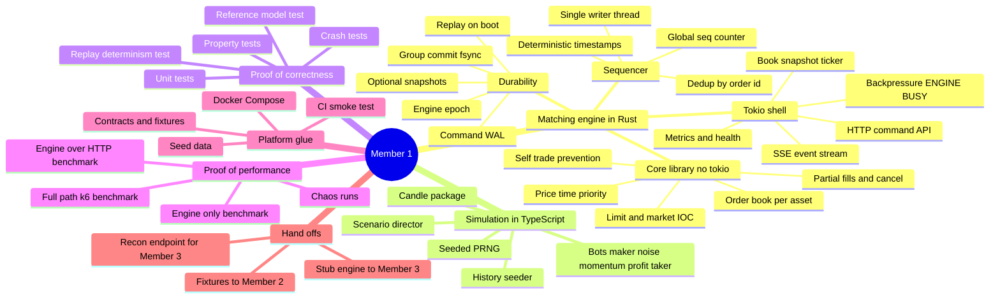

---

## 2. Where the engine sits (big picture)

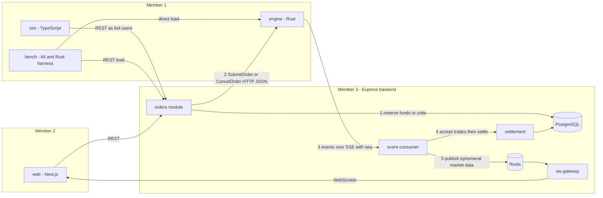

**Plain-language story of one order.**
1. A user (or a bot) sends an order to Member 3's API.
2. Member 3 reserves money or units in PostgreSQL **first**, then sends you the order.
3. You match it in memory, write it to your log, and answer "accepted" or "rejected".
4. You stream the resulting events (accepted, trades, cancels) to Member 3.
5. Member 3 turns trades into settled balances. You never see that part.

---

## 3. Core concepts you must be fluent in

| Term | Meaning for you |
|---|---|
| **Command** | A request to change engine state: `SubmitOrder`, `CancelOrder`, `ConfigureAsset`, `HaltAsset`, `ResumeAsset`. Goes through the single queue |
| **Event** | A fact the engine emits after processing a command: `OrderAccepted`, `TradeExecuted`, ... Each event gets the next global `seq` |
| **Query** | Read-only request (book snapshot, order lookup, open orders). Answered by the core thread so results are consistent with `seq` |
| **seq** | Global, strictly increasing number across **all** assets, one per event, no gaps. The stream resume key and the consumer's offset |
| **ts** | Millisecond timestamp assigned by the sequencer when a command is dequeued. Stored in the WAL so replay is identical |
| **engine_epoch** | Identifier of this WAL lineage. A brand-new empty WAL gets a new epoch. A different epoch tells Member 3 "history was reset, run recovery" |
| **order_id** | UUID generated by Member 3. Your dedup key. You never generate order ids |
| **trade_id** | `{engine_epoch}:{seq of TradeExecuted}`. Reproduced exactly on replay |
| **Maker / taker** | Maker = resting order. Taker = incoming order. Trade price is always the **maker's** price |
| **Outcome map** | `order_id` to last known status, used for idempotent resubmits and idempotent cancels |
| **Collar** | A per-asset max price number configured by Member 3. You compare against it mechanically. Policy lives in the backend |

**Units.** Price is an integer in minor units (`u64`). Quantity is an integer (`u64`). **No floating point anywhere in the engine.** Notional (price times quantity) is computed with overflow-checked math and rejected on overflow.

---

## 4. Engine architecture

### 4.1 Two worlds: async shell and synchronous core

The most important design choice: **matching never runs on the tokio runtime.**

- **Tokio shell** (axum): talks HTTP, parses JSON, authenticates the service token, serves SSE, exposes metrics. It is I/O-bound and concurrent.
- **Core thread** (a plain OS thread): owns all books and all state. It is CPU-bound and strictly sequential. No locks around the books, because only this thread touches them.

Why: a single writer gives determinism for free, removes locking bugs, and a blocked tokio worker can never stall matching (or the reverse).

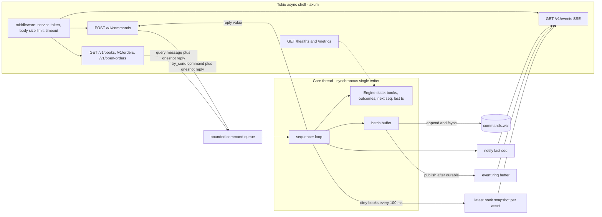

### 4.2 Crates you will likely use

| Purpose | Crate (category) | Note |
|---|---|---|
| Async runtime | `tokio` | Shell only |
| HTTP and SSE | `axum` (with `tower` and `tower-http`) | Timeouts, concurrency limits, tracing layer |
| JSON | `serde`, `serde_json` | Use strict parsing (reject unknown fields) so contract drift is loud |
| Core queue | `crossbeam-channel` bounded (or std bounded channel) | Core thread blocks on it. Shell uses `try_send` |
| Reply path | `tokio::sync::oneshot` | One reply per command |
| IDs | `uuid` | Parse and compare only |
| WAL integrity | `crc32fast` | Per-record checksum |
| Metrics | `hdrhistogram` | Latency percentiles |
| Logging | `tracing`, `tracing-subscriber` | Structured, JSON in compose |
| Errors | `thiserror` | Typed errors in the core, no panics for bad input |
| Testing | `proptest`, `criterion`, `jsonschema` | Property tests, microbench, contract validation |
| Config | environment variables parsed at start | No config files needed |

### 4.3 Core data structures (conceptual)

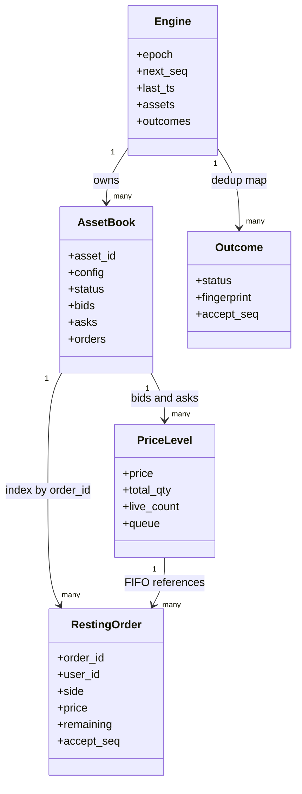

**Order book layout per asset.**

| Part | Structure | Why |
|---|---|---|
| Bids | Ordered map by price, best = highest | Deterministic iteration, fast best price |
| Asks | Ordered map by price, best = lowest | Same |
| Level queue | FIFO queue of order ids | **Time priority** within a price |
| Level totals | `total_qty` and `live_count` kept up to date | Depth snapshots without scanning the queue |
| Order index | Hash map `order_id` to resting order (side, price, remaining, user) | O(1) cancel lookup |
| Outcome map | Hash map `order_id` to outcome | Idempotent submit and cancel |

**Cancel without breaking FIFO (recommended: lazy tombstones).**
1. Remove the order from the order index and subtract its remaining from the level's `total_qty` and `live_count`.
2. Leave its id in the level queue. When matching reaches the front of a queue, **skip ids that are no longer in the index**.
3. If `live_count` hits zero, delete the whole level.
4. Optional later: replace with an intrusive linked list for true O(1) removal. Not needed for the MVP.

**Determinism hazards (never use in matching).**
- Hash map iteration order (use hash maps only for lookups).
- Floating point.
- Wall-clock reads inside the core (take `ts` only from the sequencer assignment).
- Randomness.
- Multiple threads touching state.

### 4.4 Engine-level states

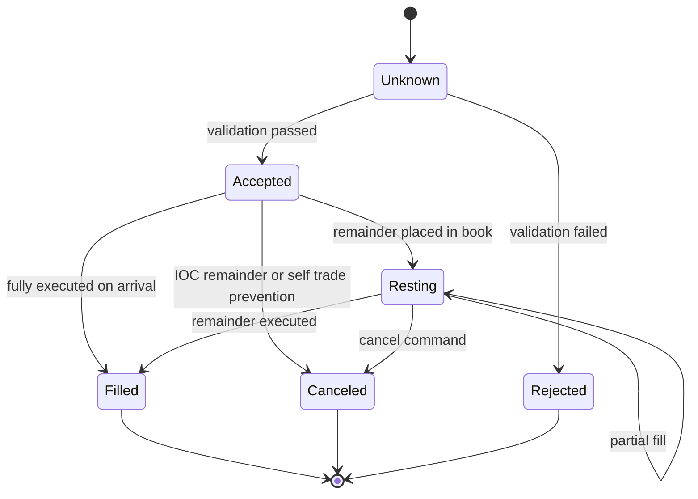

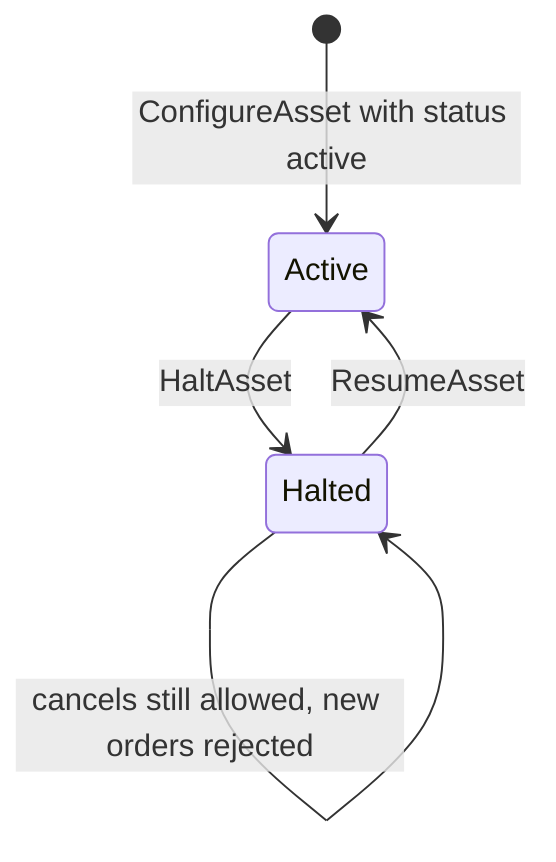

---

## 5. Matching rules (the exact behavior)

### 5.1 Rules in plain words

1. **Price priority**: a better price always trades first (highest bid, lowest ask).
2. **Time priority**: at the same price, the order that arrived first (lower `seq`) trades first.
3. **Trade price** is the maker's resting price. The taker gets price improvement if the maker is better than the taker's limit.
4. **Trade quantity** is the smaller of the two remainders.
5. A **limit GTC** order matches what it can, and the rest **rests** in the book.
6. A **market** order requires a `protection price`. It behaves as an **IOC limit at that price**: matches what it can, then the unfilled remainder is **canceled** (reason `IOC_REMAINDER`, or `NO_LIQUIDITY` if nothing filled).
7. **Self-trade prevention (policy: cancel incoming remainder).** If the incoming order is about to trade against a resting order of the **same `user_id`**, stop matching and cancel the incoming remainder with reason `SELF_TRADE_PREVENTED`. Trades that already happened stay.
8. A **halted** asset rejects new orders but still accepts cancels.

### 5.2 Matching flow

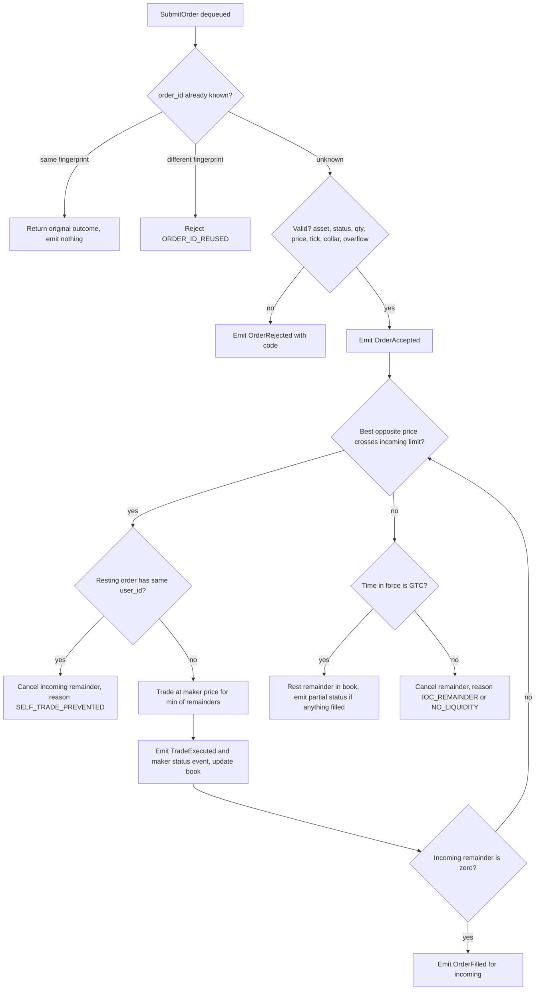

### 5.3 Validation checklist (engine rejects these)

| Code | Condition |
|---|---|
| `UNKNOWN_ASSET` | Asset not configured |
| `ASSET_HALTED` | Asset status is halted |
| `INVALID_QTY` | Zero, below min, above max |
| `INVALID_PRICE` | Zero, or market order without protection price |
| `PRICE_NOT_ON_TICK` | Price not a multiple of tick size |
| `PRICE_ABOVE_COLLAR` | Price above configured collar (mechanical tripwire) |
| `NOTIONAL_OVERFLOW` | Price times quantity overflows |
| `ORDER_ID_REUSED` | Same `order_id`, different fingerprint |

**Rule:** bad input is a *reject event*, never a panic. The core thread must not crash on any input.

### 5.4 Cancel outcomes

| Outcome | Meaning | Backend maps to |
|---|---|---|
| `CANCELED` | Order was resting, now removed. `OrderCanceled` emitted with `remaining_qty` | 200 |
| `ALREADY_CANCELED` | Repeat of a successful cancel (idempotent) | 200 |
| `ALREADY_FILLED` | Order completed before the cancel was processed | 409 `ORDER_NOT_CANCELABLE` |
| `UNKNOWN_ORDER` | Never seen (for example still `PENDING_SUBMIT` upstream) | 409 `ORDER_NOT_CANCELABLE` |

Cancel vs fill races are resolved purely by arrival order at the sequencer. That is deterministic and replayable.

---

## 6. Contracts you will propose and freeze in Phase 0

You write the first draft of these; Members 2 and 3 review. After freezing, changes go through `contracts/`.

### 6.1 Commands (HTTP `POST /v1/commands`)

| Command | Fields | Notes |
|---|---|---|
| `SubmitOrder` | `order_id`, `asset`, `user_id`, `side`, `type` (LIMIT or MARKET), `tif` (GTC or IOC), `qty`, `price` (limit price or protection price) | MARKET must carry `price` |
| `CancelOrder` | `order_id`, `reason` (USER, POLICY_BREACH, ADMIN) | Reason flows into `OrderCanceled` |
| `ConfigureAsset` | `asset`, `tick_size`, `min_qty`, `max_qty`, optional `collar_max_price`, `status` | Logged in WAL, so replay restores config |
| `HaltAsset`, `ResumeAsset` | `asset` | Cancels remain allowed while halted |

**Ack (HTTP response).**

| Field | Meaning |
|---|---|
| `status` | `ACCEPTED`, `REJECTED`, or for cancel one of the four outcomes |
| `order_id` | Echo |
| `seq` | `seq` of the first event produced by this command (if any) |
| `last_seq` | Stream position after this command. All its effects are at or before it |
| `code` | Reject code when rejected |
| `engine_epoch` | Current epoch |
| `duplicate` | `true` when the original outcome was returned for a repeat |

Ack is sent **only after the WAL write is durable** (per fsync policy).

### 6.2 Events (SSE `GET /v1/events`)

| Event | Fields | Emitted when |
|---|---|---|
| `OrderAccepted` | `order_id`, `asset`, `user_id`, `side`, `price`, `qty` | Validation passed |
| `OrderRejected` | `order_id`, `code` | Validation failed |
| `TradeExecuted` | `trade_id`, `asset`, `price`, `qty`, `buy_order_id`, `sell_order_id`, `maker_order_id`, `taker_order_id`, `taker_side`, `buy_remaining`, `sell_remaining`, `ts` | Each fill |
| `OrderPartiallyFilled` | `order_id`, `filled_qty`, `remaining_qty` | Maker after each trade, taker once at end if it rests |
| `OrderFilled` | `order_id` | Order exhausted |
| `OrderCanceled` | `order_id`, `remaining_qty`, `reason` (USER, IOC_REMAINDER, NO_LIQUIDITY, SELF_TRADE_PREVENTED, POLICY_BREACH, ADMIN) | Cancel or remainder cancel |
| `AssetConfigured`, `AssetHalted`, `AssetResumed` | `asset`, config | Config commands |

**Event ordering inside one command (fixed, documented, tested).**
`OrderAccepted`, then for each fill: `TradeExecuted` followed by the maker's status event, then the taker's final status event (`OrderFilled`, `OrderPartiallyFilled`, or `OrderCanceled`).

**Every event carries**: `type`, `engine_epoch`, `seq`, `ts`, and `asset` where relevant.

### 6.3 Book snapshots (ephemeral, not sequenced)

- Separate SSE event type `book`: top 15 levels per side, best bid and ask, spread, `as_of_seq`.
- **Does not consume a `seq`, is not stored in WAL or ring.** Only the latest per asset is kept.
- Produced by the core: it marks books dirty on any change, and about every 100 ms publishes the top-N of dirty books into a "latest snapshot" slot. SSE handlers send whatever is newest.
- Member 3's consumer throttles and republishes to Redis.

### 6.4 Stream protocol

| Item | Rule |
|---|---|
| First message | `hello` with `engine_epoch`, `current_seq`, `ring_start_seq`, config version |
| Resume | `after=<seq>` query or `Last-Event-ID`. Server sends events with `seq > after`, then live |
| Event id | SSE `id` equals `seq` |
| Epoch guard | Client may pass `epoch`. Mismatch returns 409 `EPOCH_MISMATCH` with the current epoch |
| Too old | `after` below `ring_start_seq` returns 410 `GONE` with `ring_start_seq` |
| Heartbeat | Comment line every ~15 s |
| Slow consumers | Each subscriber has its own cursor. No unbounded per-subscriber buffers |

### 6.5 Query endpoints

| Endpoint | Purpose |
|---|---|
| `GET /v1/books/:asset?depth=N` | Snapshot with `as_of_seq` (served through the core for consistency) |
| `GET /v1/orders/:order_id` | Outcome lookup (used by Member 3's resolver) |
| `GET /v1/open-orders` | All resting orders (used by reconciliation check R6) |
| `GET /healthz`, `GET /metrics` | Health and metrics JSON |

### 6.6 Security between api and engine

- Engine is **internal only** (Compose network, not published to the browser).
- Shared secret header checked by middleware on every route.
- Request body size limit, strict JSON, command timeout in the shell.

---

## 7. Sequence diagrams of the flows you must implement

### 7.1 SubmitOrder, order rests (no cross)

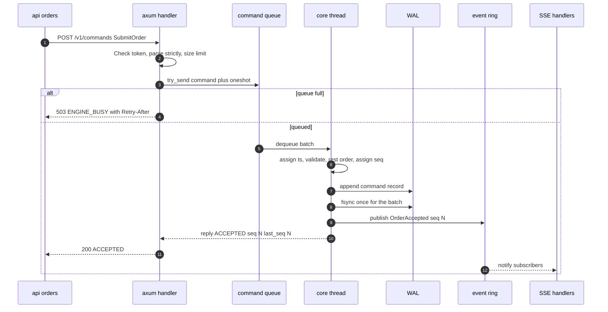

### 7.2 SubmitOrder crossing with a partial fill

Example: resting ask 5 @ 100 (order A). Incoming buy 8 @ 100 (order B).

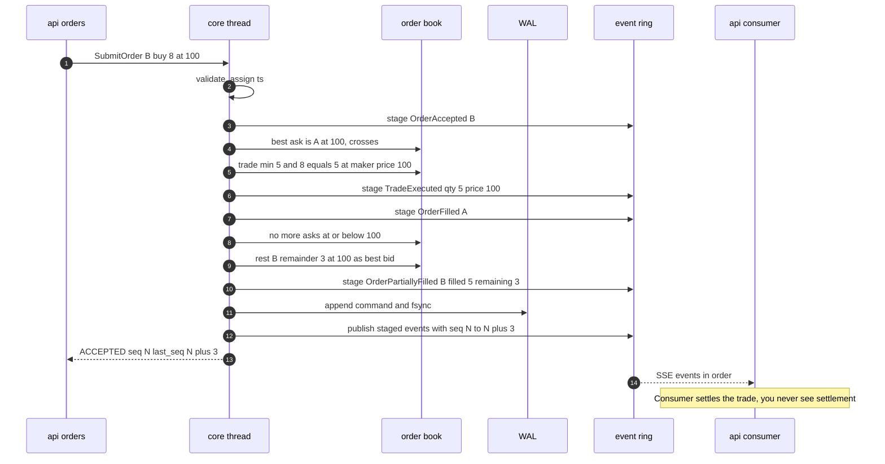

### 7.3 Market order (IOC with protection price)

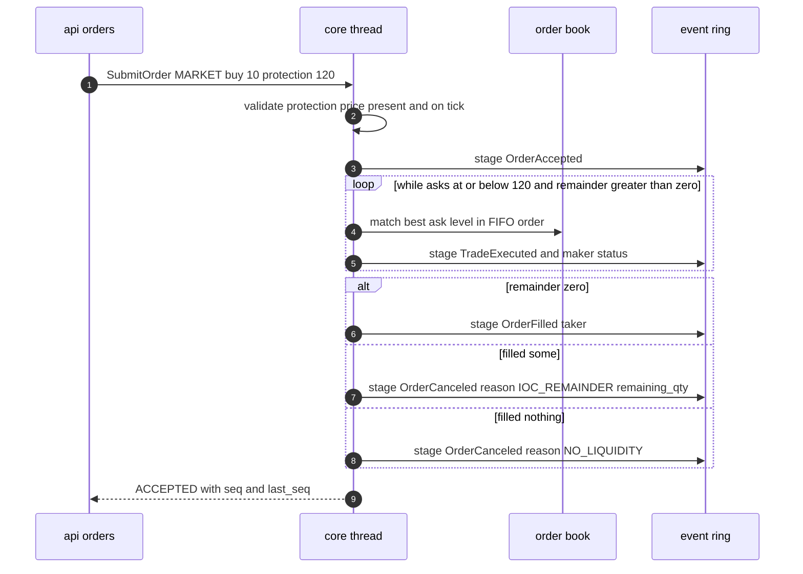

### 7.4 CancelOrder (including the race)

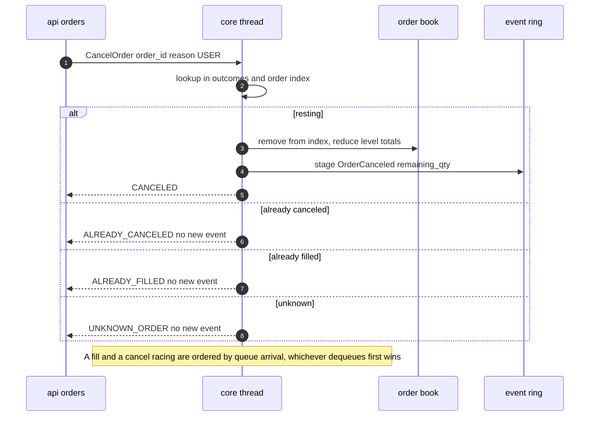

### 7.5 Idempotent resubmit (dedup)

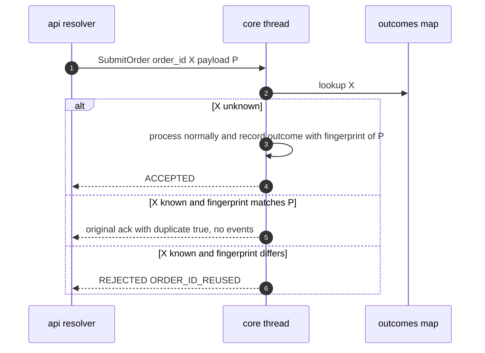

### 7.6 Group commit loop (what the core thread does forever)

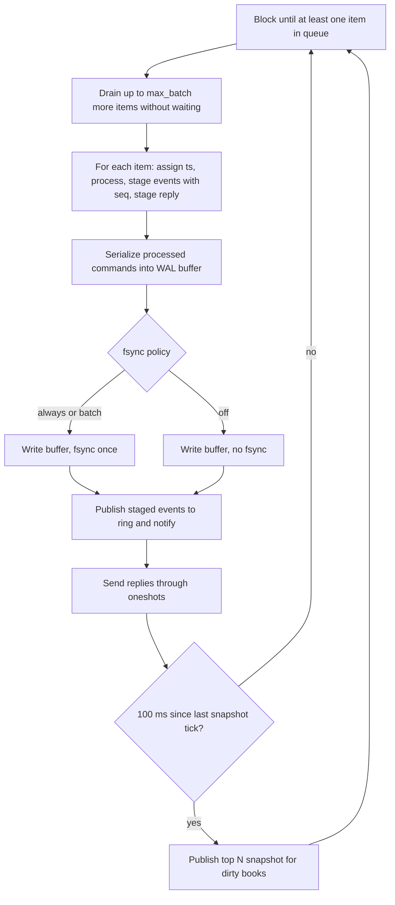

**Why release after durable?** If you acked or emitted an event and then crashed before the WAL hit disk, Member 3 would hold facts the engine cannot reproduce. Releasing after the write keeps engine and backend consistent.

### 7.7 Crash and boot recovery

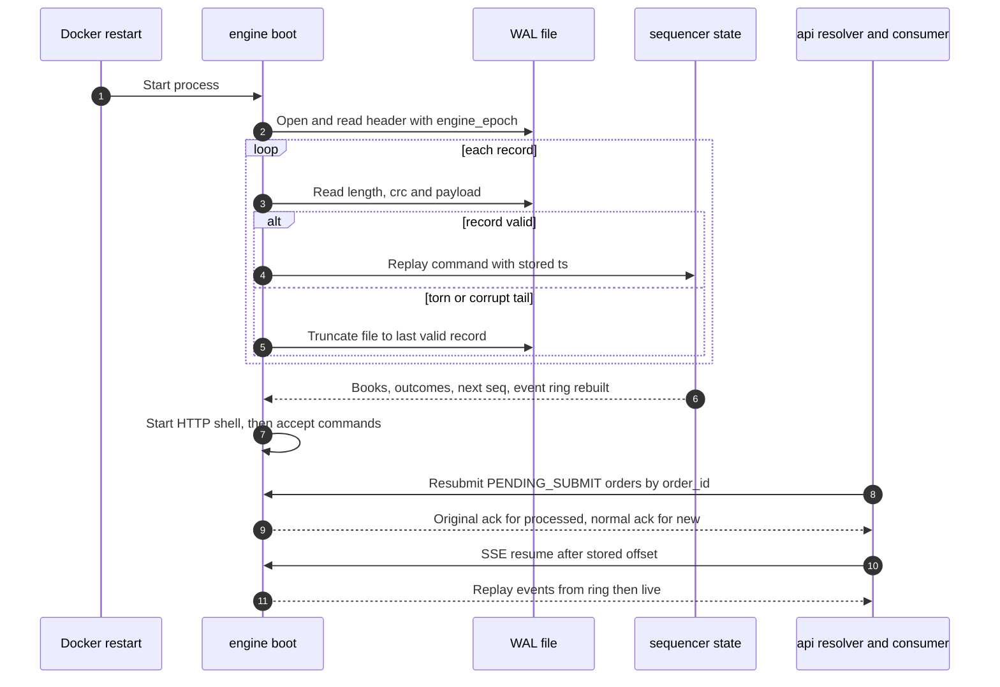

### 7.8 SSE subscription, resume, and guards

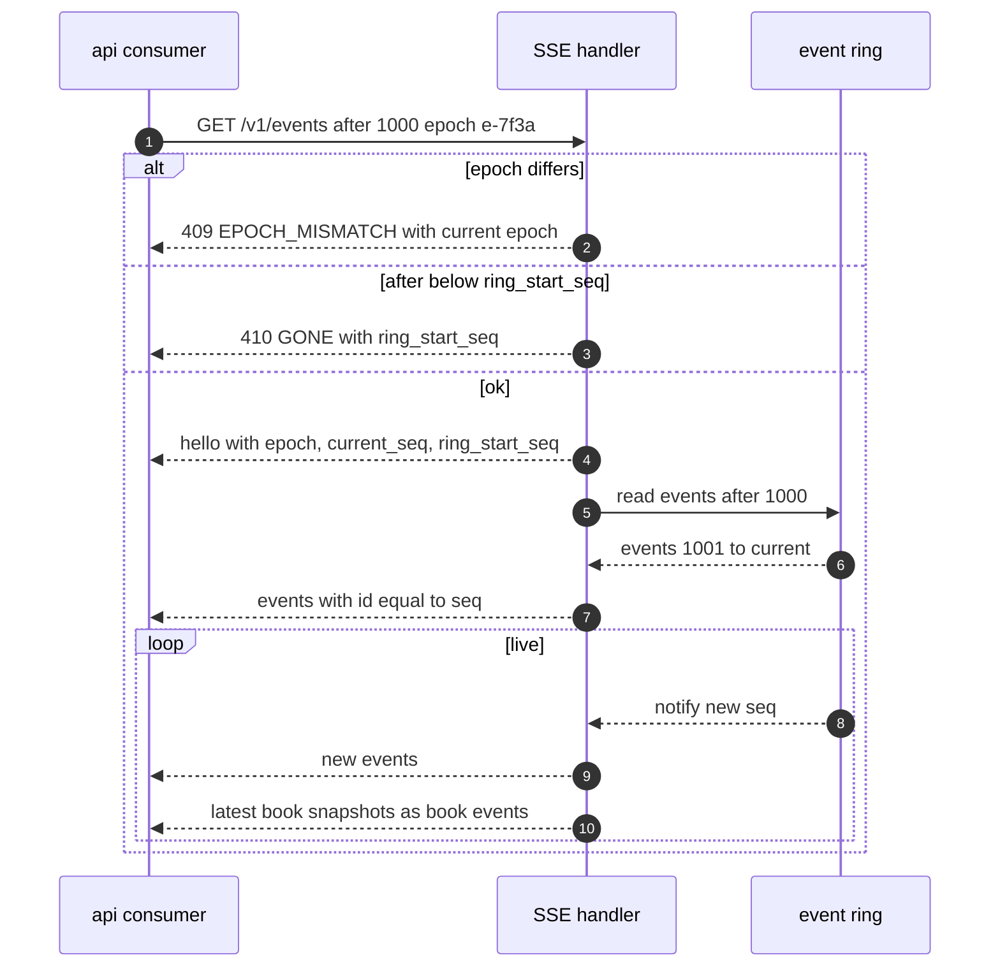

### 7.9 Rebuild-from-database fallback (WAL lost)

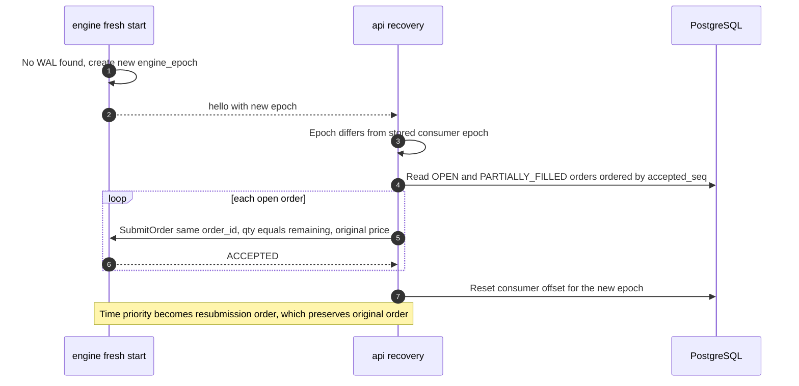

You must agree with Member 3 that `OrderAccepted` events for already-open orders are ignored by the consumer (status never goes backwards).

---

## 8. Durability: WAL, fsync, recovery

### 8.1 What goes in the WAL

- **Commands only**, not events. Events are a pure function of commands.
- Each record carries the **assigned `ts`**, so replay is byte-identical.
- First record is a **header** (magic, format version, `engine_epoch`, creation time).

**Record layout (conceptual).** Length prefix, checksum, payload (JSON in the MVP for debuggability, a binary format later if the benchmark needs it).

### 8.2 Fsync policy (env setting)

| Policy | Behavior | Use |
|---|---|---|
| `always` | fsync every batch before release | Safest, benchmark baseline |
| `batch` | fsync after each drained batch (group commit) | **Demo default** |
| `off` | no fsync, rely on OS | Benchmark upper bound only, must be disclosed |

### 8.3 Recovery steps

1. Read header. If no WAL: create one with a new `engine_epoch`.
2. Read records sequentially, verify checksum. Stop at first bad record, **truncate the torn tail**.
3. Replay each command through the same core code path used live (no special replay logic).
4. Rebuild: books, outcomes, `next_seq`, `last_ts`, event ring.
5. Ensure new `ts` is never less than `last_ts` (clamp forward).
6. Start the shell.

### 8.4 Optional snapshots (F06, Cut C)

Atomic snapshot (write temp file, fsync, rename) of books, outcomes, `next_seq`, `last_ts` with the WAL position. Boot loads the snapshot then replays only the tail. Skip unless boot time becomes annoying.

### 8.5 Fail-fast rule

If the core thread panics or hits an internal invariant violation, **abort the process** and let Docker restart it (WAL replay restores state). Never continue with a possibly corrupted book.

---

## 9. HTTP and SSE shell details

| Concern | Decision |
|---|---|
| Command handler | Parse, authenticate, create oneshot, `try_send` to queue. On full queue return 503 `ENGINE_BUSY` with `Retry-After` |
| Reply wait | Await oneshot with a timeout (illustrative 2 s). On timeout return 504. **The command may still execute**, so callers must treat 504 as "unknown outcome" and resubmit the same `order_id` |
| Queue capacity | Bounded (illustrative 10,000), env-configurable |
| Concurrency limit | Tower layer limits in-flight requests |
| Body limit | Small fixed limit |
| Strict JSON | Unknown fields rejected |
| SSE | Per-subscriber cursor, max subscribers (expect 1 to 3), heartbeat |
| Shutdown | Stop accepting, drain queue, flush WAL, exit |
| Never | Block the tokio runtime, hold a lock across an `await`, use an unbounded channel |

**Environment settings (names illustrative).** `PORT`, `WAL_DIR`, `FSYNC_POLICY`, `QUEUE_CAPACITY`, `MAX_BATCH`, `RING_CAPACITY`, `SNAPSHOT_TICK_MS`, `ENGINE_TOKEN`, `LOG_LEVEL`.

---

## 10. Observability

**Metrics (JSON at `/metrics`).**

| Metric | Why |
|---|---|
| Command latency histogram (queue wait, process, WAL write, total) | Matching latency evidence |
| Queue depth and capacity | Backpressure |
| Commands per second, events per second | Throughput |
| Current `seq`, ring start `seq`, ring fill | Resume safety |
| WAL bytes, fsync latency histogram | Durability cost |
| Orders resting per asset, levels per side | Book health |
| Rejects by code, cancels by outcome | Behavior |
| SSE subscribers, slowest cursor lag | Consumer health |

**Logging.** Structured logs with `seq`, `order_id`, `asset`, command type. No per-order info logs at high rate (log at debug). Panics print the last command.

---

## 11. Testing the engine (your credibility)

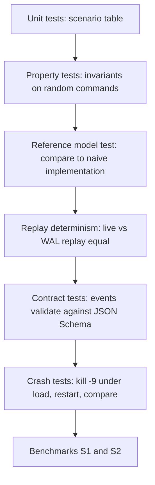

### 11.1 Scenario table (write these first, they are your spec)

| # | Scenario | Expected |
|---|---|---|
| 1 | Limit buy, empty book | Accepted, rests, best bid set |
| 2 | Buy crosses exactly one ask of equal qty | One trade, both filled, book empty |
| 3 | Buy larger than ask | Trade for ask qty, remainder rests |
| 4 | Buy smaller than ask | Trade, maker remains with reduced qty and keeps queue position |
| 5 | Buy sweeps several price levels | Trades at each maker price, ascending |
| 6 | Same price, two makers | Earlier maker fills first (FIFO) |
| 7 | Better price arrives later | Better price fills before earlier worse price |
| 8 | Trade price is maker price | Taker gets improvement |
| 9 | Market buy partial liquidity | Trades then `IOC_REMAINDER` cancel |
| 10 | Market buy empty book | `NO_LIQUIDITY` cancel |
| 11 | Protection price blocks deeper levels | Stops at protection price |
| 12 | Cancel resting | `CANCELED`, level total reduced, level removed if empty |
| 13 | Cancel partially filled | Cancels only remainder |
| 14 | Cancel filled | `ALREADY_FILLED` |
| 15 | Cancel twice | Second is `ALREADY_CANCELED` |
| 16 | Cancel unknown | `UNKNOWN_ORDER` |
| 17 | Self trade at touch | Incoming remainder canceled, no trade |
| 18 | Self trade after partial fill with others | Earlier trades stay, remainder canceled |
| 19 | Duplicate `order_id`, same payload | Original ack, no events |
| 20 | Duplicate `order_id`, different payload | `ORDER_ID_REUSED` |
| 21 | Qty zero, off tick, above collar, overflow | Matching reject codes |
| 22 | Halted asset | New orders rejected, cancels allowed |
| 23 | Tombstones in middle of queue | Skipped correctly, FIFO preserved |
| 24 | Event ordering within a command | Exactly as specified in Section 6.2 |

### 11.2 Property tests (random command streams)

- Book is **never crossed** (best bid is strictly below best ask) after every command.
- For every order: `filled + remaining + canceled = original`.
- Every trade quantity is at most both remainders at that moment.
- Trade price equals maker price.
- `seq` is strictly increasing with no gaps.
- No fills for an order after it was canceled.
- Level `total_qty` equals the sum of live orders at that level.

### 11.3 Reference model test

Write a deliberately naive matcher (sorted vectors, linear scans, obviously correct). Feed the same random commands to both. Events must match exactly. This catches subtle priority bugs.

### 11.4 Replay determinism

Run N random commands live, record the WAL. Boot a second engine from that WAL. Compare final books, outcomes, and the entire event sequence. Must be identical, including `trade_id`.

### 11.5 Crash test

Script: run load, `kill -9` the engine at random moments, restart, then compare engine open orders against what Member 3's database expects (reconciliation R6). Repeat many times.

### 11.6 Contract tests

Every event and ack your engine produces is validated against the JSON Schemas in `contracts/`. Member 2 and 3's fixtures are validated against the same schemas.

---

## 12. Benchmarking (honest version)

### 12.1 What you will measure

| Scenario | Scope | Tool | Purpose |
|---|---|---|---|
| **S1** | Core only, in-process, no network, no WAL fsync variants separated | Rust harness with histogram, `criterion` for micro cases | Raw matching speed |
| **S1b** | Core plus WAL with each fsync policy | Same harness | Durability cost |
| **S2** | Engine over HTTP with many concurrent clients | Rust or k6 against the engine | Transport and shell overhead |
| **S3 to S6** | Full path through Member 3's API | k6 plus scripts | Headline claim, burst, soak, chaos (Section 14.6) |

### 12.2 Method rules

- **Release builds only.** Warm up and discard warm-up.
- Realistic **order mix** (mostly limit near mid, some cancels, some marketable orders), seeded so runs are repeatable.
- Report **commands per second and latency percentiles (p50, p95, p99, max)** separately for queue wait, process, and total.
- Report **hardware and commit SHA** with every result.
- Keep raw output files and link every claimed number to its artifact.
- Be explicit about fsync policy used. `off` numbers must be labeled as such.

### 12.3 What you must not say

- Do not say "Rust makes it fast" as evidence. Show the numbers.
- Do not quote engine-only numbers as the system's throughput. The system is limited by the slowest stage, which is expected to be PostgreSQL settlement (Member 3).
- **Hypothesis to verify:** a single core thread handles far more than 1,000 commands per second, so the 1,000 orders per second target is not engine-bound. Measure it before saying it.

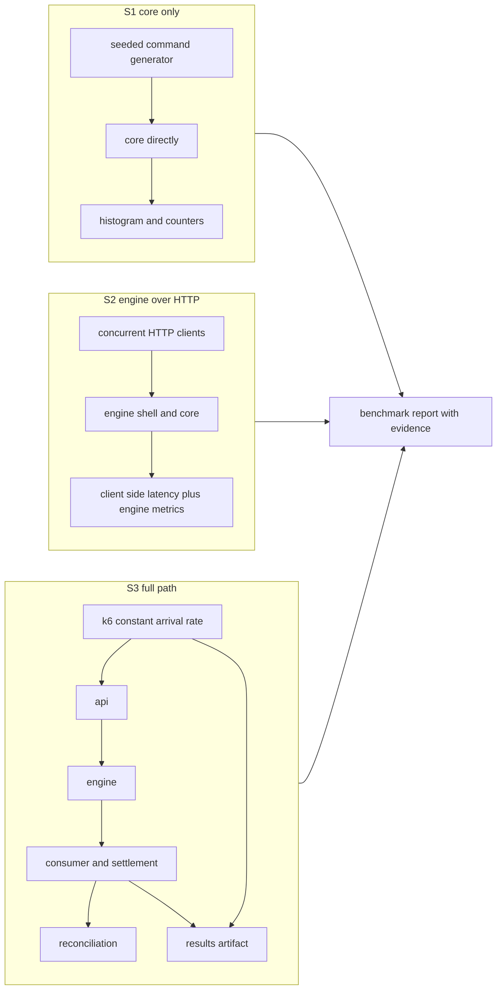

---

## 13. Your other deliverables (beyond the engine)

### 13.1 Contracts package (`contracts/`)

- JSON Schemas for commands, acks, events, book snapshot, error codes.
- Fixtures: a library of example messages for **every** event and error, plus scripted event sequences (partial fill, cancel race, reconnect).
- TypeScript types **generated** from schemas (Member 2 and 3 import them).
- Your engine tests validate output against the schemas. Their mocks validate against the same files.
- Change process: edit schema, get review from the consumer of that message, bump version, regenerate.

### 13.2 Candle package (`packages/candles/`)

A small pure TypeScript library used by Member 3's consumer **and** your seeder.

| Function (conceptual) | Behavior |
|---|---|
| Bucket start | `floor(ts / interval) * interval` |
| Apply tick | Input: trade (`ts`, `price`, `qty`, `seq`). Output: updated candle for each interval, plus any candles that just closed |
| Flush by time | Closes buckets whose end has passed when no new trade arrives |
| Rebuild | Reconstruct the active candle from a list of trades in the current bucket |

Rules: open is the first trade price, close is the last by `seq`, high and low are extremes, volume sums quantity, trade count counts trades. **No trades in a bucket means no candle.** Out-of-order or duplicate ticks (by `seq`) are ignored. Intervals: 5 s and 1 min.

### 13.3 History seeder

1. Seeded PRNG so output is reproducible.
2. Generate a mean-reverting tick series per asset for the last 6 hours with a varying volume process (quiet periods included, thinner for thin assets). Clamp to the asset ceiling.
3. Aggregate with the **candles package** into 1 min (6 h) and 5 s (last 30 min) candles.
4. Output a JSON file with `origin = SEEDED_SIM`.
5. Member 3 loads it through an admin seed endpoint or seed command. Member 2 uses the **same file** as mock chart data.
6. Last seeded close becomes the engine's reference price. The simulator's first job is to place an opening book around it.

### 13.4 Simulator (`sim/`, TypeScript)

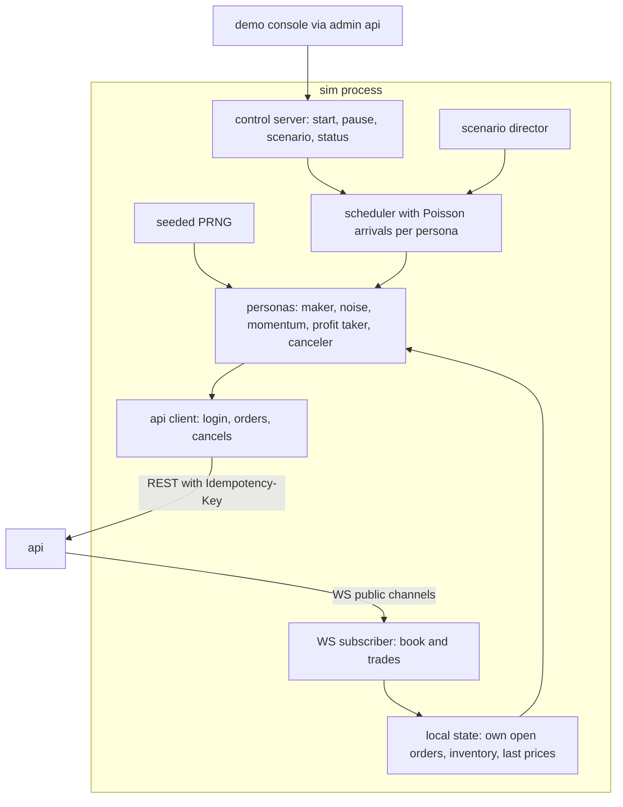

**Account pool.** Create N bot users once (marked `is_simulated`), pre-funded with credits and units by the seed. Cache tokens.

**Personas.**

| Persona | Logic |
|---|---|
| Market maker | Mid = last trade or book mid (fallback seeded close). Quote bid and ask around mid with a spread, sizes shrink as inventory skews, refresh by cancel then submit, clamp to tick and ceiling |
| Noise trader | Poisson arrivals, random side, lognormal size, mix of marketable limit orders and near-touch resting orders |
| Momentum | Look at last N trades, if imbalance beyond threshold, send marketable order in that direction |
| Profit taker | Track average cost from own fills, sell when price reaches target (never above ceiling) |
| Canceler | Random time-to-live per resting order, then cancel |
| Auction sniper (optional) | Accept auctions below a private valuation |

**Rules of good behavior.**
- Bots use the **public API**, so ceilings, rate limits, and reservations apply to them.
- Global request budget so bots stay below rate limits during demos (the benchmark uses a separate bot credential, disclosed in the report).
- Handle errors without crashing: back off on `RATE_LIMITED`, skip on `INSUFFICIENT_*`, count rejects by code.
- Never fabricate prices. All price changes come from real matches.

**Run modes.** `continuous` (dev), `demo` (deterministic seed plus scenarios), `paused` (stop submitting, nothing fabricated).

**Scenario director (F08).** Scripted steps with preconditions and checks:
1. Wake market: start maker and noise bots.
2. Sell wall: place a resting sell at an agreed price so the judge's buy fills predictably.
3. Pump: short momentum burst for a visible candle move.
4. Scalper attempt: a bot tries to list above the ceiling and gets rejected.
5. Auction drop: issuer creates a short Dutch auction.

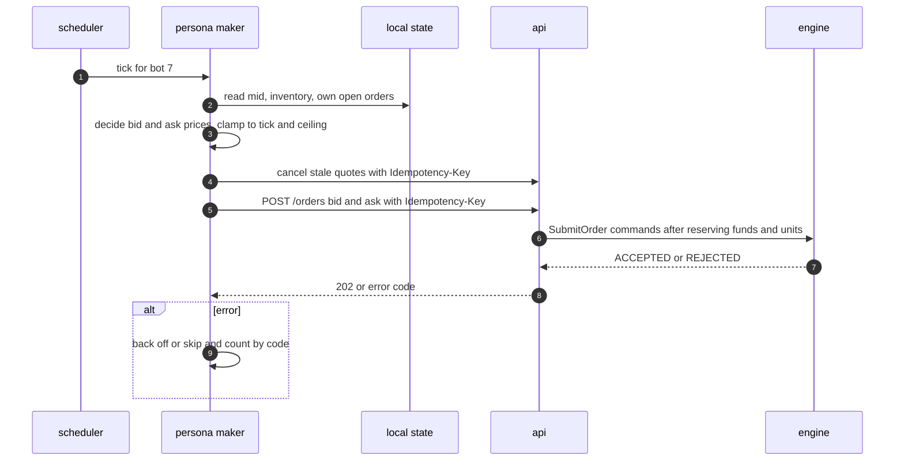

### 13.5 Docker Compose, seed data, CI smoke test (F10)

You are strong in backend, so you own the glue:
- Compose services: `web`, `api`, `engine` (with WAL volume), `postgres`, `redis`; profiles for `sim` and `bench`.
- Seed data: assets, policies (with an illustrative ceiling), bot accounts, issuer, funded demo accounts, seeded candles.
- Reset runbook: tear down, restore seed snapshot, fresh engine epoch, reseed (target under 30 s, hypothesis).
- CI smoke test: bring up the stack, register, place a crossing pair of orders, assert trade and settlement, run reconciliation.

### 13.6 Load generator and chaos (F11)

| Scenario | What | Evidence |
|---|---|---|
| S3 | k6 constant arrival rate (open model) at the target order rate with pre-funded bot accounts | Offered, accepted, rejected by code, trades, settled trades, settlement lag, API latency percentiles |
| S4 | Burst above target | `ENGINE_BUSY` and 429 behavior, no corruption |
| S5 | Soak then reconciliation | Zero drift |
| S6 | Kill engine during load, restart | Recovery time, resolver success, reconciliation clean |

**Where Python is allowed (only if needed).** Post-run analysis and charts of benchmark output (a script or notebook reading the result files). It must not sit in the engine path, the simulator, or the demo. If TypeScript velocity becomes a problem, the simulator can be re-done in Python because it only talks to the public REST API, but the shared candle package and fixtures would then need a Python port, which is why TypeScript is the default.

---

## 14. Execution plan

### 14.1 Work packages

| WP | Content | Maps to | Effort | Depends on | Cut |
|---|---|---|---|---|---|
| WP0 | Contracts v1 draft, repo and Compose skeleton, fixtures | F10 (part) | 1 pd | none | A |
| WP1 | Core library: books, matching, cancel, STP, IOC, tests | F01 | 3 pd | WP0 schemas | A |
| WP2 | Sequencer: seq, ts, dedup, outcomes, event ordering | F02 | 0.5 pd | WP1 | A |
| WP3 | Tokio shell: commands, SSE, queries, auth, backpressure | F03 | 1.5 pd | WP2 | A |
| WP4 | **Walking skeleton handoff to Member 3** (Milestone M1) | — | 0 pd | WP3 slice 1 | A |
| WP5 | WAL, replay, epoch, group commit | F04 | 1 pd | WP2 | A |
| WP6 | Candle package and history seeder | F09 | 1.5 pd | WP0 | A |
| WP7 | Simulator: personas, accounts, control | F07 | 2 pd | M1 plus Member 3 orders API | A |
| WP8 | Compose, seed, CI smoke, reset runbook | F10 (rest) | 1 pd | M1 | A |
| WP9 | Engine metrics and benchmarks S1, S1b, S2 | F05 | 1.5 pd | WP5 | B |
| WP10 | Momentum and profit-taker bots, scenario director | F08 | 1.5 pd | WP7 | B |
| WP11 | k6 full-path, chaos scripts, report | F11 | 2 pd | Member 3 stack, WP9 | B |
| WP12 | Snapshots | F06 | 0.5 pd | WP5 | C |

Totals: Cut A about 11.5 pd, Cut B about +5 pd, Cut C about +0.5 pd.

### 14.2 Build the engine in vertical slices (do not build everything at once)

| Slice | Contents | Why this order |
|---|---|---|
| **Slice 1: walking skeleton** | Single asset, limit GTC orders, rest/match/cancel, in-memory, HTTP command, SSE events, no WAL, no dedup | Unblocks Member 3 within the first working sessions |
| **Slice 2: complete matching** | Multi-asset, configure/halt, market IOC, STP, validation codes, dedup and outcomes, strict event ordering | Completes requirement A |
| **Slice 3: durability** | WAL, group commit, replay, epoch, hello message, resume guards | Crash recovery |
| **Slice 4: market data** | Dirty-book snapshot ticker, queries, open-orders endpoint, metrics | Feeds Member 2 and reconciliation |
| **Slice 5: hardening** | Property tests, reference model, replay test, crash test, benchmarks | Credibility |

```mermaid
flowchart LR
    P0["WP0 contracts and skeleton"] --> P1["WP1 core library"]
    P1 --> P2["WP2 sequencer"]
    P2 --> P3["WP3 tokio shell"]
    P3 --> M1(["M1 walking skeleton to Member 3"])
    P2 --> P5["WP5 WAL and replay"]
    P0 --> P6["WP6 candles and history seeder"]
    M1 --> P7["WP7 simulator"]
    M1 --> P8["WP8 compose seed CI"]
    P5 --> P9["WP9 metrics and engine benchmarks"]
    P7 --> P10["WP10 scenario director"]
    P9 --> P11["WP11 full path k6 and chaos"]
    P10 --> M2(["M2 demo script runs"])
    P11 --> M3(["M3 benchmark report"])
    P6 --> P7
```

### 14.3 Milestones and "done when"

| Milestone | Done when |
|---|---|
| **M0 Contracts v1** | Schemas, error codes, fixtures merged and acknowledged by Members 2 and 3 |
| **M1 Walking skeleton** | Member 3 can submit a limit order, cancel it, and receive `OrderAccepted`, `TradeExecuted`, `OrderCanceled` over SSE locally |
| **M2 Complete engine** | Scenario table 1 to 24 passes, property tests pass, event ordering matches the contract |
| **M3 Durable engine** | Kill and restart reproduces book and outcomes, consumer resumes by `seq` without gaps or duplicates |
| **M4 Living market** | Simulator plus seeded history produce live candles in the frontend |
| **M5 Evidence** | Benchmark S1, S2, S3 reports with artifacts, chaos run passes with clean reconciliation |
| **M6 Demo ready** | Scenario director drives the demo script twice without surprises, reset runbook rehearsed |

### 14.4 Per-work-package checklists

**WP1 Core library.**
- Pure Rust library crate, no tokio dependency.
- Types: price, qty, ids, order, event, command, outcome.
- Book operations: add, match, cancel, depth, best bid and ask.
- All 24 scenarios have tests before the matcher is "finished".
- No panics on any input (fuzz a little).

**WP2 Sequencer.**
- Single entry point `process(command, ts) -> (events, reply)`.
- `seq` assigned only here. `ts` clamped nondecreasing.
- Dedup and outcome map working.

**WP3 Shell.**
- Routes from Section 6, strict JSON, token middleware.
- `try_send` backpressure verified by a test with a tiny queue.
- SSE resume tested with a slow client and a reconnecting client.

**WP5 WAL.**
- Header, checksum, torn-tail truncation, replay through the live code path.
- Replay-equality test green.
- Release-after-durable verified.

**WP6/WP7 Simulation.**
- Same seed gives same history and same bot decisions (when book state is the same).
- Bots survive API errors and engine restarts.

---

## 15. Hand-offs and communication

```mermaid
sequenceDiagram
    autonumber
    participant M1 as Member 1
    participant M3 as Member 3
    participant M2 as Member 2
    M1->>M3: Draft engine command and event schemas
    M1->>M2: Draft fixtures for book, trades, candles
    M3->>M1: Review, request fields such as maker order id and remaining quantities
    M2->>M1: Review, request snapshot depth and message frequency
    M1->>M1: Freeze contracts v1 and tag
    M1->>M3: Walking skeleton engine M1 with limit orders and SSE
    M3->>M3: Build order intake and consumer against the real engine
    M1->>M3: Expose open-orders endpoint and outcome lookup
    M3->>M1: Provide bot credential tier and admin seed endpoint
    M1->>M2: Seeded history file and sim-driven live market
    M2->>M1: Report contract gaps found in the terminal
    M1->>M3: Chaos and benchmark results, settlement bottleneck findings
    M3->>M1: Tuning changes, reconciliation specifics
```

**Questions to settle with Member 3 in Phase 0 (propose defaults).**

| Question | Proposed default |
|---|---|
| Who generates `order_id`? | Member 3, UUID |
| Does the HTTP ack replace the event stream for state? | No. Ack is for the caller. State changes come from the stream |
| What does the consumer do on `OrderAccepted` for an already-open order? | Ignore (idempotent) |
| How do they detect a reset engine? | `engine_epoch` change in `hello` |
| What is `seq` in the ack? | `seq` of first event, plus `last_seq` |
| How are reservations released after cancel? | By the consumer from `OrderCanceled.remaining_qty` |
| Who sets collar and tick config? | Member 3 via `ConfigureAsset` at startup and on policy change |
| Timeout semantics | 504 means unknown outcome, resubmit same `order_id` |

**Questions to settle with Member 2.**

| Question | Proposed default |
|---|---|
| Book depth and rate | Top 15 levels, about 10 snapshots per second, conflated |
| Candle intervals | 5 s and 1 min |
| Simulated flags on trades | `TradeTick` carries `buyer_is_sim` and `seller_is_sim` (Member 3 fills from user flags) |
| Fixtures | Generated by your seeder, same file used as mock chart data |

**Your floating capacity.** After M3 you are the only member with spare capacity early. Offer it to Member 3: randomized consistency tests on settlement, the engine-versus-database reconciliation check, auction concurrency tests. You are strong in backend, so this is high value.

---

## 16. Pitfalls checklist (read before each milestone)

| # | Pitfall | Avoidance |
|---|---|---|
| 1 | Running matching inside tokio tasks | Dedicated OS thread, channel in, oneshot out |
| 2 | Unbounded queues | Bounded everywhere, `try_send`, `ENGINE_BUSY` |
| 3 | Locks across `await` | No shared locks around books at all. Ring and snapshot slot use short critical sections |
| 4 | Non-deterministic matching | Ordered maps and FIFO queues, no hash iteration, no floats, no wall clock |
| 5 | Releasing events before WAL durable | Release step comes after write and fsync |
| 6 | `seq` gaps or mismatch after replay | Replay runs the same code path, equality test in CI |
| 7 | `ts` going backwards | Clamp to last `ts` |
| 8 | Panicking on bad input | Typed rejects, fuzz inputs |
| 9 | Treating 504 as failure | It means unknown. Callers retry with the same `order_id` |
| 10 | Slow SSE consumer growing memory | Per-subscriber cursor over shared ring, `GONE` when too old |
| 11 | Ring too small for resume | Size ring generously, rebuild on boot from WAL |
| 12 | Cancel and fill racing | Serialize through the queue, outcomes map answers repeats |
| 13 | Quoting engine-only throughput as system throughput | Report stages separately, disclose fsync policy |
| 14 | Benchmark with closed-loop clients | Use constant arrival rate |
| 15 | Simulator creating fake prices | Only real fills move price, no fabrication |
| 16 | Contract drift | Schemas first, CI validates both sides |
| 17 | Engine continues after internal error | Abort and restart, replay restores state |
| 18 | Hot bot accounts in the benchmark causing artificial settlement contention | Spread load across many bot accounts and say so |

---

## 17. Decision log (already decided, do not reopen without a reason)

| Decision | Choice | Reason |
|---|---|---|
| Threading | One core thread for all assets | Global `seq`, simplest determinism, far above target throughput (hypothesis to verify) |
| Interface | HTTP/JSON commands plus SSE events | Debuggable, native resume, trivial for Node |
| Durability | Command WAL plus replay, DB rebuild fallback | Small, deterministic |
| Events | Derived from commands, never stored separately | Replay regenerates them |
| Order book | Ordered maps plus FIFO queues with lazy tombstones | Simple and correct |
| Market data | Unsequenced conflated snapshots | Tolerant of drops, cheap |
| STP | Cancel incoming remainder | Simple, deterministic |
| Price protection | Market orders are IOC limits at protection price | One matching path |
| Simulator language | TypeScript | Shared types and candle package |
| Money representation | Integer minor units | No floating point errors |

---

## 18. Final self-review checklist (before you say "engine done")

- [ ] I can explain the command to event to settlement path without notes.
- [ ] Scenario table 1 to 24 pass.
- [ ] Property tests and reference model test pass on large random runs.
- [ ] Replay from WAL yields identical books, outcomes, events, trade ids.
- [ ] `kill -9` under load never produces a gap, duplicate, or lost accepted order.
- [ ] Member 3 resumed from `seq` after restarting the consumer and saw no duplicates.
- [ ] Queue full returns `ENGINE_BUSY` and never blocks.
- [ ] No unbounded buffer exists anywhere.
- [ ] Contracts validated both ways in CI.
- [ ] Benchmark reports exist with hardware, SHA, fsync policy, and raw artifacts.
- [ ] Simulator works through the public API only and never fabricates prices.
- [ ] Demo script runs twice cleanly and reset takes a known time.