# THE DARKHOLD EXCHANGE — PROJECT BLUEPRINT

> Status: product discovery and architecture planning. No code, SQL, or config in this document.
> Effort unit: **pd** = focused developer-day at *hackathon fidelity* (happy path plus key failure paths, no polish). Estimates are relative and must be re-validated at kickoff.
> Every number labeled *illustrative* or *hypothesis* is a policy or target the team must decide or measure. Nothing here is a verified result.

---

## 1. Executive summary

**What we build.** A miniature exchange for scarce digital assets (festival passes, limited merch). Users trade through a price-time-priority order book, watch live depth and candlestick charts, buy from Dutch auctions, and see every trade settle through a double-entry ledger. Price ceilings tied to face value are enforced everywhere money can move.

**Architecture in one paragraph.** One Rust process (`engine`) owns matching only: a single sequencer thread, in-memory order books, a command log (WAL), and an event stream with sequence numbers. One Node/Express modular monolith (`api`) owns everything else: auth, catalog, price policy, wallets, holdings, reservations, ledger, order intake, settlement, auctions, candles, WebSocket fan-out, reconciliation. PostgreSQL is the system of record for money and ownership. Redis holds rate-limit counters, idempotency fast-path, a rebuildable hot cache, and ephemeral Pub/Sub fan-out. A TypeScript `sim` process plays simulated traders through the public API. The frontend is Next.js.

**The one design idea that makes it correct.** *Reserve, then match, then settle.* Funds and units are escrowed in PostgreSQL **before** an order reaches the engine. The engine can therefore only match orders that are already fully funded. A `TradeExecuted` event is final; settlement is a deterministic, idempotent bookkeeping step that moves already-escrowed funds and units.

**Honest framing.**
- Chart = executions from the engine. Seeded history is labeled simulated.
- Throughput claims are split into offered, accepted, matched, executed, settled, with settlement lag reported.
- The ledger proves **internal conservation**, not solvency against external custody.
- Rate limits and friction reduce abuse; they do not eliminate bots.

**Scope ladder (ruthless).**

| Cut line | Contents | Approx. effort | Demo result |
|---|---|---|---|
| **A — Pass Tier** | Engine, settlement, ledger, terminal, live book and chart, ceilings, minimal reconciliation, simulator | ~34 pd (~11 per person) | Complete exchange story without auctions or benchmark claims |
| **B — Victory Tier** | Dutch auction, full-path benchmark, full reconciliation, batching, demo console, polish | +13 pd (~4 per person) | Full judging demo |
| **C — Optional** | Snapshots, notification center, hash-chained ledger, CAPTCHA, delivery-escrow demo, worker split | +4.5 pd | Only if A and B are green with time to spare |

Reserve 25–30% of total capacity for integration, bug fixing, and demo rehearsal. If time is short, cut from the bottom of Section 22.6 upward.

---

## 2. Problem statement and product goals

**Problem.** Limited festival passes and merch attract scalpers and bot swarms. Plain resale sites let anyone list at any price and reward whoever clicks fastest.

**Objective.** A secondary marketplace with: an in-memory limit order book, real-time depth over WebSockets, anti-scalping price collars, atomic settlement, Dutch auctions as fair liquidation, and credible abuse controls.

**Goals.**

| # | Goal | Measured by |
|---|---|---|
| G1 | Correct matching: price-time priority, partial fills, cancels | Engine test suite, replay determinism |
| G2 | No money or asset anomalies | Reconciliation reports zero drift after load and chaos runs |
| G3 | Live, honest market view | Chart equals aggregation of engine trades, simulated actors labeled |
| G4 | Price ceilings cannot be bypassed | Negative tests on every price-entry path |
| G5 | Dutch auction with safe concurrency | N concurrent acceptors yield exactly one winner |
| G6 | Credible performance claim | Benchmark report with evidence, not an assertion |
| G7 | Convincing 8-minute demo | Scripted, deterministic, with fallback |

**Non-goals.** Real payments, KYC, real ticket-vendor integration, multi-currency, fees, regulatory compliance, horizontal scaling.

---

## 3. Product principles and scope

1. **Engine matches; backend owns money.** The engine never touches the database. The backend never decides match outcomes.
2. **Pre-fund everything.** No order reaches the engine without a committed reservation.
3. **Match is final.** Settlement may retry, never reverse.
4. **One writer per fact.** Each table or in-memory structure has exactly one owning module.
5. **Idempotent everywhere.** Orders, cancels, auction accepts, event consumption, and settlement tolerate replay.
6. **Derived data is rebuildable.** Candles, Redis caches, and book snapshots can be rebuilt from trades and the engine.
7. **Label simulation.** Simulated users, trades, and history are visibly marked.
8. **Fail closed on money.** An invariant violation halts the affected asset and alerts. It never continues silently.
9. **No unneeded infrastructure.** No Kafka, RabbitMQ, Kubernetes, or microservices.
10. **Policy is not architecture.** Business numbers (ceiling multiplier, caps, band) are configurable policies, flagged for team decision.

**Vocabulary (used consistently).**

| Term | Meaning |
|---|---|
| Asset | A tradable instrument, for example "Darkhold Fest Weekend Pass". Units are fungible within an asset in the MVP |
| Order | A user's instruction to buy or sell (limit or market). Lives in the engine book while resting |
| Listing | A *view*: resting sell orders aggregated by price, plus active auctions. Not a stored entity |
| Trade | One execution between a buy order and a sell order at a price and quantity |
| Settlement | Moving funds and units for a trade in PostgreSQL with ledger entries |
| Reservation | Escrow hold on funds or units, owned by an order or an auction |
| Match | Engine emits `TradeExecuted` (final) |
| Accepted for settlement | `api` durably recorded the trade as `PENDING_SETTLEMENT` |
| Settled | Settlement transaction committed |

---

## 4. User personas and primary journeys

| Persona | Goal | Key needs |
|---|---|---|
| **Fan (buyer)** | Buy a pass at a fair price | Clear price, ceiling explanation, fast confirmation |
| **Reseller (seller)** | Sell a pass they cannot use | Simple sell form, visible order status, cancel |
| **Issuer** | Release inventory fairly | Dutch auction with floor and decay |
| **Scalper or bot (adversary)** | Hoard and flip above face value | Must hit ceilings, caps, rate limits |
| **Operator or judge** | Verify the system works | Demo console, reconciliation button, benchmark evidence |

**Primary journeys.**

1. **Buy**: marketplace, asset terminal, inspect book and chart, place limit buy, watch fill, see ownership and balance change.
2. **Sell**: portfolio, asset terminal, place sell, partial fill, cancel remainder.
3. **Auction**: auctions list, watch price decay, accept current price, receipt.
4. **Blocked scalp**: place sell above ceiling, rejected with explanation.
5. **Verify**: operator runs reconciliation, sees zero drift, opens benchmark evidence.

---

## 5. Feature inventory

### 5.1 Requirement coverage (nothing omitted)

| Req | Requirement | Tier | Features |
|---|---|---|---|
| A | In-memory matching engine | Pass | F01–F04, F05 |
| B | Real-time depth and charts | Pass | F07, F09, F18, F19, F31 |
| C | Anti-scalping ceilings | Pass | F13, F15, F20, F21 |
| D | Atomic trade settlement | Pass | F14, F16, F17 |
| E | Dutch auction | Victory | F21, F33 |
| F | Solvency and escrow | Victory | F14, F22, F25 (optional), F27 (optional) |
| G | 1,000+ orders/s | Victory | F05, F11, F17b |
| H | Bot resistance and security | Pass and Optional | F12, F20, F23, F26 (optional) |

### 5.2 Feature table

Legend. **Demo**: Y = must appear in the judging demo, Nice = helps but is not required, N = invisible. **Form**: Min = the real implementation, Sim = simplified stand-in, Fut = future.

**Member 1 — engine, simulation, benchmarks**

| ID | Feature | Tier | Effort pd | Depends on | Demo | Form | Cut |
|---|---|---|---|---|---|---|---|
| F01 | Order book core: limit, market (IOC), price-time, partial fills, cancel, best bid/ask, snapshot, self-trade prevention | Pass | 3 | none | Y | Min | A |
| F02 | Sequencer: single writer, global `seq`, deterministic `ts`, order-id dedup | Pass | 0.5 | F01 | Y | Min | A |
| F03 | HTTP command API plus SSE event stream with resume by `seq` | Pass | 1.5 | F02, contracts | Y | Min | A |
| F04 | WAL command log, replay on boot, `engine_epoch` | Pass | 1 | F02 | Nice (live kill) | Min | A |
| F05 | Engine metrics and engine-only benchmark harness | Victory | 1.5 | F01 | Y (numbers) | Min | B |
| F06 | WAL snapshots for fast recovery | Optional | 0.5 | F04 | N | Fut | C |
| F07 | Bots: market maker and noise traders, start/stop control | Pass | 2 | F10, api orders | Y | Min | A |
| F08 | Momentum and profit-taker bots, scenario director | Victory | 1.5 | F07 | Y | Min | B |
| F09 | Seeded history generator plus shared candle-aggregation package | Pass | 1.5 | contracts | Y | Sim | A |
| F10 | Compose, seed data, contracts package, fixtures, smoke test | Pass | 2 | none | Y | Min | A |
| F11 | Full-path load generator, benchmark report, chaos scripts | Victory | 2 | F17, F18 | Y | Min | B |

**Member 3 — backend**

| ID | Feature | Tier | Effort pd | Depends on | Demo | Form | Cut |
|---|---|---|---|---|---|---|---|
| F12 | Auth: register, login, JWT, middleware | Pass | 0.5 | F10 schema | Y | Min | A |
| F13 | Catalog, face value, price policy, ceiling calculation | Pass | 0.5 | F10 | Y | Min | A |
| F14 | Wallet, holdings, reservations, double-entry ledger primitives | Pass | 2 | F10 | Y | Min | A |
| F15 | Order intake and cancel: validation, idempotency, reserve, submit | Pass | 2 | F13, F14, F03 | Y | Min | A |
| F16 | Engine event consumer: offset, accept trades, order state | Pass | 1.5 | F03, F14 | Y | Min | A |
| F17 | Settlement worker (per-trade transactions) | Pass | 1.5 | F16 | Y | Min | A |
| F17b | Settlement batching (micro-batches, ordered locks) | Victory | 0.5 | F17 | Y (throughput) | Min | B |
| F18 | WebSocket gateway, Redis Pub/Sub, channel auth | Pass | 2 | F16 | Y | Min | A |
| F19 | Candle persistence and REST (uses shared package) | Pass | 0.5 | F09 | Y | Min | A |
| F20 | Rate limiting, holding cap, max open orders, validation | Pass | 1 | F12 | Nice | Min | A |
| F21 | Dutch auction: create, decay price, accept, expire, cancel | Victory | 2 | F14, F13 | Y | Min | B |
| F22a | Minimal reconciliation: ledger sums, balances vs ledger | Pass | 0.5 | F14 | Y | Min | A |
| F22b | Full reconciliation: reservations, engine-vs-DB, stuck trades, admin endpoint | Victory | 1 | F22a, F03 | Y | Min | B |
| F23 | Audit log | Pass | 0.25 | F12 | Nice | Min | A |
| F24 | Persisted notifications | Optional | 0.5 | F18 | N | Fut | C |
| F25 | Hash-chained ledger (tamper evidence only) | Optional | 0.5 | F14 | N | Fut | C |
| F26 | CAPTCHA at signup or auction accept | Optional | 0.5 | F12 | N | Fut | C |
| F27 | Delivery-verified escrow demo for merch | Optional | 1 | F14 | N | Sim | C |
| F28 | `api` worker split mode | Optional | 0.5 | F18 | N | Fut | C |

**Member 2 — frontend**

| ID | Feature | Tier | Effort pd | Depends on | Demo | Form | Cut |
|---|---|---|---|---|---|---|---|
| F29 | App shell, auth screens, API client, mock server, design tokens | Pass | 1.5 | contracts | Y | Min | A |
| F30 | Marketplace page | Pass | 1 | F29 | Y | Min | A |
| F31 | Trading terminal: chart, volume, ladder, order form, trades, open orders, WS state, edge states | Pass | 6 | F29, contracts | Y | Min | A |
| F32 | Portfolio, wallet, open orders, history | Pass | 1.5 | F29 | Y | Min | A |
| F33 | Dutch auction list and detail | Victory | 1.5 | F21 contract | Y | Min | B |
| F34 | Demo console: sim control, reconciliation, benchmark view, health | Victory | 1 | F22b, F11 | Y | Min | B |
| F35 | Landing page (static) | Optional | 0.5 | F29 | Nice | Sim | B |
| F36 | Toast notifications from WS | Pass | 0.25 | F18 | Y | Min | A |
| F37 | Notification center and profile/security pages | Optional | 1 | F24 | N | Fut | C |
| F38 | Visual polish, responsive, empty and loading states | Victory | 1.5 | F31 | Y | Min | B |

**Totals.** Cut A ≈ 34 pd. Cut B ≈ +13 pd. Cut C ≈ +4.5 pd.

---

## 6. Complete user experience and page-by-page specification

### 6.1 Page ranking by contribution to the demo

| Rank | Page | Priority | Effort |
|---|---|---|---|
| 1 | Asset terminal (trading) | P0 | F31 |
| 2 | Marketplace | P0 | F30 |
| 3 | Portfolio and wallet (with open orders and history as tabs) | P0 | F32 |
| 4 | Auction list and detail | P0 (Cut B) | F33 |
| 5 | Login and register | P0 | F29 |
| 6 | Demo console (admin) | P0 (Cut B) | F34 |
| 7 | Landing | P1 | F35 |
| 8 | Notifications | P2 | toast only in MVP |
| 9 | Profile and security | P2 | Fut |

**Smallest complete UX.** Login, Marketplace, Terminal, Portfolio (with open orders and history tabs), Auctions, Demo console. Open orders, order history, and transaction history are tabs, not separate routes.

### 6.2 Page specifications

**Landing (P1, static).** Goal: explain the product in one screen. Shows: value proposition, "simulated market" notice, link to marketplace. Actions: enter marketplace, login. Data: none. States: static.

**Login and register (P0).** Goal: obtain an account. Shows: form with validation hints. Actions: register, login. Data: `/auth/*`. Real-time: none. Error: inline field errors, `RATE_LIMITED` shows retry time. Success: redirect to marketplace with starter credits visible.

**Marketplace (P0).** Goal: discover assets. Shows per asset: name, category, face value, resale ceiling, last price, 24h or session change, best bid and ask, available ask quantity, active-auction badge, "SIM" activity badge. Actions: open terminal, open auction. Data: `GET /assets`, WS public `market` channel for stats ticks. Real-time: last price and best bid/ask update. Empty: "No assets configured". Error: retry banner. Disconnected: stale badge on prices, REST polling every 10 s.

**Asset terminal (P0).** See 6.3.

**Order book and recent trades (P0).** Panels inside the terminal. Not separate pages.

**Portfolio and wallet (P0).** Goal: verify balances and ownership. Shows: available and reserved funds, holdings (available and reserved per asset), tabs for Open orders, Order history, Transactions (settled trades with receipt links). Actions: cancel order, open receipt. Data: `/me/wallet`, `/me/holdings`, `/me/orders`, `/me/transactions`; WS private channel. States: empty ("No holdings yet"), `PENDING_SETTLEMENT` rows show a "settling" chip. After a cancel: row moves to history, reserved balance drops.

**Auctions list and detail (P0, Cut B).** Goal: buy at the current price. Shows: list with current price, floor, time remaining, quantity. Detail adds: decay curve with a marker for "now", start and floor prices, ceiling, accept button. Actions: accept at current price (sends `max_price` equal to the displayed price). Data: `/auctions`, `/auctions/:id`, WS `auction:{id}` for `AuctionPriceUpdate`. Errors: `AUCTION_ALREADY_SOLD`, `INSUFFICIENT_FUNDS`, `AUCTION_NOT_ACTIVE`. Success: receipt and updated holdings.

**Notifications (P2).** MVP: toasts for order accepted, partial fill, filled, canceled, rejected, settled, auction won. Persisted center is optional (F24, F37).

**Profile and security (P2).** Future: password change, active sessions.

**Demo console (P0, Cut B, operator only).** Goal: make the demo deterministic. Shows: simulator state, scenario buttons, engine and settlement health (queue depth, settlement lag), reconciliation result, last benchmark summary. Actions: start, pause, scenario triggers, run reconciliation, kill engine (chaos, optional), reset demo. Data: `/admin/*`, `/metrics`.

### 6.3 Trading terminal design

**Layout.**

```text
+-------------------------------------------------------------------------+
| Asset header: name, category, face value, resale ceiling, SIM badge      |
| Last price | 24h or session change | Best bid | Best ask | Spread        |
+--------------------------------------+----------------------------------+
| Candlestick chart + volume           | Order book ladder (asks above,   |
| interval toggle: 5s | 1m             | spread row, bids below)          |
| "Simulated history" shading          | Depth bars, cumulative qty       |
+--------------------------------------+----------------------------------+
| Recent trades feed (SIM tagged)      | Order form: Buy | Sell           |
|                                      | Limit | Market, qty, price,       |
|                                      | est. cost, ceiling hint, balance |
+--------------------------------------+----------------------------------+
| Tabs: Open orders | Order history | Notifications strip                  |
+-------------------------------------------------------------------------+
```

**Terminal state behavior.**

| Situation | Behavior |
|---|---|
| User has no balance | Buy button disabled, inline "Insufficient available funds", link to wallet. Server still validates and returns `INSUFFICIENT_FUNDS` |
| No sell orders | Ask side shows "No sellers", market buy disabled with tooltip, limit buy still allowed and rests |
| Market has no trades | Last price shows the last seeded or last real trade with age ("no trades for 3m"). No fabricated candle. Chart keeps its last candle |
| Order rejected | Inline error plus toast with the human explanation. For `PRICE_ABOVE_CEILING` shows "Resale cap for this asset is X (Y% of face value Z)" |
| Order partially fills | Order row shows filled/total with a progress bar. Toast on each fill. Remainder rests |
| User cancels | Row shows "Canceling...", then `CANCELED`. If `ORDER_NOT_CANCELABLE`, shows "Already filled" and refreshes the row |
| WebSocket disconnects | Banner "Live data disconnected, reconnecting". Order form stays usable but warns prices may be stale. On reconnect: snapshot plus REST catch-up |
| Trade matched, settlement pending | Row and portfolio show a "settling" chip. Balances shown as available/reserved from the server, never optimistic |
| Settlement fails | Row shows "Settlement delayed, support notified" and the asset may show a trading-halted banner. Funds stay reserved. No false completed state |

---

## 7. Recommended technology stack

| Layer | Choice | Reason |
|---|---|---|
| Frontend | Next.js, TypeScript, Tailwind, shadcn/ui, TradingView Lightweight Charts | Team preference, chart fit |
| Backend | Node.js, Express, modular monolith, a typed PostgreSQL client or query builder | One backend, one language |
| Engine | Rust, `tokio` for the HTTP/SSE shell, single sequencer thread | Deterministic core, low latency |
| Simulator and tools | **TypeScript** | See 7.1 |
| Load generator | k6 for full-path load (constant-arrival-rate), Rust bench harness for engine-only | Open-model arrivals avoid coordinated omission |
| Database | PostgreSQL | Transactions, constraints, ledger |
| Cache and bus | Redis | Rate limits, idempotency, cache, Pub/Sub |
| Local run | Docker Compose | Required |
| Contracts | JSON Schema files as source of truth, TS types generated, Rust types tested against schemas | One contract, two languages |

### 7.1 Rust + Python vs Rust + TypeScript for the simulator

| Criterion | Rust + Python | Rust + TypeScript |
|---|---|---|
| Integration with backend and frontend | Separate runtime, hand-copied types | Shared generated contract types and API client |
| Development speed for Member 1 | Fast if Python-fluent | Fast enough, ecosystem is familiar |
| Runtime and container count | Adds a Python image | Reuses the Node image and toolchain |
| Candle aggregation sharing | Must be rewritten | Same package used by `api` and `sim` |
| Load-generation libraries | Weaker async HTTP ergonomics | Strong, plus k6 uses JS |
| Maintainability by Member 3 | Lower | Higher (same stack) |
| Raw performance | Not the bottleneck | Not the bottleneck |

**Recommendation: Rust + TypeScript.** The simulator is an API client, not the engine, so its language does not affect the throughput claim. Shared types, one Node image, and one candle package remove integration cost. Python is an acceptable fallback if Member 1's TypeScript velocity proves materially slower, because the simulator talks only to the public REST API.

**Do not add Python FastAPI.** No component needs a second application backend.

---

## 8. High-level architecture (Diagram 1)

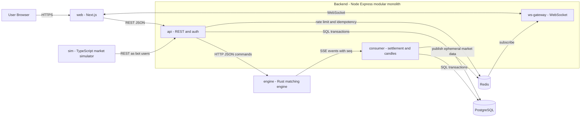

**Reading guide.** Commands flow down (`web` to `api` to `engine`). Facts flow back as an event stream (`engine` to `consumer`). Browsers see market data only through Redis to `ws-gateway`. `api`, `consumer`, and `ws-gateway` are modules of one codebase and, by default, one process.

---

## 9. Component responsibility and ownership map (Diagram 2)

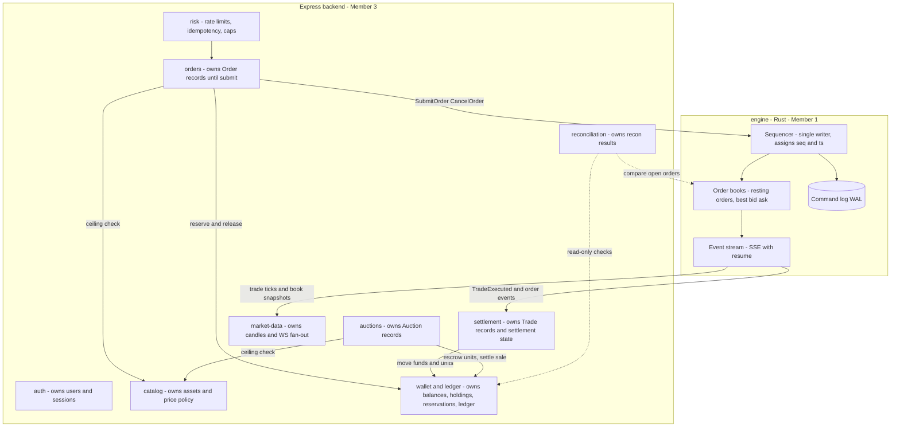

**Authority map.**

| Fact or operation | Authoritative component | Notes |
|---|---|---|
| Order book state, match outcome, trade price and quantity, `seq` | `engine` | Deterministic from WAL |
| Order record before submit (`PENDING_SUBMIT`) | `api` orders | Written with reservation in one transaction |
| Order state after submit | `api` consumer (single writer) | Driven only by engine events |
| Price ceiling and policy | `api` catalog | Single choke-point function used by orders and auctions |
| Balances, holdings, reservations, ledger | `api` wallet and ledger on PostgreSQL | Only the settlement and auction modules may move value |
| Trade settlement state | `api` settlement | `PENDING_SETTLEMENT` to `SETTLED` |
| Auction state and current price | `api` auctions | Price is a pure function of database time |
| Candles | `api` market-data | Pure function of trades, plus seeded history |
| Real-time fan-out | `ws-gateway` via Redis | Ephemeral, never a source of truth |
| Rate limits and idempotency keys | `api` risk | Redis fast-path, PostgreSQL unique constraint authoritative |

**No ambiguous shared ownership.** The `engine` has no database access. The frontend has no business logic beyond input hints.

---

## 10. Deployment architecture (Diagram 3)

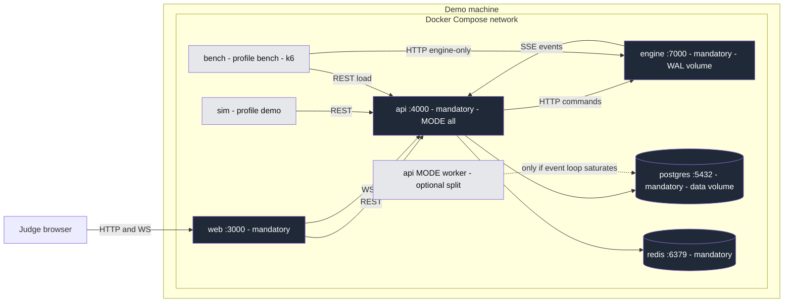

**Process lifecycles.**

| Process | Needs separate lifecycle because | MVP form |
|---|---|---|
| `engine` | Restarted independently to demonstrate crash recovery. Owns WAL volume | Separate container, mandatory |
| `api` | Restarted independently to demonstrate consumer resume | One container running API, consumer, WS gateway, auction sweeper, reconciliation (`MODE=all`) |
| `postgres`, `redis` | Stateful stores | Mandatory containers |
| `web` | Dev server or static build | Mandatory |
| `sim` | Start and stop on demand | Profile `demo`. May run on the host as a CLI |
| `bench` | Only for benchmark runs | Profile `bench` |
| `api` worker mode | Isolates settlement and candle work if the API event loop lags | **Deferred.** Enable only if the benchmark shows event-loop lag above the team threshold |

**Consolidation allowed for the demo.** `sim` can run inside the `api` container as a CLI entry. `web` can run as a static build. Nothing else is merged.

---

## 11. Event and market-data architecture (Diagram 4)

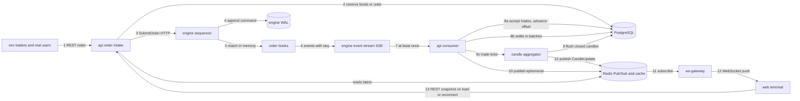

**Rules.**
- **Redis Pub/Sub is not durable.** Lost messages are recovered by snapshot, never by replay from Redis.
- **Redis cache** holds the latest book snapshot per asset and market stats for fast browsing. It is rebuilt by the consumer after a restart.
- **Durable path** is PostgreSQL (trades, orders, ledger, closed candles) plus the engine WAL.
- **Conflatable vs non-conflatable.** Book snapshots are conflatable (latest wins, throttled to about 10 per second per asset). Trades and private order events are not conflatable.
- **One consumption path.** `consumer` reads the engine SSE stream and is the single writer of order state after submit. The HTTP response to a command is only an acknowledgment for the caller.

---

## 12. Complete sequential user workflows

### Order lifecycle (state diagram)

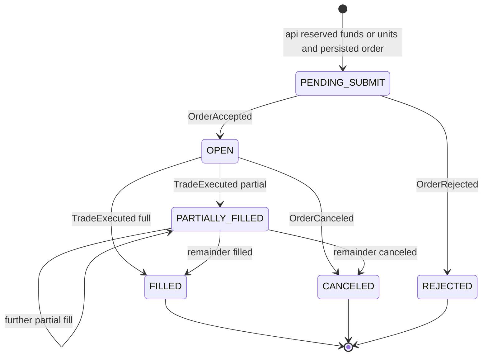

Market orders behave as immediate-or-cancel limit orders at a protection price. Any unfilled remainder ends in `CANCELED` with a reason.

### Trade and settlement lifecycle (state diagram)

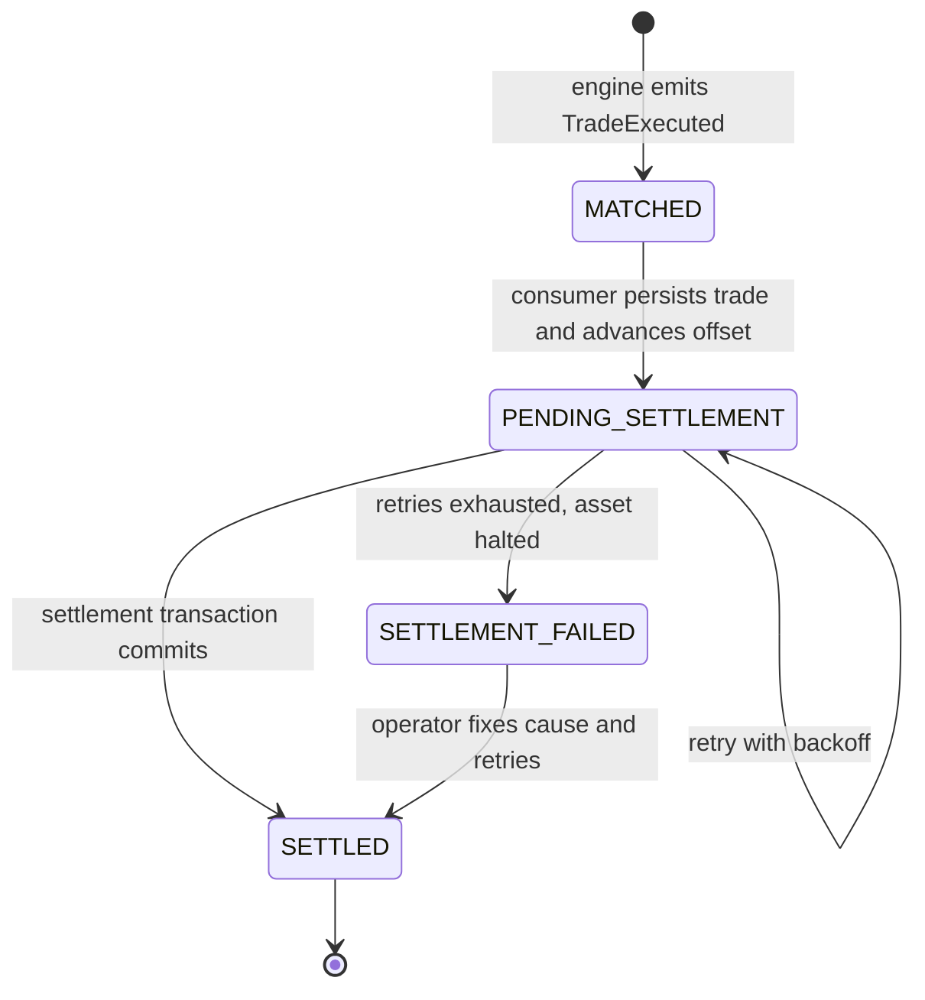

### Auction lifecycle (state diagram)

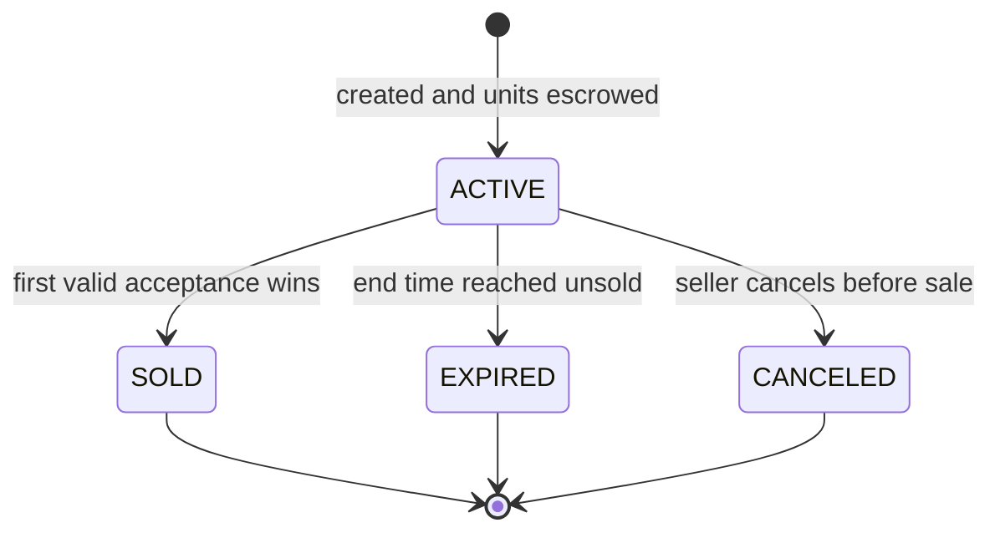

---

### Workflow 1 — Registration, login, protected access

1. Browser submits registration.
2. `api` checks the per-IP rate limit in Redis.
3. `api` validates email format and password policy.
4. One PostgreSQL transaction creates the user, wallet, ledger accounts, starter credits (ledger transaction from the `FAUCET` system account), and an audit event.
5. Duplicate email returns `EMAIL_TAKEN`.
6. `api` issues a short-lived JWT. Login verifies the password hash and issues a token the same way.
7. Protected calls carry the token. Middleware verifies signature and expiry, then loads the user.
8. Authority: PostgreSQL for identity. On failure the user sees field-level errors or a retry time.

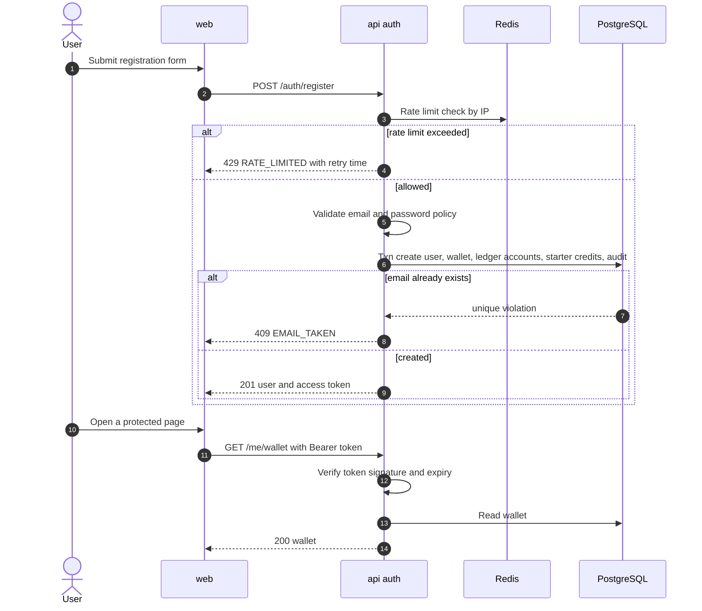

### Workflow 2 — Marketplace discovery

1. Browser requests the asset list.
2. `api` reads the catalog and current price policy (face value, ceiling).
3. `api` reads the latest market stats and top-of-book from the Redis cache (last price, change, best bid and ask, available ask quantity).
4. `api` reads active auctions per asset from PostgreSQL.
5. `api` returns a combined, read-only view. Browse traffic never touches the engine.
6. If the cache is empty after a restart, stats show "no data yet" until the consumer repopulates it.

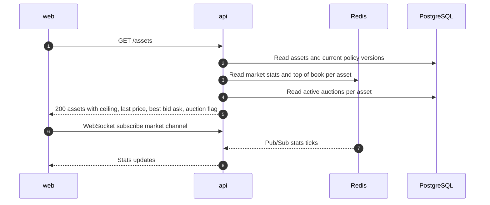

### Workflow 3 — Opening an asset terminal

1. Browser fires parallel REST calls: asset detail, candles (selected interval), order-book snapshot, recent trades, the user's open orders, wallet.
2. Candles come from PostgreSQL. The book snapshot comes from the Redis cache with its `as_of_seq`, falling back to the engine.
3. Browser opens the WebSocket and authenticates with the token.
4. Browser subscribes: `book:{asset}`, `trades:{asset}`, `candles:{asset}:{interval}`, `user:{id}`.
5. Server sends a fresh `BookSnapshot` with `as_of_seq`. The client discards any REST snapshot older than that.
6. Live `TradeTick`, `CandleUpdate`, and `BookSnapshot` messages follow. The client upserts candles by open time.

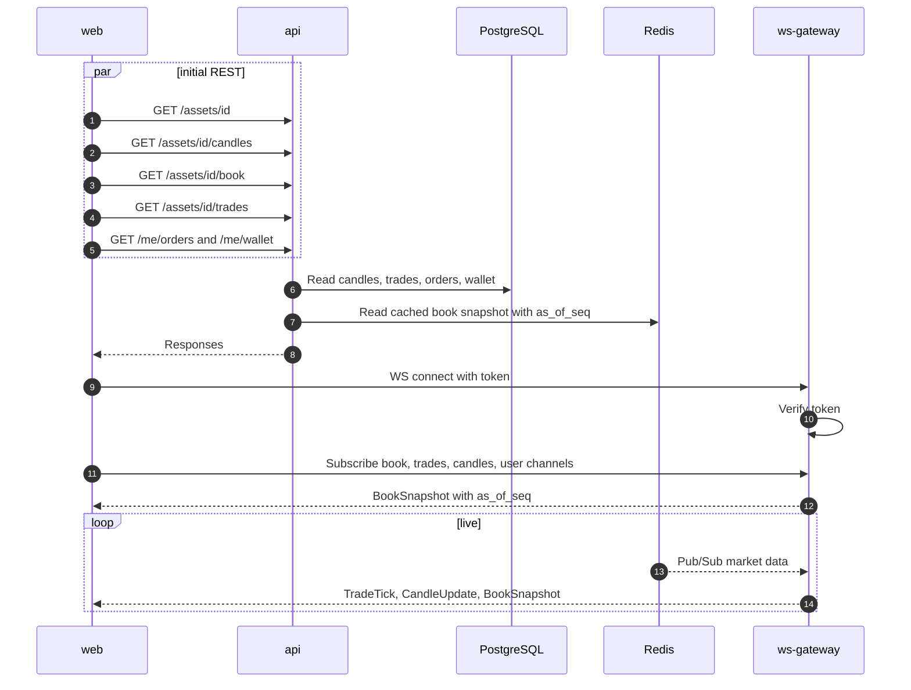

### Workflow 4 — Submitting a limit buy order

1. Browser posts the order with an `Idempotency-Key`.
2. `api` authenticates, applies rate limits, validates schema, tick size, quantity, asset status.
3. `api` checks `price <= ceiling` and the holding cap.
4. `api` registers the idempotency key (Redis `SET NX`, PostgreSQL unique constraint authoritative). A repeat returns the stored response.
5. One transaction: conditionally move funds `available` to `reserved` (`limit_price x qty`, fails if insufficient), insert the order as `PENDING_SUBMIT` with a new `order_id`, insert the reservation, write the ledger transaction and audit event.
6. `api` sends `SubmitOrder(order_id, ...)` to the engine.
7. The sequencer deduplicates by `order_id`, validates, appends to the WAL, matches, and emits `OrderAccepted`, `TradeExecuted`, `OrderPartiallyFilled` or `OrderFilled`.
8. Engine HTTP response returns ACCEPTED or REJECTED with `seq`. `api` returns 202 (or 422 with the engine code).
9. The consumer (not `api`) applies the events: order becomes `OPEN` and later partial/filled, trades are accepted and settled, reservations are released.
10. Users see fills and settlement through WebSocket events and toasts.

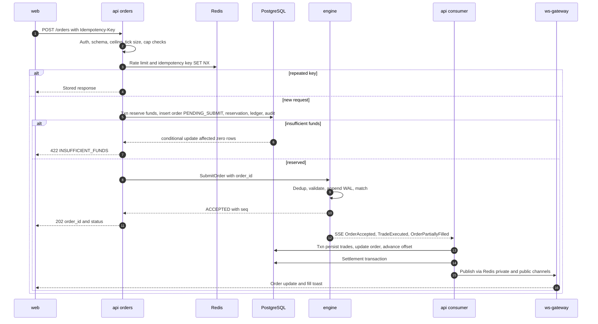

### Workflow 5 — Submitting a limit sell order

1. Browser posts the sell with `Idempotency-Key`.
2. `api` runs the same validation, rate limit, and ceiling checks.
3. Reservation: conditionally move units `available` to `reserved` in the user's holding. Insufficient units returns `INSUFFICIENT_HOLDINGS`. Units already in an auction are not `available`, so a double listing is impossible.
4. Order persisted as `PENDING_SUBMIT`; ledger transaction for the unit escrow.
5. Engine submit, match, and events as in Workflow 4.
6. On each trade, settlement moves units from the seller's `reserved` to the buyer's `available` and funds from the buyer's `reserved` to the seller's `available`.
7. Cancel releases the remaining reserved units.

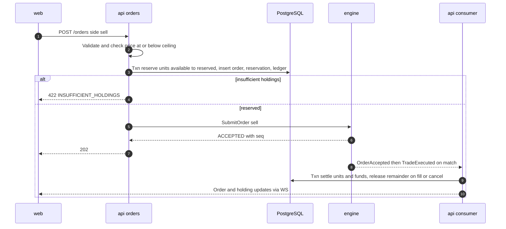

### Workflow 6 — Executing a market order

1. The form requires a worst-price (price protection). Default: buy limit = `min(ceiling, reference ask x (1 + band))`; sell limit = `reference bid x (1 - band)` with a floor. The band is a policy (illustrative 10%).
2. For a buy, `api` reserves `protection_price x qty`. For a sell, it reserves units.
3. Engine treats the order as immediate-or-cancel at the protection price.
4. Result is one of: full execution, partial execution (remainder canceled), or no liquidity (canceled with reason `NO_LIQUIDITY`).
5. Consumer settles fills and releases the unused reservation, including price improvement.
6. UI shows executed quantity, average price, and the reason for any cancel.

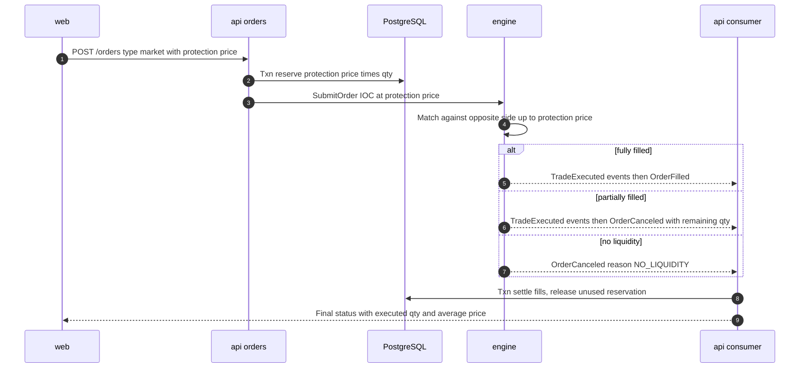

### Workflow 7 — Order cancellation

1. Browser requests cancel with an `Idempotency-Key`.
2. `api` verifies ownership and that the DB state is `OPEN` or `PARTIALLY_FILLED`. `PENDING_SUBMIT` returns `ORDER_NOT_CANCELABLE` (retry shortly).
3. `api` sends `CancelOrder(order_id)`.
4. The sequencer serializes the cancel against fills. Whichever command has the lower `seq` wins.
5. If the order still rests, engine emits `OrderCanceled` with `remaining_qty`. If it was already filled or never rested, engine returns `NOT_FOUND_OR_FILLED` and `api` returns `ORDER_NOT_CANCELABLE`.
6. Consumer releases the reservation for exactly `remaining_qty` and settles earlier partial fills separately.
7. The point of no return is the engine processing the fill that exhausts the order; after that a cancel can never succeed.

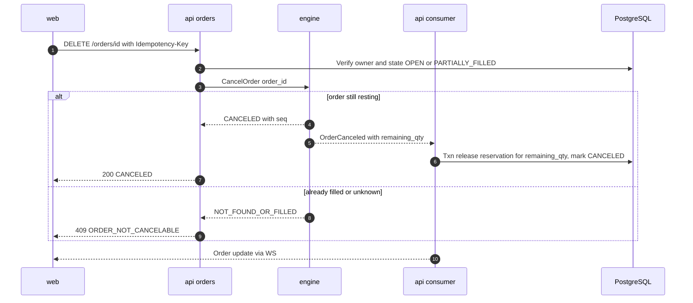

### Workflow 8 — Atomic trade settlement

1. Engine emits `TradeExecuted` (`trade_id`, `seq`, buy and sell `order_id`, price, quantity, `ts`). This is **MATCHED**.
2. Consumer transaction A: insert the trade as `PENDING_SETTLEMENT` (unique `trade_id`), increase `matched_qty` on both orders, advance `consumer_offset` to `seq`. Duplicates are ignored. This is **accepted for settlement**.
3. Settlement worker takes `PENDING_SETTLEMENT` trades in `seq` order, in batches.
4. Transaction B per batch: lock wallets and holdings in deterministic id order, verify the reservations cover the trade, then per trade:
   - buyer `reserved` funds decrease by `price x qty`;
   - seller `available` funds increase by `price x qty`;
   - buyer price improvement `(limit - price) x qty` moves `reserved` to `available`;
   - seller `reserved` units decrease; buyer `available` units increase;
   - reservations decrement; orders get `settled_qty`;
   - one ledger transaction with both funds legs and unit legs, balanced per commodity;
   - trade becomes `SETTLED`.
5. Commit publishes `SettlementCompleted` to the buyer and seller channels.
6. On any failure the transaction rolls back and retries with backoff. After the retry limit the trade becomes `SETTLEMENT_FAILED`, the asset is halted, and an alert is raised. Funds and units remain reserved, so no value is lost or duplicated.

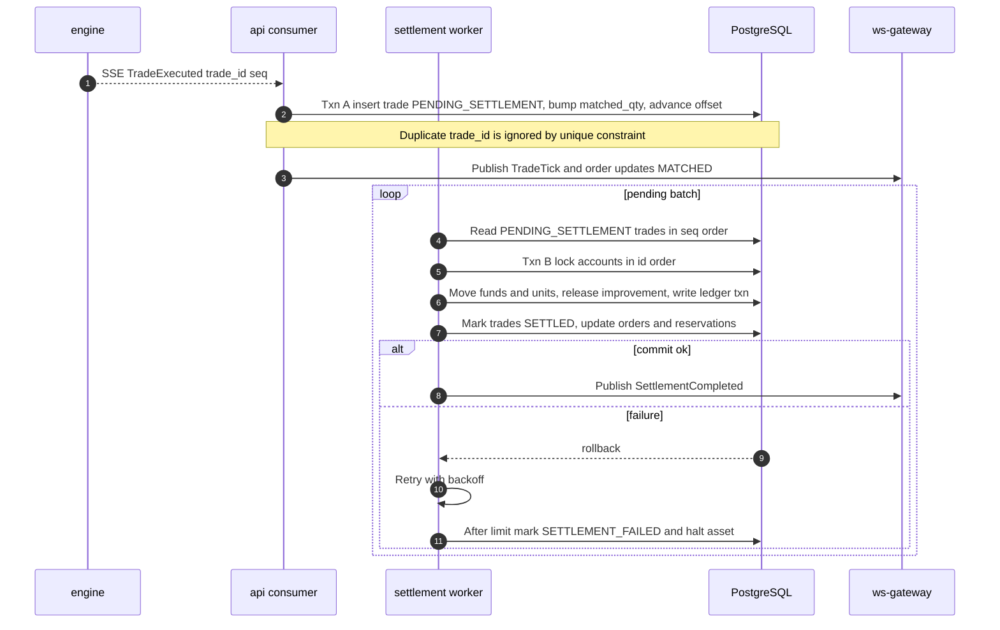

### Workflow 9 — Live chart and order-book updates

1. A simulated trader (through the public API) submits an order. It follows the Workflow 4 or 5 path.
2. The engine matches and emits `TradeExecuted` plus book changes.
3. The consumer feeds each trade tick to the candle aggregator.
4. Aggregator rule: bucket = `floor(ts / interval)`. First tick in a bucket sets open, high, low, close; later ticks update high, low, close and add to volume and trade count.
5. Each update publishes `CandleUpdate` to Redis. A closed bucket (next tick lands in a later bucket, or a timer passes the bucket end) is flushed to PostgreSQL.
6. The consumer throttles `BookSnapshot` (top 15 levels) to about 10 per second per asset and publishes it.
7. `ws-gateway` forwards to subscribers.
8. With no trades: no candle is created and no price update is published. Book snapshots and heartbeats continue.
9. History and live fit together: seeded candles carry `origin=SEEDED_SIM`, live candles `origin=ENGINE`. The seeded last close is the engine's initial reference price, and the simulator seeds the opening book around it.

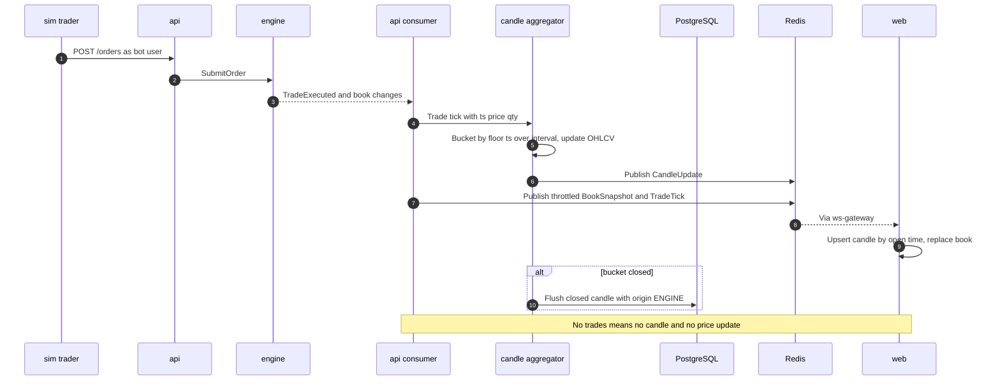

### Workflow 10 — Dutch auction

1. Seller posts `start_price`, `floor_price`, `step_seconds`, `end_time`, quantity.
2. `api` checks ownership and `start_price <= ceiling`, `floor <= start`, step and duration sanity.
3. One transaction: reserve units (reservation owned by the auction), insert the auction as `ACTIVE`, write ledger and audit.
4. Price is computed on demand from database time: `price(t) = max(floor, start - steps_elapsed x decrement)`. There are no per-auction timers. `ws-gateway` ticks every second and publishes `AuctionPriceUpdate` for active auctions.
5. Buyer sends `AuctionAccept(max_price)`, where `max_price` is the displayed price.
6. One transaction takes a row lock on the auction record, verifies it is `ACTIVE` and not past `end_time`, recomputes the current price `p`, and requires `p <= max_price`. Because price only decreases, a late request never costs more than the buyer saw.
7. In the same transaction: debit the buyer's available funds (conditional), credit the seller, transfer the escrowed units, write the ledger transaction, set the auction to `SOLD` with winner and accepted price. Settlement is synchronous and atomic.
8. A concurrent second acceptor waits on the lock, sees `SOLD`, and gets `AUCTION_ALREADY_SOLD`. A buyer with insufficient funds rolls back and the auction stays `ACTIVE`.
9. A sweeper (every second) marks past-due auctions `EXPIRED` and releases escrow. Accept also checks time lazily so a sweeper delay is never exploitable. The seller may cancel while `ACTIVE`.

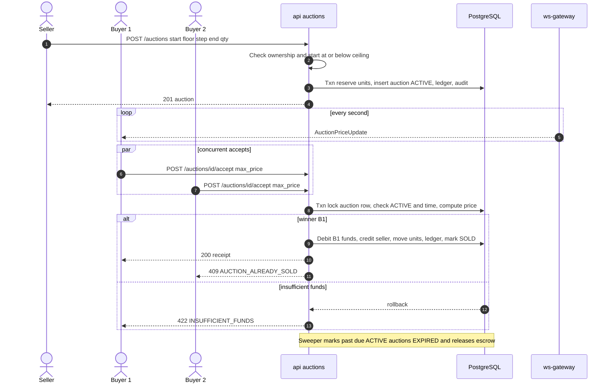

### Workflow 11 — Escrow and balance reconciliation

1. Reserve and release happen inside Workflows 4, 5, 7, 8, 10. Each writes a ledger transaction.
2. Reconciliation runs on a timer and on operator demand.
3. Checks (see Section 18.5): ledger balance per commodity, wallet and holding mirrors vs ledger sums, reservations vs reserved totals, supply conservation, stuck `PENDING_SETTLEMENT`, engine open orders vs database open orders, ceiling compliance of executed trades.
4. Result is stored with a verdict and an audit event.
5. A discrepancy raises an alert. Asset-scoped discrepancies halt that asset. A ledger imbalance halts all trading.

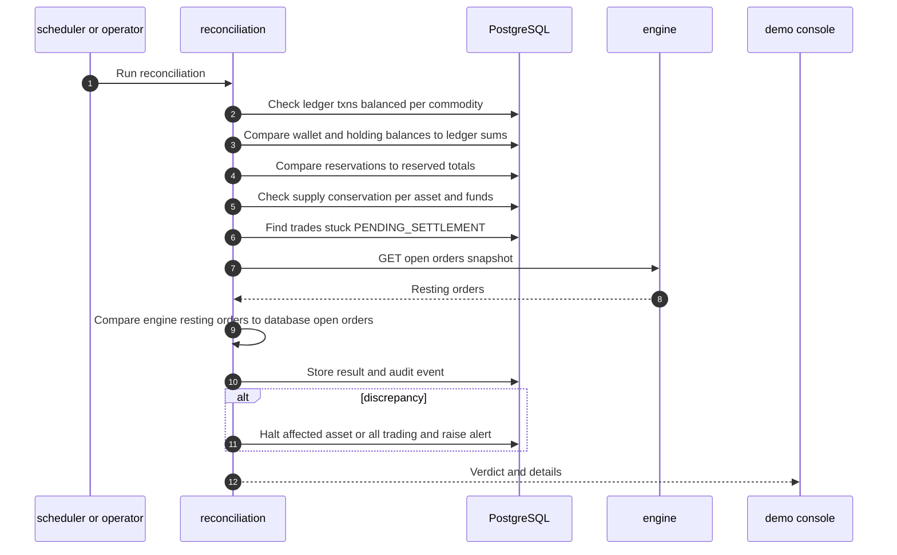

### Workflow 12 — Performance testing

1. Setup: bench creates N pre-funded bot accounts and tokens through a dedicated bot service credential (higher rate limit tier, disclosed in the report).
2. Warm-up period is discarded.
3. The generator submits orders at a **constant arrival rate** (open model) for a fixed duration with a defined order mix.
4. Metrics are collected from three places: k6 (client latency, status codes), `api` and `engine` `/metrics` (engine-ack latency, queue depth, settlement lag), PostgreSQL pool wait.
5. After the run, the generator waits for the settlement queue to drain, then runs reconciliation.
6. Results are written to a versioned artifact with commit SHA, hardware, and date.

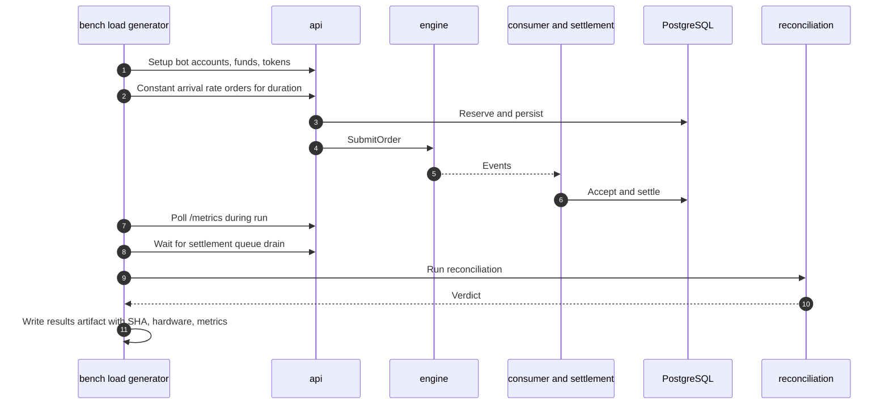

### Workflow 13 — Failure recovery

**13a. Crash during order processing (engine restarts).**

1. Engine dies mid-run. `api` calls time out. Orders stay `PENDING_SUBMIT` with funds reserved.
2. Engine restarts and replays the WAL to rebuild books and the dedup map.
3. The resolver resubmits stale `PENDING_SUBMIT` orders with the same `order_id`. The engine returns the original result if it already processed the command, or processes it now.
4. Consumer reconnects to SSE from the stored offset.

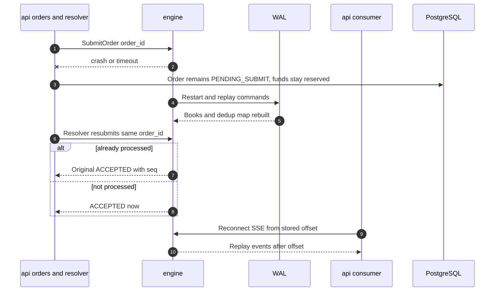

**13b. After match, before settlement (api or consumer crash).**

1. Engine matched; consumer may or may not have persisted the trade.
2. On restart the consumer reads `consumer_offset` and resumes SSE from `offset + 1`.
3. Replayed trades already persisted are ignored (unique `trade_id`).
4. The settlement worker resumes from `PENDING_SETTLEMENT` rows in PostgreSQL.

```mermaid
sequenceDiagram
    autonumber
    participant E as engine
    participant C as api consumer
    participant P as PostgreSQL
    participant S as settlement worker
    E-->>C: TradeExecuted seq 101
    C--xP: crash before persist
    C->>P: Restart and read consumer_offset 100
    C->>E: SSE resume after 100
    E-->>C: Replay seq 101 and later
    C->>P: Insert trade PENDING_SETTLEMENT, advance offset
    Note over C,P: Duplicate trade_id ignored by unique constraint
    S->>P: Settle pending trades
```

**13c. WebSocket disconnect.**

```mermaid
sequenceDiagram
    autonumber
    participant W as web
    participant G as ws-gateway
    participant A as api REST
    W--xG: connection lost
    W->>W: Show disconnected banner, backoff retry
    W->>G: Reconnect with token and resubscribe
    G-->>W: BookSnapshot with as_of_seq
    W->>A: GET trades, candles, open orders, wallet since last seen
    A-->>W: Catch-up data
    W->>W: Clear banner, merge by seq and open time
```

---

## 13. Conceptual data model

### 13.1 ER diagram

```mermaid
erDiagram
    USER ||--|| WALLET : has
    USER ||--o{ HOLDING : owns
    ASSET ||--o{ HOLDING : held_as
    ASSET ||--o{ ASSET_POLICY : versioned_by
    USER ||--o{ ORDERS : places
    ASSET ||--o{ ORDERS : traded_in
    ORDERS ||--o{ TRADE : buy_side_of
    ORDERS ||--o{ TRADE : sell_side_of
    ASSET ||--o{ TRADE : executed_in
    ORDERS ||--o{ RESERVATION : escrows_via
    AUCTION ||--o{ RESERVATION : escrows_via
    USER ||--o{ AUCTION : sells
    ASSET ||--o{ AUCTION : sold_in
    TRADE ||--o| LEDGER_TXN : settled_by
    AUCTION ||--o| LEDGER_TXN : settled_by
    LEDGER_TXN ||--|{ LEDGER_ENTRY : contains
    LEDGER_ACCOUNT ||--o{ LEDGER_ENTRY : receives
    ASSET ||--o{ CANDLE : aggregates
    USER ||--o{ NOTIFICATION : receives
    USER ||--o{ AUDIT_EVENT : acts
    USER ||--o{ IDEMPOTENCY_KEY : submits

    USER {
        uuid id PK
        string email UK
        string password_hash
        bool is_simulated
        string role
    }
    ASSET {
        uuid id PK
        string symbol UK
        string category
        string status
        bigint total_supply
    }
    ASSET_POLICY {
        uuid id PK
        uuid asset_id FK
        bigint face_value_minor
        int ceiling_bps
        timestamp effective_from
    }
    WALLET {
        uuid user_id PK
        bigint available_minor
        bigint reserved_minor
    }
    HOLDING {
        uuid user_id PK
        uuid asset_id PK
        bigint available_qty
        bigint reserved_qty
    }
    ORDERS {
        uuid id PK
        uuid user_id FK
        uuid asset_id FK
        string side
        string type
        bigint limit_price_minor
        bigint qty
        bigint matched_qty
        bigint settled_qty
        string status
        bigint accepted_seq
    }
    TRADE {
        string id PK
        uuid asset_id FK
        uuid buy_order_id FK
        uuid sell_order_id FK
        bigint price_minor
        bigint qty
        bigint seq
        string state
        string venue
    }
    RESERVATION {
        uuid id PK
        uuid owner_id FK
        string kind
        string ref_type
        uuid ref_id
        bigint remaining
        string status
    }
    AUCTION {
        uuid id PK
        uuid seller_id FK
        uuid asset_id FK
        bigint start_price_minor
        bigint floor_price_minor
        int step_seconds
        timestamp end_time
        string status
        uuid winner_id
        bigint accepted_price_minor
    }
    LEDGER_ACCOUNT {
        uuid id PK
        uuid owner_id
        string kind
        string commodity
    }
    LEDGER_TXN {
        uuid id PK
        string ref_type
        string ref_id UK
        timestamp created_at
    }
    LEDGER_ENTRY {
        uuid id PK
        uuid txn_id FK
        uuid account_id FK
        bigint amount
    }
    CANDLE {
        uuid asset_id PK
        string interval PK
        timestamp open_time PK
        bigint open_minor
        bigint high_minor
        bigint low_minor
        bigint close_minor
        bigint volume
        int trade_count
        string origin
    }
    IDEMPOTENCY_KEY {
        uuid user_id PK
        string key PK
        string request_hash
        json response
    }
    CONSUMER_OFFSET {
        string consumer PK
        string engine_epoch
        bigint last_seq
    }
    RECON_RUN {
        uuid id PK
        timestamp ran_at
        string verdict
        json details
    }
    NOTIFICATION {
        uuid id PK
        uuid user_id FK
        string type
    }
    AUDIT_EVENT {
        uuid id PK
        uuid actor_id FK
        string action
        string entity
    }
```

### 13.2 Entity table

| Entity | Purpose | Durable | Source of truth | Unique or idempotency | MVP |
|---|---|---|---|---|---|
| User | Identity, simulated flag | Yes | PostgreSQL | Unique email | Yes |
| Asset | Tradable instrument, status, total supply | Yes | PostgreSQL | Unique symbol | Yes |
| Asset policy | Versioned face value and ceiling multiplier | Yes | PostgreSQL | One effective row per asset and time | Yes |
| Ticket or collectible (serial unit) | Individually identifiable unit | Yes | PostgreSQL | Unique serial | **No.** Units fungible by quantity in MVP. Optional with F27 |
| Listing | Offer visibility | n/a | Derived from resting sell orders and auctions | n/a | Derived view only |
| Order | Instruction and its state | Yes | `api` until submit, then consumer from engine events | Primary key `order_id` is generated by `api` and used as the engine dedup key | Yes |
| Order fill | A trade seen from one order's side | n/a | Derived from Trade | n/a | Derived view only |
| Trade | One execution and its settlement state | Yes | Engine decides, PostgreSQL records | Unique `trade_id` | Yes |
| Wallet | Funds available and reserved | Yes | PostgreSQL (mirrors ledger) | One per user | Yes |
| Holding (ownership record) | Units available and reserved per user and asset | Yes | PostgreSQL (mirrors ledger) | Unique (user, asset) | Yes |
| Ledger account | Ledger endpoint per owner, kind, commodity | Yes | PostgreSQL | Unique (owner, kind, commodity) | Yes |
| Ledger transaction | Group of balanced entries | Yes | PostgreSQL | Unique (ref_type, ref_id) | Yes |
| Ledger entry | Signed amount on an account | Yes, append-only | PostgreSQL | Sum per transaction and commodity is zero | Yes |
| Balance reservation and escrow record | Hold on funds or units for an order or auction (one entity, two kinds) | Yes | PostgreSQL | Unique (ref_type, ref_id, kind) | Yes |
| Auction | Dutch auction state | Yes | PostgreSQL | Conditional state transition | Cut B |
| Auction bid or acceptance | Winner and price stored on auction. Losing attempts logged in audit | Yes | PostgreSQL | Idempotency key on accept | Cut B (on auction row) |
| Notification | Persisted user message | Yes | PostgreSQL | Optional | Optional (F24) |
| Market-data candle | OHLCV bucket | Yes (rebuildable) | Derived from trades plus seeded history | Unique (asset, interval, open_time) | Yes |
| Audit event | Append-only action log | Yes | PostgreSQL | Request id | Yes |
| Idempotency key | Dedup for submit, cancel, accept | Redis fast-path, PostgreSQL authoritative | PostgreSQL | Unique (user, key) | Yes |
| Consumer offset | Last applied engine `seq` and epoch | Yes | PostgreSQL | One per consumer | Yes |
| Recon run | Reconciliation result | Yes | PostgreSQL | none | Yes |
| Book snapshot, order book, command log | Engine working state | Book in memory, WAL on disk | `engine` | `seq` | Yes |

**Money representation.** Integer minor units (no floating point). Quantities are integers. Currency is a single simulated credit.

---

## 14. Data consistency and transaction invariants

| # | Invariant | Enforced by engine | Enforced by PostgreSQL | Checked by reconciliation |
|---|---|---|---|---|
| I1 | An asset unit cannot be sold twice | Resting qty never exceeds order qty | Conditional `available` to `reserved` move, non-negative check constraints, auction and order share one holding | Reserved units equal sum of active reservations |
| I2 | Available balance never negative | n/a | Check constraint plus conditional updates | Wallet recomputed from ledger |
| I3 | Settled trade has balanced ledger entries covering both funds and units | n/a | One transaction writes trade state, both legs, and ledger | Per transaction per commodity sum is zero |
| I4 | Ownership reflects settled transfers | n/a | Units move only inside settlement or auction transactions | Holdings equal ledger unit sums, supply is conserved |
| I5 | A canceled order gets no new fills | Sequencer orders cancel against fills by `seq` | Consumer ignores fills for orders already `CANCELED` and alerts | Engine resting vs database open orders |
| I6 | Partial fills never exceed remaining quantity | Fill quantity is min of both remainders | Check `matched_qty <= qty` | Compare sums of trade qty to order qty |
| I7 | Every completed trade traces to its orders | Events carry both `order_id`s | Foreign keys from trade to orders | Orphan check |
| I8 | Auction and order-book inventory do not conflict | n/a | Single holding row with reservations of kind ORDER or AUCTION | Reserved total equals reservations total |
| I9 | Price ceilings applied consistently | Optional collar tripwire per asset | Single policy function on every price-entry path | Every executed trade price at or below the ceiling effective at its time |
| I10 | Retried requests never duplicate orders or settlements | Dedup by `order_id` | Unique (user, idempotency key), unique `trade_id`, unique ledger ref | Duplicate scan |
| I11 | A trade appears `SETTLED` only after the settlement transaction commits | n/a | State flips inside that transaction | Stuck or inconsistent trade scan |
| I12 | Funds never move without units | n/a | Both legs in one ledger transaction | Same as I3 |

---

## 15. API and service communication contracts

### 15.1 Shared conventions

- **Auth**: Bearer JWT. Admin routes require the `admin` role.
- **Idempotency**: `Idempotency-Key` header required on order submit, cancel, auction create, auction accept.
- **Errors**: one envelope with `code`, human `message`, optional `details`, `request_id`.
- **Error codes (shared)**: `VALIDATION_FAILED`, `UNAUTHENTICATED`, `FORBIDDEN`, `RATE_LIMITED`, `IDEMPOTENCY_CONFLICT`, `INSUFFICIENT_FUNDS`, `INSUFFICIENT_HOLDINGS`, `PRICE_ABOVE_CEILING`, `ASSET_NOT_TRADABLE`, `HOLDING_CAP_EXCEEDED`, `MAX_OPEN_ORDERS`, `ORDER_NOT_FOUND`, `ORDER_NOT_CANCELABLE`, `SELF_TRADE_PREVENTED`, `NO_LIQUIDITY`, `ENGINE_BUSY`, `ENGINE_UNAVAILABLE`, `AUCTION_NOT_ACTIVE`, `AUCTION_ALREADY_SOLD`, `PRICE_MOVED`.
- **Pagination**: cursor-based on list endpoints.
- **Time**: engine `ts` (epoch ms) is authoritative for trade time; database time for auctions.

### 15.2 REST endpoint groups

**Authentication**
- Endpoints: `POST /auth/register`, `POST /auth/login`, `GET /me`.
- Caller: web, sim, bench.
- Input: email, password. Response: user and token.
- Validation: email format, password policy, rate limit per IP. Errors: `VALIDATION_FAILED`, `RATE_LIMITED`, `UNAUTHENTICATED`, `EMAIL_TAKEN`.
- Dependencies: PostgreSQL, Redis.

**Assets and marketplace**
- Endpoints: `GET /assets`, `GET /assets/:id`.
- Caller: web. Response: asset, face value, ceiling, status, last price, change, best bid and ask, available ask quantity, auction flag.
- Auth: public. Errors: not found. Dependencies: PostgreSQL, Redis cache.

**Listings**
- Endpoints: `GET /assets/:id/listings` (derived: aggregated resting sells and active auctions).
- Caller: web. Dependencies: Redis cache or engine snapshot, PostgreSQL auctions. Treated as a view of the book.

**Order submission and cancellation**
- Endpoints: `POST /orders`, `DELETE /orders/:id`, `GET /orders/:id`.
- Caller: web, sim, bench.
- Input: asset, side, type, quantity, limit or protection price, client idempotency key.
- Response: 202 with `order_id` and status, or error.
- Validation and authorization: owner only, ceiling, tick size, cap, balance or units, asset status, rate limit.
- Errors: `PRICE_ABOVE_CEILING`, `INSUFFICIENT_FUNDS`, `INSUFFICIENT_HOLDINGS`, `HOLDING_CAP_EXCEEDED`, `MAX_OPEN_ORDERS`, `ENGINE_BUSY`, `ENGINE_UNAVAILABLE`, `ORDER_NOT_CANCELABLE`.
- Dependencies: Redis, PostgreSQL, engine.

**Order-book snapshots**
- Endpoint: `GET /assets/:id/book?depth=N`.
- Response: bids, asks (price, quantity, cumulative), best bid and ask, spread, `as_of_seq`.
- Source: Redis cache with engine fallback.

**Trades and market history**
- Endpoints: `GET /assets/:id/trades`, `GET /assets/:id/candles?interval=&limit=`.
- Response: trades with SIM flags and `seq`; candles with `origin`.
- Dependencies: PostgreSQL.

**Wallet and portfolio**
- Endpoints: `GET /me/wallet`, `GET /me/holdings`, `GET /me/orders`.
- Response: available and reserved funds, holdings with available and reserved quantities, orders with `matched_qty` and `settled_qty`.
- Auth: owner only.

**Auctions**
- Endpoints: `POST /auctions`, `GET /auctions`, `GET /auctions/:id`, `POST /auctions/:id/accept`, `DELETE /auctions/:id`.
- Input (accept): `max_price`, idempotency key.
- Response: current price, status, receipt.
- Errors: `AUCTION_NOT_ACTIVE`, `AUCTION_ALREADY_SOLD`, `PRICE_MOVED`, `INSUFFICIENT_FUNDS`, `PRICE_ABOVE_CEILING`, `INSUFFICIENT_HOLDINGS`.

**Transaction history**
- Endpoints: `GET /me/transactions`, `GET /transactions/:id` (receipt).
- Response: settled trades and auction sales with ledger transaction id, prices, quantities.

**Notifications**
- Endpoints: `GET /me/notifications` (Optional persisted). MVP uses WebSocket toasts only.

**Admin and demo (operator only)**
- Endpoints: `POST /admin/sim/start|pause|scenario`, `POST /admin/reconcile`, `GET /admin/reconcile/latest`, `POST /admin/assets/:id/halt|resume`, `POST /admin/assets/:id/policy`, `POST /admin/demo/reset`.
- Dependencies: sim control endpoint, reconciliation, engine admin commands.

**Health and metrics**
- Endpoints: `GET /healthz`, `GET /metrics` on `api` and `engine`.
- Content: queue depths, settlement lag, event-loop lag, command latency histogram, consumer offset vs engine `seq`.

### 15.3 WebSocket contract

| Channel | Access | Messages | Conflatable |
|---|---|---|---|
| `market` | Public | Asset stats tick | Yes |
| `book:{asset}` | Public | `BookSnapshot` (top 15 levels, `as_of_seq`) | Yes |
| `trades:{asset}` | Public | `TradeTick` (price, qty, ts, side, SIM flag, `seq`) | No |
| `candles:{asset}:{interval}` | Public | `CandleUpdate` (full candle, `origin`) | Yes (upsert) |
| `auction:{id}` | Public | `AuctionPriceUpdate` (price, next change, status) | Yes |
| `user:{id}` | Authenticated owner only | Order updates, `SettlementCompleted`, `SettlementFailed`, auction won | No |

Behavior: JWT validated on connect, heartbeat ping/pong, subscription ownership checks, slow-client disconnect, snapshot-on-reconnect.

### 15.4 Engine interface options

| Option | Pros | Cons | Verdict |
|---|---|---|---|
| **HTTP/JSON commands plus SSE event stream** | Debuggable with curl, no tooling, SSE gives `Last-Event-ID` resume natively, trivial from Node | JSON overhead (irrelevant at 1,000 per second), no schema enforcement | **Recommended** |
| gRPC | Typed, streaming | Needs protoc toolchain in two languages, harder to debug live, minor gain at our rate | Rejected for MVP |
| Redis Streams as command bus | Decoupling, durability via Redis | Async ack complicates user-facing accept or reject, makes Redis a durability dependency, extra consumer-group semantics | Rejected |
| Raw TCP or custom framing | Fastest | Highest cost, no benefit | Rejected |

**Engine endpoints.** `POST /v1/commands` (`SubmitOrder`, `CancelOrder`, `ConfigureAsset`, `HaltAsset`, `ResumeAsset`), `GET /v1/books/:asset?depth=`, `GET /v1/orders/:order_id`, `GET /v1/open-orders` (for reconciliation), `GET /v1/events?after=<seq>` (SSE, honors `Last-Event-ID`), `GET /healthz`, `GET /metrics`.

### 15.5 Message formats (conceptual)

**Kinds.**
- **Command**: a request to change state (`SubmitOrder`, `CancelOrder`). Idempotent by `order_id`.
- **Domain event**: a fact that happened, sequenced, replayable (`OrderAccepted`, `TradeExecuted`, ...). Source: engine, or `api` for settlement events.
- **Snapshot**: full state at `as_of_seq` (`BookSnapshot`). Replaces prior state.
- **Ephemeral market-data update**: lossy, not replayed (`TradeTick`, `CandleUpdate`, `AuctionPriceUpdate`).

| Message | Kind | From to | Key fields |
|---|---|---|---|
| `SubmitOrder` | Command | api to engine | `order_id`, asset, side, type, qty, limit price or protection price, TIF (GTC or IOC), user id, optional collar |
| `OrderAccepted` | Domain event | engine to consumer | `order_id`, `seq`, `ts`, `engine_epoch` |
| `OrderRejected` | Domain event | engine to consumer | `order_id`, `seq`, reason code |
| `OrderPartiallyFilled` | Domain event | engine to consumer | `order_id`, filled qty, remaining qty, `seq` |
| `OrderFilled` | Domain event | engine to consumer | `order_id`, `seq` |
| `OrderCanceled` | Domain event | engine to consumer | `order_id`, `remaining_qty`, reason (USER, IOC_REMAINDER, NO_LIQUIDITY, POLICY_BREACH), `seq` |
| `TradeExecuted` | Domain event | engine to consumer | `trade_id`, buy and sell `order_id`, asset, price, qty, maker side, `ts`, `seq` |
| `SettlementCompleted` | Domain event | settlement to users | `trade_id`, ledger txn id, new balances, `seq` |
| `SettlementFailed` | Domain event | settlement to operators and users | `trade_id`, reason, asset halted flag |
| `BookSnapshot` | Snapshot | consumer to browsers | asset, bid and ask levels, best bid and ask, spread, `as_of_seq` |
| `BookDelta` | Ephemeral | **Optional, not in MVP** | levels changed, `from_seq`, `to_seq` |
| `TradeTick` | Ephemeral | consumer to browsers | price, qty, ts, aggressor side, sim flags, `seq` |
| `CandleUpdate` | Ephemeral | aggregator to browsers | interval, open time, OHLCV, trade count, `origin` |
| `AuctionPriceUpdate` | Ephemeral | auctions to browsers | auction id, current price, next price, seconds to next step, status |

**Illustrative envelope (single example).**

```json
{ "type": "TradeExecuted", "engine_epoch": "e-7f3a", "seq": 10482, "ts": 1760000000123,
  "trade_id": "e-7f3a:10482", "asset": "DFEST-WKND", "price": 12000, "qty": 2,
  "buy_order_id": "...", "sell_order_id": "..." }
```

### 15.6 Identifiers, sequencing, timestamps

| Item | Rule |
|---|---|
| `order_id` | Generated by `api` (time-ordered UUID). Doubles as the engine dedup key |
| `trade_id` | `{engine_epoch}:{seq}` assigned by the engine, reproduced exactly on WAL replay |
| `seq` | Global, strictly increasing across all assets, assigned by the single sequencer. Used for resume, dedup, `consumer_offset` |
| `engine_epoch` | New value whenever the WAL lineage restarts from empty. A changed epoch triggers the DB-rebuild recovery path |
| `as_of_seq` | Stamps snapshots so clients can order REST and WS data |
| Idempotency key | Client-supplied. Stored with request hash. Same key with a different hash returns `IDEMPOTENCY_CONFLICT` |
| Timestamps | Engine `ts` assigned by the sequencer and stored in the WAL, so replay is deterministic. Candle buckets use engine `ts` |

---

## 16. Market simulation and chart aggregation design

### 16.1 Goals and honesty rules

- Produce internally consistent exchange activity that visibly exercises matching, depth, and price movement. It makes no prediction claims.
- Simulated actors are real accounts with `is_simulated=true`, trade through the public API, and are labeled **SIM** in trade feeds, with a persistent "Includes simulated traders" notice.
- No executions means no price update and no fabricated candle.

### 16.2 Assets for the demo (illustrative)

| Asset | Category | Face value (illustrative) | Liquidity profile |
|---|---|---|---|
| Darkhold Fest Weekend Pass | Festival | 10,000 minor units | High |
| Moonrise GA Pass | Festival | 8,000 | Medium |
| Darkhold Hoodie Limited | Merch | 3,000 | Medium |
| Sigil Collector Pin | Collectible | 500 | Thin (demonstrates no-trade periods) |

Ceiling multiplier is a **policy decision** (see Section 17.1). Demo seeds use an *illustrative* default.

### 16.3 Historical candle generation

1. Fix a seeded PRNG so every run is reproducible.
2. Generate a tick series for the past 6 hours: a mean-reverting random walk around face value, with a volume process that varies by liquidity profile and has quiet periods.
3. Clamp every tick to the ceiling.
4. Aggregate ticks into `1m` candles for 6 hours and `5s` candles for the last 30 minutes using the **same shared aggregation package** that live trades use.
5. Write with `origin=SEEDED_SIM`. The chart shades seeded candles and labels them "Simulated history".
6. The last seeded close is the engine's reference price. The simulator seeds the opening book around it. The first live candle opens at its first real trade price. A gap is allowed and honest.

### 16.4 Simulated trader behavior

| Persona | Behavior | Parameters (illustrative) |
|---|---|---|
| Market maker | Quotes bid and ask around mid with a spread, refreshes quotes, skews with inventory, limited by inventory and cash | Spread 1–3%, size 1–5, refresh 1–3 s |
| Noise trader | Random side, marketable or near-touch limit orders | Poisson arrivals, lognormal size, mostly 1–3 units |
| Momentum trader | Follows the last N trade directions | Window N, threshold |
| Profit taker | Sells holdings after gains of X% (never above ceiling) | X per bot |
| Auction sniper (Optional) | Accepts when price drops below private valuation | Valuation per bot |
| Canceler | Cancels resting orders after random time-to-live | TTL 5–60 s |

**Regimes.** Calm, active, volatile. The regime changes arrival rate and spread. Liquidity profiles set arrival rates per asset (illustrative: high tens per second, medium few per second, thin sub-1 per second).

**Price-ceiling enforcement.** Bots use the public API, so ceilings apply to them. A scripted "scalper bot" scenario tries to list above the ceiling to demonstrate rejection.

### 16.5 OHLCV aggregation spec

| Field | Definition |
|---|---|
| Candle timestamp | Bucket start = `floor(trade ts / interval) x interval` (engine `ts`) |
| Open | Price of the first trade in the bucket |
| High and low | Max and min trade price in the bucket |
| Close | Price of the last trade in the bucket (by `seq`) |
| Volume | Sum of trade quantities |
| Trade count | Number of trades |
| Interval | Stored: `5s` and `1m`. Others are derived on read if ever needed |

**Active candle.** Held in memory by the aggregator, updated per trade, published as `CandleUpdate`, flushed on close and every few seconds. **After a restart**, the active candle is rebuilt from `trade` rows of the current bucket, so candles are a pure function of trades.

**Auction sales** are excluded from candles in the MVP (venue is `AUCTION`) to preserve "chart equals continuous-book executions". They appear in transaction history and may appear as chart markers later.

### 16.6 Run modes

| Mode | Purpose | Behavior |
|---|---|---|
| `continuous` | Development | Seeded PRNG, free-running personas |
| `demo` | Judging | Deterministic seed plus the scenario director |
| `paused` | Pause | Simulator stops submitting. Books remain. Chart freezes. Nothing is fabricated. Resume continues from current book and last price |

**Reset.** A scripted "reset demo" tears down, restores the seeded database snapshot, starts a fresh engine epoch, and re-seeds history. Target: under 30 seconds (hypothesis).
**Engine restart.** WAL replay restores the books. No duplicate candles because candles key on (asset, interval, open_time).

### 16.7 Scenario director (demo mode)

Scripted, triggered from the demo console:

1. **Wake the market**: start market makers and noise traders.
2. **Sell wall**: inject a resting sell at a known price so the judge's buy fills predictably.
3. **Pump**: momentum burst to move the candle visibly.
4. **Scalper attempt**: bot tries a price above the ceiling and is rejected.
5. **Drop auction**: issuer creates a Dutch auction with a short decay.

All steps use a fixed seed, so the demo never depends on luck.

---

## 17. Security and anti-scalping design

### 17.1 Price ceilings

| Question | Answer |
|---|---|
| How face value is recorded | Versioned `asset_policy` row (`face_value_minor`, `ceiling_bps`, `effective_from`), created by admin at asset creation |
| Ceiling formula | `ceiling = floor(face_value x ceiling_bps / 10000)` |
| Fixed multiplier or policy? | **Configurable per-asset policy.** The multiplier is a **business decision the team must make**. Demo seeds an illustrative value. The platform does not hard-code it |
| Where it applies | Limit buy and sell orders (reject price above ceiling), market order protection price, auction start price, and therefore every trade and auction sale price |
| Face-value change | Admin creates a new policy version. Open orders above the new ceiling are canceled by a sweeper with reason `POLICY_BREACH`, with audit events and user notifications |
| Invalid asset record | Missing, zero, or inconsistent policy sets the asset to `TRADING_HALTED`. Orders get `ASSET_NOT_TRADABLE` |
| Frontend explanation | Rejected order shows the ceiling, face value, and percentage |
| Final authority | `api` catalog policy function. It is the single choke point called by orders and auctions |
| Bypass prevention | No other price-entry path exists. No asset-transfer endpoint exists. The engine may enforce a mechanical collar tripwire (compare to a configured max, no policy logic). Reconciliation verifies every executed trade price against the ceiling effective at its time |

**Additional anti-scalping controls (policy, cheap and effective).**
- Per-account holding cap per asset (enforced inside the reservation transaction with a per-holding lock; illustrative default).
- Max open orders per account.
- Bot accounts flagged as simulated and excluded from any "fair access" statistics.

### 17.2 Bot resistance and abuse controls

| Control | MVP form | Honest limit |
|---|---|---|
| Rate limiting | Redis token bucket per IP (auth) and per user (orders), 429 with retry time. Numbers are illustrative and tuned from benchmarks | Does not stop distributed bots |
| Input validation | Schema validation on every endpoint, integer money, bounds | n/a |
| Authentication and authorization | JWT, owner checks, admin role | Token theft out of scope |
| Idempotency and duplicate prevention | Required key, PostgreSQL unique constraint authoritative | n/a |
| Request throttling and backpressure | Bounded in-flight engine calls, `ENGINE_BUSY` with `Retry-After` | n/a |
| Bot friction | Optional Turnstile-type challenge at signup or auction acceptance (F26) | Friction, not elimination |
| Audit trail | Append-only audit events for auth, orders, cancels, auctions, admin, reconciliation | Not tamper-proof unless hash-chained (F25) |
| Unauthorized asset transfers | No transfer API. Value moves only via settlement and auction transactions. Application database role has insert-only privileges on ledger tables | n/a |
| WebSocket authorization | JWT on connect, private channel ownership check, max connections per user and IP, max subscriptions per socket, message size limit, heartbeat | n/a |

**Basic abuse prevention vs sophisticated bot detection.** The MVP provides the former. Behavioral detection, device fingerprinting, account-age gating, and sybil resistance are **future work** and are not claimed.

### 17.3 Provable claims we can actually make

- No trade or auction sale executes above the ceiling (invariant plus reconciliation check).
- One account cannot exceed the per-account rate limit or holding cap.
- We do **not** claim that bots are eliminated or that sybil attacks are prevented.

---

## 18. Settlement, ledger, escrow, and reconciliation design

### 18.1 Accounting model

- **Commodities**: `CREDIT` (funds) and one per asset (units).
- **Ledger accounts** per owner: `AVAILABLE` and `RESERVED` for each commodity they hold, plus system accounts: `FAUCET` (source of starter credits), `ISSUANCE` (source of minted units).
- **Ledger transaction**: a set of entries whose sum is zero per commodity. Entries are append-only.
- **Materialized mirrors**: wallet and holding rows carry `available` and `reserved` for fast conditional updates. Reconciliation proves mirrors equal ledger sums.

### 18.2 Reservation lifecycle

| Event | Ledger movement |
|---|---|
| Buy order placed | Buyer funds `AVAILABLE` to `RESERVED` |
| Sell order placed or auction created | Seller units `AVAILABLE` to `RESERVED` |
| Trade settled | Buyer funds `RESERVED` to seller `AVAILABLE`, price improvement `RESERVED` to `AVAILABLE`, seller units `RESERVED` to buyer `AVAILABLE` |
| Order canceled or IOC remainder | Remaining reservation `RESERVED` to `AVAILABLE` |
| Auction sold | Buyer funds `AVAILABLE` to seller `AVAILABLE`, units `RESERVED` to buyer `AVAILABLE` |
| Auction expired or canceled | Units `RESERVED` to `AVAILABLE` |

### 18.3 Matching and settlement interaction

The engine never touches the database. It emits events; `api` converts them to bookkeeping. Settlement needs no new validation because funds and units were escrowed before matching. Settlement therefore cannot fail for business reasons. It can fail only for infrastructure or bugs.

### 18.4 Idempotency, transaction boundaries, retries

| Boundary | Mechanism |
|---|---|
| Order intake | One PostgreSQL transaction: reservation, order row, ledger, audit |
| Engine command | Dedup by `order_id`. WAL append before processing |
| Event acceptance | One transaction: trade insert (unique `trade_id`), order counters, `consumer_offset` |
| Settlement | One transaction per batch with ordered locks. Unique ledger reference per trade |
| Retry | Exponential backoff. Poison trade leads to `SETTLEMENT_FAILED`, asset halt, alert |

PostgreSQL transactions make **each step** atomic. The cross-component workflow (api to engine to consumer) is **not** one atomic transaction. It is made safe by write-ahead reservation, idempotent commands, sequenced at-least-once events, idempotent consumers, and reconciliation.

### 18.5 Reconciliation checks

| # | Check | Detects |
|---|---|---|
| R1 | Every ledger transaction sums to zero per commodity | Imbalanced posting |
| R2 | Wallet and holding mirrors equal ledger account sums | Drift, double-posting |
| R3 | Reserved totals equal sum of active reservations | Leaked or orphaned escrow |
| R4 | Total units per asset equal issued supply. Total credits equal faucet issued | Value creation or loss |
| R5 | No `PENDING_SETTLEMENT` older than the SLA | Stuck settlement |
| R6 | Engine open orders match database `OPEN` and `PARTIALLY_FILLED` orders (quantity and price) | Engine and database divergence |
| R7 | Every executed trade price at most the ceiling in force at its time | Ceiling bypass |
| R8 | No negative balances or quantities | Constraint failures |

Triggered on a timer and by the operator. Output is a pass/fail report stored in `RECON_RUN`.

### 18.6 What this proves and does not prove

**Proves (from internal records):** value is conserved, balances equal ledger history, escrow equals active holds, engine and database agree on open orders, no executed price exceeded the ceiling.

**Does not prove:** that real money or real tickets exist off-platform, absence of operator collusion, or solvency against external custody. Hash chains (F25) add tamper evidence only. We do not call any of this "cryptographic proof of solvency."

**Escrow and delivery.** Settlement is atomic delivery-versus-payment inside one database transaction. For the simulated assets, the ownership write *is* delivery. Verifying delivery of a real external ticket would need an external ticketing integration, which is out of scope. F27 offers an optional simulated merch flow where funds are held until the buyer confirms receipt.

---

## 19. Failure handling and recovery

### 19.1 Diagram 5 — Failure and recovery architecture

```mermaid
flowchart TD
    F1["Engine crashes"] --> D1["api times out, SSE drops"]
    D1 --> R1["Engine restarts and replays WAL to rebuild books"]
    R1 --> R1b["Resolver resubmits PENDING_SUBMIT orders by order_id, engine dedups"]
    R1b --> R1c["Consumer resumes SSE from stored offset"]
    F1b["WAL lost or engine epoch changes"] --> R1d["api rebuilds books by resubmitting OPEN orders in original order under new epoch"]
    F2["api or consumer restarts"] --> R2["Resume SSE from offset, duplicates ignored by trade_id"]
    F3["PostgreSQL unavailable"] --> R3["Writes return 503, no reservation means no engine submit, consumer retries with backoff"]
    F4["Duplicate request or event"] --> R4["Idempotency keys, unique trade_id, monotonic order states"]
    F5["WebSocket client disconnects"] --> R5["Client reconnects with backoff, snapshot and REST catch-up"]
    F6["Redis unavailable"] --> R6["Live push stops, REST works, cache rebuilt on return"]
    F7["Settlement poison trade"] --> R7["Retry then SETTLEMENT_FAILED, asset halted, alert"]
    R1c --> G["Reconciliation confirms invariants"]
    R1d --> G
    R2 --> G
    R3 --> G
    R7 --> G
```

### 19.2 Failure windows

| Window | Between | Consequence | Mitigation |
|---|---|---|---|
| W1 | PostgreSQL reserve commit and engine submit | Order stuck `PENDING_SUBMIT`, funds reserved | Resolver resubmits by `order_id` |
| W2 | Engine WAL append and HTTP ack | `api` thinks submit failed | Resubmit, engine dedup returns original result |
| W3 | Engine event and consumer persist | Event unseen by database | SSE resume from offset |
| W4 | Trade persisted and settled | `PENDING_SETTLEMENT` | Settlement worker retries from database |
| W5 | Settled and WebSocket publish | Client unaware | Snapshot and REST on reconnect, user channel state from REST |
| W6 | Engine WAL durability | Last commands lost if not fsynced | Configurable fsync policy (`always`, `batch`, `off`). Demo default `batch`. Divergence repaired by the rebuild-from-database path |

### 19.3 Guarantees

- Engine to consumer: **at-least-once**, ordered by `seq`. Consumer apply is idempotent, so the effect is effectively-once.
- Redis Pub/Sub: **best effort, lossy**. Never a source of truth.
- PostgreSQL: durable. Cross-component consistency is eventual and verified by reconciliation.
- A trade never appears `SETTLED` without a committed settlement transaction.

### 19.4 Recovery strategy ranking

1. **Primary**: WAL replay on boot, no snapshots (hackathon-grade, small WAL).
2. **Fallback**: rebuild books from database open orders ordered by `accepted_seq`, under a new `engine_epoch` (consumer offset resets to the new epoch).
3. **Optional**: WAL snapshots (F06) for faster boot.

---

## 20. Performance and testing strategy

### 20.1 Metric definitions

| Metric | Definition |
|---|---|
| Offered rate | Orders per second the generator sends |
| Accepted rate | Orders acknowledged ACCEPTED by `api` and engine |
| Rejected rate | By reason code (validation, funds, ceiling, busy) |
| Error rate | 5xx and timeouts |
| Matched orders | Orders with at least one fill |
| Executed trades | `TradeExecuted` per second |
| Settled trades | `SETTLED` per second |
| Settlement lag | Time from `TradeExecuted` to `SETTLED` (p50, p99) |
| End-to-end latency | Client send to API response (p50, p95, p99) |
| Matching latency | Engine command processing time (p50, p99) |
| Backpressure signals | `ENGINE_BUSY` count, queue depths, event-loop lag, PostgreSQL pool wait |

### 20.2 Concurrent HTTP vs serialized order books

Many HTTP requests arrive concurrently. The engine serializes them through one sequencer. Order priority is **arrival at the sequencer**, not the client's send time. `ts` and `seq` are assigned there. This is deterministic and replayable. Total engine throughput is limited by the sequencer's per-command cost, which is expected to be far above 1,000 per second. That is a **hypothesis to measure**, not a claim.

### 20.3 Benchmark scenarios

| Scenario | Scope | Purpose |
|---|---|---|
| S1 | Engine only, in-process (Rust harness) | Raw matching throughput and latency |
| S2 | Engine over HTTP | Transport overhead |
| S3 | Full path at constant 1,000 orders per second for a fixed duration | Headline claim with settlement lag reported |
| S4 | Burst above target (for example 2x for a short window) | Backpressure behavior: `ENGINE_BUSY`, 429s, no corruption |
| S5 | Soak plus reconciliation | Zero drift after load |
| S6 | Chaos: kill engine mid-run | Recovery time and invariants |

**Order mix (illustrative):** majority limit orders near mid, a share of cancels, a share of marketable orders.

**Method rules.**
- Open-model constant arrival rate (avoids coordinated omission).
- Discard warm-up.
- Pre-fund accounts so that insufficient-funds rejections are not the measured behavior.
- Disclose that the load generator uses a higher-rate-limit bot credential.
- Report offered, accepted, matched, executed, settled separately.
- Evidence artifact per run: raw results, commit SHA, hardware, date, reconciliation report.

**Targets (hypotheses, not promises).** Sustain 1,000 accepted orders per second in S3 with bounded settlement lag. Report the lag honestly rather than choosing a favorable window.

**Known bottleneck.** Settled trades per second can be lower than accepted orders per second because each settlement touches several rows and hot accounts (market makers) contend on the same rows. Mitigations: micro-batching (F17b), deterministic lock order, spreading bot accounts. The report states the measured settled rate and lag.

### 20.4 Backpressure, slow clients, duplicates, reconnects

| Concern | Handling |
|---|---|
| Overload | Bounded in-flight engine calls and bounded engine queue return `ENGINE_BUSY` with `Retry-After`. The reservation is released through the engine rejection path |
| Slow WebSocket clients | Per-socket buffer limit, conflate book snapshots, disconnect when still over the limit |
| Duplicate messages | `seq` dedup for stream consumption, idempotency keys for requests, unique constraints |
| Reconnecting clients | Snapshot-on-reconnect plus REST catch-up |

### 20.5 Test strategy

| Area | Tests | Automated | Notes |
|---|---|---|---|
| Matching engine units | Price-time priority, partial fills, market IOC, cancel, self-trade prevention, best bid/ask | Yes | Table-driven scenarios |
| Determinism | Same command log produces identical trades and book (replay equality) | Yes | Property-style test |
| Cancellation races | Cancel vs fill ordering by `seq` | Yes | Engine level |
| Candle aggregation | Bucketing, gaps, restart rebuild, no fabrication | Yes | Shared package tests |
| Price ceiling | Rejection on every path (limit, market protection, auction, face-value change sweep) | Yes | Negative tests |
| Insufficient balance and units | Conditional reservation failure | Yes | |
| Ownership conflicts | Sell the same units via order and auction | Yes | Must fail |
| Settlement atomicity | Fault injection mid-transaction, no partial moves | Yes | Rollback verification |
| Duplicate requests | Same idempotency key repeated | Yes | |
| Duplicate events | Replay events, state unchanged | Yes | |
| Auction concurrency | N concurrent acceptors, exactly one winner | Yes | |
| Auction expiration | Sweeper and lazy expiry race | Yes | |
| WebSocket reconnect | Drop, resubscribe, state equals REST truth | Semi-automated | Plus manual |
| Database consistency | Reconciliation after randomized workloads | Yes | |
| Engine crash recovery | Kill and restart during load, invariants hold | Scripted | Also demoable |
| Contract tests | Engine output validated against JSON Schemas, frontend fixtures validated against the same | Yes | Prevents integration drift |
| Load and latency | S1–S6 | Scripted | Manual review of report |
| UX flows | Terminal edge states | Manual checklist | |

---

## 21. Technical decisions and trade-offs

| # | Decision | Recommended | Alternatives | Advantages | Disadvantages | Integration cost | Risk | Finalize before coding? |
|---|---|---|---|---|---|---|---|---|
| 1 | Simulator language | **TypeScript** | Python | Shared types and package, one runtime | Member 1 may prefer Python | Low | Low | Yes (Phase 0) |
| 2 | Engine interface | **HTTP/JSON plus SSE with `seq` resume** | gRPC, Redis Streams | Simple, debuggable, native resume | Less typed (contract tests compensate) | Low | Low | Yes |
| 3 | Market-data fan-out | **Redis Pub/Sub for ephemeral push plus REST snapshots** | Database polling, in-process broadcast | Decouples consumer from gateway, enables later worker split | Lossy by design, extra hop | Low | Low (lossy is handled by snapshots) | Yes |
| 4 | Persistence timing | **Write-ahead intent: reserve and persist order before engine. Accept trades before settling. Settle idempotently** | Persist only after settlement | No funds without records, replayable | Extra rows and states | Medium | Medium (state machine bugs) | Yes |
| 5 | Durability of engine input | **WAL of commands plus replay, DB rebuild fallback** | Memory only, external log service | Deterministic recovery, small | Fsync policy must be chosen | Medium | Medium | Yes (replay format affects contract) |
| 6 | Backend structure | **Modular Express monolith, one process by default** | Multiple services | Fewest moving parts | Event-loop sharing | Low | Low | Yes |
| 7 | Simulator process | **Dedicated `sim` process using public API plus scenario director** | In-engine or in-API simulation | Exercises full path, honest metrics | One more process | Low | Low | Yes |
| 8 | Balances and reservations | **Materialized available/reserved plus immutable double-entry ledger plus reservations** | Ledger-only derived balances, event sourcing | Fast conditional updates plus audit trail | Mirror must be reconciled | Medium | Medium | Yes |
| 9 | Auctions vs orders | **Shared holding and reservation primitives. Auctions settle synchronously outside the engine** | Auction as engine order type, separate inventory | No double sale, simple concurrency via row lock | Auction not on the book | Low | Low | Yes |
| 10 | Historical candles | **Store seeded and live candles, derive from trades after restart** | Regenerate on boot | Fast load, reproducible, honest origin flag | Small storage | Low | Low | No |
| 11 | Throughput vs settlement | **Decouple: report accepted throughput and settlement lag, batch settlement** | Synchronous settlement per order, skip settlement in benchmark | Honest and scalable | Needs lag reporting | Medium | Medium | No |
| 12 | Engine threading | **Single sequencer thread for all assets** | Per-asset threads | Global `seq`, simple determinism | Single-core ceiling (not binding at target) | Low | Low | Yes |

---

## 22. MVP scope and implementation phases

No dates are invented. Milestones are relative. Effort refers to Section 5.

### 22.1 Phase 0 — Architecture and interface agreements

| Item | Detail |
|---|---|
| Objective | Freeze contracts so three people can build in parallel |
| Included | JSON Schemas for engine commands and events, REST API outline, WS messages, error codes, ID and `seq` rules, state machines, policy defaults, seeded fixtures, repo skeleton, Compose skeleton |
| Deferred | Auction detail contract (finish at Phase 4 start) |
| Dependencies | none |
| Responsible | All three, Member 1 owns the contracts package (F10) |
| Deliverables | `contracts/` with schemas and fixtures, decision sign-off on Section 21 and Section 26 policy items |
| Acceptance | Frontend can run against mocks, engine and backend each pass contract tests against the same schemas |
| Risks | Contract churn |
| Definition of done | Contracts tagged v1, change process agreed |

### 22.2 Phase 1 — Minimum viable exchange

| Item | Detail |
|---|---|
| Objective | Smallest end-to-end flow: register, fund, place orders, match, settle |
| Included | F01–F04, F10, F12–F17, F29, minimal F30 and F31 (form plus open orders), F22a |
| Deferred | Candles, WS, simulator, auctions |
| Dependencies | Phase 0 |
| Responsible | M1 engine, M3 intake and settlement, M2 shell and basic pages on mocks |
| Deliverables | A scripted scenario: two users trade, balances and holdings correct, ledger balanced |
| Acceptance | Reconciliation passes after a scripted multi-trade scenario, duplicate submit has no effect, kill and restart engine mid-scenario preserves state |
| Risks | Settlement state machine bugs, engine and backend contract mismatch |
| Definition of done | Demoable via REST and basic UI without live updates |

### 22.3 Phase 2 — Real-time trading experience

| Item | Detail |
|---|---|
| Objective | Live book, chart, trades, and a living market |
| Included | F07, F09, F18, F19, F31 (full), F36 |
| Deferred | Book deltas, momentum bots |
| Dependencies | Phase 1 |
| Responsible | M3 gateway and candles, M1 simulator and history, M2 terminal |
| Deliverables | Terminal with seeded history, live candles, ladder, trades, reconnect handling |
| Acceptance | Chart equals aggregation of engine trades, no trade means no new candle, reconnect restores state |
| Risks | WS state bugs, candle bucketing errors |
| Definition of done | Cut A demo script runs end to end |

### 22.4 Phase 3 — Settlement and trust

| Item | Detail |
|---|---|
| Objective | Prove correctness of money and ownership, enforce ceilings and abuse limits |
| Included | F13 policy completeness, F20, F23, F32, F22b, F17b |
| Deferred | Hash-chained ledger, CAPTCHA |
| Dependencies | Phase 1 |
| Responsible | M3 primarily, M1 helps with randomized consistency tests, M2 portfolio and error messaging |
| Deliverables | Ceilings on all paths, rate limits, caps, full reconciliation, portfolio page |
| Acceptance | Ceiling negative tests pass, randomized workload ends with zero reconciliation drift |
| Risks | Row contention in settlement |
| Definition of done | Cut A complete and trustworthy |

### 22.5 Phase 4 — Dutch auctions and advanced behavior

| Item | Detail |
|---|---|
| Objective | Auction engine integrated with inventory and settlement |
| Included | F21, F33, F08 (scenario director) |
| Deferred | Multi-lot auctions, auction chart markers |
| Dependencies | Phases 1 and 3 |
| Responsible | M3 auctions, M2 UI, M1 scenarios |
| Deliverables | Create, decay, accept, expire, cancel, concurrency proof |
| Acceptance | N concurrent acceptors give exactly one winner, no unit sold via order and auction simultaneously, auction sale settles with a balanced ledger transaction |
| Risks | Time-source mistakes, lazy-expiry races |
| Definition of done | Auction scene works in the demo script |

### 22.6 Phase 5 — Performance, resilience, demo readiness

| Item | Detail |
|---|---|
| Objective | Evidence and rehearsal |
| Included | F05, F11, F34, F35, F38, benchmark S1–S6, chaos run, demo rehearsal, reset script |
| Deferred | Everything in Cut C unless time remains |
| Dependencies | Phases 2–4 |
| Responsible | M1 benchmarks and chaos, M2 console and polish, M3 tuning |
| Deliverables | Benchmark report with evidence, rehearsed demo, fallback recording |
| Acceptance | Benchmark artifact exists, chaos run passes, two full rehearsals succeed |
| Risks | Benchmark exposes settlement bottleneck late |
| Definition of done | Demo runbook complete |

### 22.7 Cut order if time runs short (cut from the top first)

1. Cut C items (all optional).
2. Landing, notification center, profile.
3. Momentum and profit-taker bots (F08 partial).
4. Settlement batching (F17b), keeping per-trade settlement.
5. Full reconciliation (F22b), keeping minimal checks (F22a).
6. Benchmark scenarios S4 to S6, keeping S1 and S3.
7. Dutch auction (F21, F33) is the **last Victory feature to drop**, and dropping it must be declared openly.
8. Never cut: reserve-before-match, idempotency, ceilings, reconciliation minimum, SIM labeling.

---

## 23. Three-member task allocation and integration plan

### 23.1 Responsibility matrix

| Area | Member 1 — Engine, simulation, benchmarks | Member 2 — Frontend | Member 3 — Backend |
|---|---|---|---|
| Owns | `engine`, `sim`, contracts package, candle package, benchmarks, Compose and seed | `web` | `api` (all modules), PostgreSQL schema, Redis usage |
| Data owned | Order books, WAL | Client state only | Orders, trades, balances, holdings, reservations, ledger, auctions, candles, audit |
| Calls | n/a | `api` REST and WS | `engine` HTTP and SSE |
| Called by | `api` | users | `web`, `sim`, `bench` |

### 23.2 Tasks per phase

| Phase | Member 1 | Member 2 | Member 3 |
|---|---|---|---|
| 0 | Draft engine command and event schemas, ID and `seq` rules, fixtures, repo and Compose skeleton | Review contracts, set up mocks from fixtures, design tokens | Draft REST and WS contracts, error codes, schema outline, policy defaults |
| 1 | Order book, sequencer, HTTP and SSE, WAL | App shell, auth screens, marketplace stub, order form and open orders on mocks | Schema, auth, catalog, ledger primitives, order intake, consumer, per-trade settlement, minimal reconciliation |
| 2 | Bots (market maker, noise), history generator, candle package | Chart, volume, ladder, trades feed, WS hooks and reconnect, toasts | WS gateway, Redis fan-out, candle REST, market stats cache |
| 3 | Randomized consistency tests, contract tests, help with settlement tests | Portfolio and error explanations, ceiling messaging | Rate limits, caps, audit, full reconciliation, settlement batching |
| 4 | Scenario director, auction scenarios | Auction list and detail | Auction module |
| 5 | Engine metrics and benchmarks S1–S6, chaos scripts | Demo console, polish, empty and loading states | Performance tuning, reset script support, security checks |

### 23.3 Parallelism and cross-member dependencies

| Dependency | Producer | Consumer | Blocks parallel work? | Mitigation |
|---|---|---|---|---|
| Engine command and event contract | M1 | M3 | Yes, at Phase 0 | Freeze schemas first, M3 uses a stub engine that replays fixtures |
| REST and WS contract | M3 | M2 | Yes, at Phase 0 | Fixtures and mock server |
| Asset and ID conventions | M1 and M3 | All | Low | Contracts package |
| Candle package | M1 | M3, sim | No | Shared package with tests |
| Seed data | M1 | All | No | Versioned seed |
| Real engine for integration | M1 | M3 | Mid Phase 1 | Early engine slice with limit orders only |
| Real backend for UI | M3 | M2 | Mid Phase 1 | Mocks until ready |
| Auction contract | M3 | M2, M1 | Phase 4 | Draft in Phase 0, finalize before Phase 4 |

### 23.4 Artifacts each member must provide

| From | To | Artifact |
|---|---|---|
| M1 | M3 | Engine schemas, order lifecycle doc, stub or real engine, replay fixtures |
| M1 | M2 | WS and REST fixtures for candles, book, trades |
| M1 | All | Seed data, benchmark report, reproduction scripts |
| M3 | M2 | REST and WS contract, error code list, mock fixtures |
| M3 | M1 | Bot service credential, API client, reconciliation spec |
| M2 | M3 and M1 | UI feedback on contract gaps, test scenarios from the terminal edge-state table |

### 23.5 Avoiding integration conflicts

- **Single source of truth**: JSON Schemas in `contracts/`. Types are generated. Engine output is validated against the same schemas in CI. Frontend fixtures are validated against them too.
- **Contract change process**: change the schema first, review by owner and consumer, bump version, regenerate.
- **Mock-first frontend**: develops against fixtures and a mock server.
- **Stub engine**: backend can develop with a fixture-replaying stub until the real engine slice lands.
- **Integration checkpoints**: end of Phase 1 (scripted REST scenario), mid Phase 2 (live terminal), end of Phase 3 (reconciliation green), end of Phase 4 (auction), Phase 5 (rehearsal).
- **No duplicated business logic**: ceiling, reservation, and settlement rules exist only in `api`. The engine holds only an optional mechanical collar.
- **Language**: engine is Rust and uses its own repository folder and toolchain. Everything else is a TypeScript workspace.

### 23.6 Repository structure (conceptual)

```text
darkhold/
  contracts/        JSON Schemas, error codes, fixtures, versioning notes
  engine/           Rust matching engine, WAL, SSE shell, benchmark harness
  api/              Express modular monolith
    modules/        auth, catalog, orders, ledger, settlement, auctions,
                    market-data, risk, reconciliation, admin
  web/              Next.js frontend, mock server wired to contract fixtures
  sim/              Market simulator, scenario director, history seeder
  packages/
    candles/        Shared OHLCV aggregation
    api-client/     Generated typed client used by sim, bench, web mocks
  bench/            k6 scenarios, chaos scripts, results artifacts
  ops/              Compose profiles, seed data, demo reset runbook
  docs/             This blueprint, order lifecycle, decisions log
```

---

## 24. Acceptance criteria

| Feature | Measurable criterion |
|---|---|
| Matching engine | Replaying a stored command log yields byte-identical trades and book. Price-time priority verified by tests. Partial fill never exceeds remaining qty |
| Order lifecycle | Every order ends in a terminal state. State transitions are monotonic |
| Cancellation | Cancel vs fill race resolves by `seq`. Released reservation equals `remaining_qty` |
| Market orders | Never execute worse than the protection price. Remainder is canceled with a reason |
| Real-time depth | Terminal shows book and trades updating without reload. Reconnect restores state without manual refresh |
| Candles | Each candle equals aggregation of its trades. No candle exists for an empty bucket. Restart produces no duplicate or altered candles |
| Simulation labeling | Every simulated trade and history candle is visibly labeled |
| Price ceilings | No path accepts a price above the ceiling. Reconciliation R7 passes. Frontend shows the explanation |
| Settlement | After any test run, R1–R8 pass. Duplicate events and requests change nothing. No negative balances |
| Escrow | Reserved totals equal active reservations (R3) |
| Dutch auction | N concurrent acceptors give exactly one winner. Expired auctions release units. Price never exceeds start or drops below floor |
| Inventory conflict | A unit reserved by an order cannot be auctioned, and the reverse |
| Reconciliation | Operator can run it and see a verdict. Injected discrepancy is detected |
| Rate limiting | Exceeding the per-user limit returns 429 with retry information |
| WS security | Subscribing to another user's private channel is rejected |
| Recovery | Killing the engine under load and restarting leaves R1–R8 passing and open orders intact |
| Performance | Benchmark artifact exists for S1 and S3 with offered, accepted, matched, executed, settled counts, latency percentiles, and settlement lag. Any published number links to its artifact |
| Demo | Two consecutive full runs of the demo script succeed on the demo machine |

---

## 25. Final demonstration plan

### 25.1 Story (about 8 minutes)

| # | Step | Judges see | Trigger | Real or simulated |
|---|---|---|---|---|
| 1 | Open Darkhold Fest pass: face value, ceiling, history | Populated chart labeled "Simulated history" | Pre-seeded | Simulated history |
| 2 | Start simulated market | Book and chart come alive, SIM badges | Live (console button) | Simulated actors, real matching |
| 3 | Watch the book change | Ladder, spread, trade feed updating | Live | Real engine events |
| 4 | Place a real buy order | Order accepted and partially filled | Live (user) | Real |
| 5 | Scripted sell wall fills the judge's order | Trade on chart, order filled | Scenario button | Real matching, scripted liquidity |
| 6 | Verify ownership and balances | Portfolio, receipt, ledger entries | Live | Real |
| 7 | Price-ceiling rejection | Rejected sell above ceiling with explanation | Scenario "scalper" | Real enforcement |
| 8 | Dutch auction accept | Price decays, accept, receipt | Live | Real |
| 9 | Reconciliation | Green verdict | Console button | Real checks |
| 10 | Crash recovery (optional) | Kill engine, restart, books restored, reconciliation green | Console button | Real |
| 11 | Benchmark evidence | Report from a pre-run, with artifact link | Pre-run | Measured, with disclosed method |

### 25.2 Prepared in advance

- Seeded database snapshot, fixed PRNG seed, funded demo accounts (Judge Buyer, Judge Seller, Issuer).
- Pre-run benchmark with artifact and a short recording.
- Fallback screen recording of the full flow.
- Reset script and reset time rehearsed.
- Pre-positioned auction scenario with a short decay.

### 25.3 Triggered live

Simulator start, scenarios, judge orders, auction accept, reconciliation, optional crash.

### 25.4 Avoiding unpredictability

- Deterministic seed and scripted scenarios, never rely on random flow for a key moment.
- The sell wall guarantees the judge's buy fills.
- Never run the benchmark live. Show the pre-run artifact.
- Rehearse twice. Keep the fallback recording ready.

### 25.5 Honesty checklist (state aloud)

- History and traders are simulated. Matching, settlement, ledger, and auctions are real implementations.
- Funds are simulated credits. No real payments.
- Ledger shows internal conservation, not external solvency.
- Benchmark numbers are from the pre-run with the stated method and hardware.
- Rate limits reduce abuse. They do not stop all bots.

---

## 26. Risks, assumptions, unresolved questions, final recommendations

### 26.1 Risks

| Risk | Likelihood | Impact | Mitigation |
|---|---|---|---|
| Settlement throughput lags the 1,000 per second claim | Medium | High | Batching, ordered locks, report lag honestly, spread bot accounts |
| Contract drift between engine and backend | Medium | High | Shared schemas and CI contract tests |
| Backend is the heaviest workload | Medium | High | Member 1 absorbs candle package, seed, Compose, consistency tests, and helps after Phase 2 |
| State-machine bugs between `PENDING_SUBMIT`, `OPEN`, `SETTLED` | Medium | High | Single-writer rule, monotonic transitions, randomized tests |
| WebSocket state bugs in the terminal | Medium | Medium | Snapshot-on-reconnect, `as_of_seq`, upsert by open time |
| Demo depends on random simulator behavior | Medium | High | Deterministic seed, scripted scenarios, fallback recording |
| Hot-account lock contention | Medium | Medium | Batching, account spreading |
| Redis outage during demo | Low | Medium | REST fallback and banner |
| Scope creep into optional features | High | Medium | Strict cut line, Section 22.7 |

### 26.2 Assumptions (validate at kickoff)

| Assumption | Validation |
|---|---|
| Single sequencer thread exceeds required throughput | Benchmark S1 |
| One Node process handles API plus consumer at target | Benchmark S3, watch event-loop lag |
| Effort estimates hold | Re-estimate after Phase 1 |
| Units are fungible per asset | Product decision (see below) |
| Single simulated currency suffices | Confirm |

### 26.3 Unresolved questions (policy decisions, not architecture)

1. **Ceiling multiplier** per asset (what percentage above face value is permitted).
2. **Holding cap** per account per asset and **max open orders** values.
3. **Market-order protection band** default.
4. **Self-trade policy** (recommended: prevent by canceling the incoming remainder).
5. **Fees**: none in the MVP. Confirm.
6. **Unique ticket serials** vs fungible units. MVP assumes fungible.
7. **Starter credits** amount and policy.
8. **Hackathon duration and judging format** (live hands-on vs scripted).
9. **Rate-limit numbers** (tune after benchmarking).
10. **Fsync policy** for the WAL in the demo.

### 26.4 Final recommendations

1. Adopt **Rust engine plus Express modular monolith plus TypeScript simulator**, with PostgreSQL and Redis. No further infrastructure.
2. Freeze **contracts in Phase 0**, and enforce them with shared schemas.
3. Implement **reserve, match, settle** exactly as specified. It is the heart of correctness.
4. Use **HTTP/JSON commands plus SSE events with `seq` resume**, and a WAL for the engine.
5. Treat candles as **derived from trades**, with seeded history labeled and stored.
6. Build **Cut A first**, then Cut B. Touch Cut C only when both are green.
7. Report **offered, accepted, matched, executed, settled, and settlement lag** separately in the benchmark. Publish only measured numbers with evidence.
8. Make **reconciliation visible** in the demo console. It is the credible answer to the solvency question.
9. **Script and rehearse the demo**, with a fallback recording.
10. Make the unresolved **policy decisions** (Section 26.3) at kickoff, not mid-build.