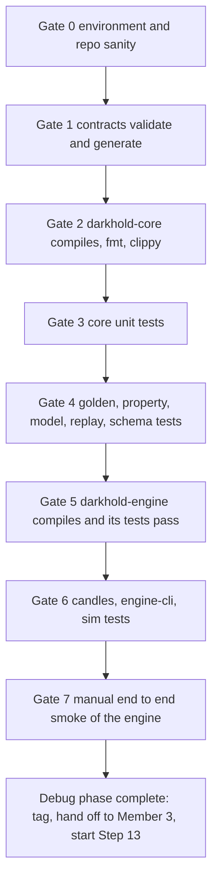
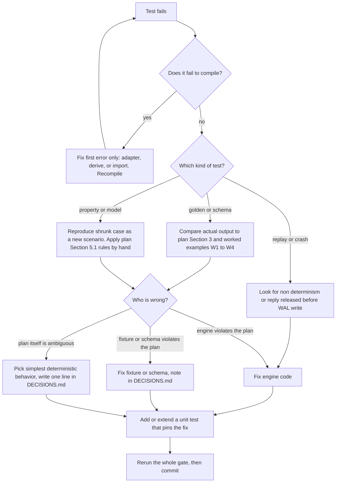

# Debugging phase plan (Member 1, Steps 1 to 12 written, nothing verified yet)

## 0. Where you are

| Step | Content | State |
|---|---|---|
| 0 to 2 | Root files, contracts v1, core types | Written. Verify |
| 3, 4 | `book`, `matcher`, `validate`, `outcome`, `view`, `engine` | Drop-in. **Never compiled** |
| 5 | 24 golden scenarios, property, model, replay tests | Drop-in. **Never run** |
| 6 to 8 | `darkhold-engine` shell, WAL, recovery, metrics, queries | Drop-in. **Never compiled** |
| 9, 10 | Integration and crash tests, full CLI, candles | Drop-in. **Never run** |
| 11, 12 | History seeder, seed data, sim foundations | Drop-in. **Never run** |
| 13 to 17 | Personas, director, control server, Compose, bench | **Not started. Do not start until Gate 7 passes** |

The drop-ins were assembled against the **plan's** API, not against your actual Step 2 code. Expect mismatches. That is normal. Fix them in the adapter spots listed in Section 5.

## 1. Rules for this phase

1. **One gate at a time, in order.** A later gate cannot be trusted while an earlier one is red.
2. **Commit when a gate turns green.** One commit per gate, message `gate N green: <what>`. Never commit red code to the shared branch.
3. **Never edit the spec to make a test pass.** A failing test means code, fixture, or adapter is wrong. Decide which with the triage flow (Section 6).
4. **Do not delete or `#[ignore]` a failing test.** Isolate it, reproduce it, fix the cause.
5. **Time-box.** After 45 minutes on one failure, write a minimal reproduction and ask for help with the full output (Section 8).
6. **Keep `docs/DEBUG_LOG.md`** (Section 9). One line per fix. It becomes your handover notes.

## 2. Gate order



## 3. Gate by gate

### Gate 0: environment and repo sanity

Run from `matching_engine/` unless noted.

```bash
git status --short            # everything intended is tracked, no target/ node_modules/ data/ listed
rustc --version && cargo --version     # matches rust-toolchain.toml
node --version                         # v20.x
cat engine/Cargo.toml                  # members list only crates that exist on disk
cat package.json                       # workspaces: contracts, packages/*, sim, bench, tools/*  (no api, no web)
```

Pass when: toolchain matches, `.gitignore` covers `engine/target`, `node_modules`, `dist`, `data/`, `.env`, and `Cargo.toml` members exist.
Common failures: a workspace member folder is missing (`bench` before Step 17 exists), so remove it from `package.json` until the folder exists.

### Gate 1: contracts

```bash
npm install
npm run validate -w contracts
npm run generate -w contracts && git diff --stat contracts/generated
```

Pass when: validate exits 0 over every schema and fixture, and `generated/types.ts` exists.
If golden validation fails here, the **fixture and schema disagree**. Compare the event in the failing fixture to Section 3.3 of the plan. The schema is derived from the plan, so fix the schema or fixture, not the Rust code.

### Gate 2: core compiles

```bash
cd engine
cargo check -p darkhold-core --all-targets
cargo fmt --all
cargo clippy -p darkhold-core --all-targets -- -D warnings
```

Fix compile errors **top to bottom, first error only, then re-run** (later errors are often consequences of the first).

Expected error classes and where to fix:

| Error pattern | Cause | Fix location |
|---|---|---|
| `no method named ...` or wrong argument type on `AssetId`, `OrderId`, `Engine` | Drop-in assumed a different Step 2 API | The adapter block in `tests/support/common.rs`, and the call site in `engine.rs` (adjust to your real signatures) |
| `trait Serialize not implemented` for `Command`, `EventEnvelope`, `CommandReply`, `BookView` | A derive is missing in Step 2 or Step 4 types | Add the derive on the type |
| Variant shape mismatch (`EventBody::AssetHalted` unit vs struct) | Step 2 differs from the assumption | Match to Step 2. Keep wire shape per plan Section 3.3 |
| Missing `pub use` in `lib.rs` | Append from `lib_append_S3_S4.txt` not applied | Apply it, delete the txt |
| Clippy lint failures | Style only | Fix the lint, do not `allow` blanket lints |

### Gate 3: core unit tests

```bash
cargo test -p darkhold-core --lib
```

Pass when: all unit tests in `types`, `command`, `config`, `fingerprint`, `book`, `matcher`, `validate`, `outcome`, `view`, `engine` pass.
Specific checks worth your attention:
- `fingerprint`: the fixed-input hash test must match the hard-coded value. A mismatch means the canonical string or the FNV constants are wrong (plan Section 2.2 item 15).
- `book`: tombstone compaction test (queue length above `2 * live_count + 32`) must trigger and keep FIFO.
- `validate`: ordering test (first failing check wins) must pass.

### Gate 4: golden, property, model, replay, schema

Run one file at a time:

```bash
cargo test -p darkhold-core --test schemas
cargo test -p darkhold-core --test golden
cargo test -p darkhold-core --test scenarios
cargo test -p darkhold-core --test replay
cargo test -p darkhold-core --test model
PROPTEST_CASES=2000 cargo test -p darkhold-core --test properties
```

Reading failures:

| Failing test | Meaning | First action |
|---|---|---|
| `schemas` | Engine output does not match a schema | Print the offending JSON, compare field by field to Section 3 of the plan |
| `golden` one scenario | Engine output differs from the fixture | Triage flow (Section 6). Run only that scenario with the test filter and `-- --nocapture` |
| `replay` | Determinism rule D8 broken | Look for hash-map iteration, time reads, or unsorted output in `engine.rs`, `book.rs`, `view.rs` |
| `model` | Engine and naive reference disagree | The test prints the first differing command. Reproduce it as a scenario, decide who is right by the matching rules in plan Section 5.1 |
| `properties` | An invariant failed | Proptest prints a shrunk case. **Commit the generated `proptest-regressions/` file**, then fix the bug |

Hard anchors that are independent of any fixture (verify these by hand if a golden disagrees): plan Section 5.3 worked examples W1 to W4. The drop-in notes say S09, S17, S14 match W2, W3, W4.

Do not run `UPDATE_GOLDEN=1` to "fix" a diff. It is only for generating a new file, and every regenerated file must be reviewed line by line against plan Section 5.

### Gate 5: `darkhold-engine`

First apply the manual steps from the Step 6, 7, 8, 9 notes if you have not (routes in `http/mod.rs`, `outcomes_count`, `AppState` field names, `Cargo.toml` deps).

```bash
cargo check -p darkhold-engine --all-targets
cargo clippy -p darkhold-engine --all-targets -- -D warnings
cargo test -p darkhold-engine --lib
cargo test -p darkhold-engine --test wal_tests
cargo test -p darkhold-engine --test recovery_tests
cargo test -p darkhold-engine --test ring_tests
cargo test -p darkhold-engine --test http_tests
cargo test -p darkhold-engine --test sse_tests
cargo test -p darkhold-engine --test http_full_tests
cargo test -p darkhold-engine --test sse_guard_tests
cargo test -p darkhold-engine --test crash_tests
```

Pass when: all green, and `crash_tests` passes at its default iteration count. Then run `CRASH_ITERATIONS=50 cargo test -p darkhold-engine --test crash_tests` once and leave it passing.

Reading failures:

| Failing area | Likely cause |
|---|---|
| `wal_tests` torn tail | Truncation offset off by the record header size, or CRC covering the wrong bytes (CRC covers type byte plus payload) |
| `recovery_tests` equality | Replay not using the same `process` path, or `ts` not taken from the record |
| Release ordering test | Replies or ring pushes happening before the WAL call returns in `core_thread.rs` |
| `http_tests` 503 test | `try_send` not used, or queue capacity not honored |
| SSE guard tests | Guard order wrong. Required order: token, epoch mismatch, after in future, gone, subscriber cap |
| `crash_tests` | An acknowledged command missing after restart means a reply was released before durability |
| "binary not found" | `CARGO_BIN_EXE_darkhold-engine` name differs from your package or bin name. Edit the one line in `tests/harness/mod.rs` |

### Gate 6: TypeScript packages

```bash
cd ..                                   # matching_engine/
npm install
npm run build -w @darkhold/candles && npm test -w @darkhold/candles
npm run build -w engine-cli && npm test -w engine-cli
npm run seed:fixture -w sim
npm run validate -w contracts           # now includes the seeded candles file
npm run typecheck -w sim && npm test -w sim
node ops/seed/generate.mjs --check      # run from the repo root if your path needs it
```

Pass when: all green, `candles.seeded.json` validates, the supply check in the seed generator passes.
Checks: running `seed:fixture` twice must give byte-identical files (determinism). If they differ, the PRNG, ordering of assets, or an unsorted object key is the cause.

### Gate 7: manual end-to-end smoke of the engine

Port warning for macOS: the default `7000` is used by AirPlay Receiver on recent macOS. Use another port locally (below) or turn the receiver off.

Terminal A:

```bash
cd matching_engine/engine
ENGINE_TOKEN=dev ENGINE_BIND=127.0.0.1:7070 WAL_DIR=./data/dev FSYNC_POLICY=batch LOG_LEVEL=debug \
  cargo run --release -p darkhold-engine
```

Terminal B (tail), Terminal C (commands). Set `ENGINE_URL=http://127.0.0.1:7070` and `ENGINE_TOKEN=dev` in both. Use `--help` of each `engine-cli` command if flags differ from the plan.

| # | Action (terminal C) | Expect |
|---|---|---|
| 1 | `health` | `ok`, an epoch like `e-xxxxxxxx`, `seq 0` |
| 2 | `configure TEST-A` tick 1, min 1, max 1000, no collar, active | reply `OK seq 1`; tail shows `AssetConfigured` and a `book` event |
| 3 | submit U1 SELL 5 @ 100 (order A) | `ACCEPTED seq 2 last_seq 2` |
| 4 | submit U2 BUY 8 @ 105 (order B) | `ACCEPTED seq 3 last_seq 6`. Tail: `OrderAccepted`, `TradeExecuted price 100 qty 5 buy_remaining 3 sell_remaining 0`, `OrderFilled A`, `OrderPartiallyFilled B filled 5 remaining 3`. `trade_id` is `<epoch>:4` |
| 5 | same submit as step 4 again | same reply with `duplicate true`, **no** new events, seq unchanged |
| 6 | `book TEST-A` | one bid level price 105 qty 3 orders 1, no asks |
| 7 | cancel B | `CANCELED remaining_qty 3 seq 7`; tail: `OrderCanceled reason USER` |
| 8 | cancel B again | `ALREADY_CANCELED duplicate true`, no event |
| 9 | cancel A | `ALREADY_FILLED seq null` |
| 10 | submit with a wrong token (`ENGINE_TOKEN=bad`) | HTTP 401 |
| 11 | submit price 0 | HTTP 200 `REJECTED INVALID_PRICE`, `OrderRejected` event |
| 12 | `tail --after 3` in a new terminal | prints events from seq 4 onward only |
| 13 | `kill -9` the engine, restart it with the same env | same epoch, `seq` 7 (or 8 if step 11 ran), `open-orders` empty, `order <B>` shows `CANCELED filled 5 remaining 3` |
| 14 | `tail --after 7 --epoch <epoch>` | works. With a wrong epoch: HTTP 409 `EPOCH_MISMATCH`. With `--after 9999`: 409 `AFTER_IN_FUTURE` |
| 15 | Stop engine, delete `data/dev/commands.wal`, start again | **new epoch**, `seq 0`. Old epoch in `tail --epoch` gives 409 |
| 16 | `metrics` | JSON with queue, latency percentiles, wal fsync count, books |

Pass when: every row matches. This is your proof the engine meets the contract. Save the terminal output as `docs/smoke-gate7.txt`.

## 4. Debugging tools to use

| Need | Tool |
|---|---|
| See Rust backtrace | `RUST_BACKTRACE=1` |
| Print test output | `cargo test <name> -- --nocapture` |
| Run one test or one scenario | `cargo test -p darkhold-core --test golden S05` (filter by name) |
| More random cases | `PROPTEST_CASES=10000` |
| Periodic internal invariant check in the engine | `PARANOID=1` (env). Aborts on violation |
| Engine logs | `LOG_LEVEL=debug`, `LOG_FORMAT=pretty` |
| Compare two event lists | Print both as JSON, diff by `seq` |
| Watch live events | `engine-cli tail` |
| Inspect what the engine thinks | `engine-cli open-orders`, `order <id>`, `book <asset>`, `metrics` |

## 5. Known trouble spots (from the drop-in notes)

| Spot | What to check |
|---|---|
| `tests/support/common.rs` "ADAPTER" block | Single place mapping the plan's `Engine` API to yours. Fix signatures here first |
| `Engine::process` signature | Takes `(Command, u64)` and returns a struct with `ts_used`, `events`, `reply`. `core_thread.rs` depends on it |
| Serialization shape | `BookView` bids and asks are arrays of `{price, qty, orders}`. `CommandReply` always includes `seq` (null when none), `last_seq`, `engine_epoch`, `duplicate` |
| `EventBody` variants | `AssetHalted` and `AssetResumed` have no extra fields. Event JSON must carry `type`, `engine_epoch`, `seq`, `ts`, `asset` |
| `AppState` field names | `tx, config, ring, slot, metrics, core_alive, epoch`. Handlers must match |
| `Config` fields | `command_timeout_ms`, `snapshot_depth` and others listed in the Step 7, 8 notes must exist |
| Env names | `RING_CAPACITY`, `SSE_MAX_SUBSCRIBERS`, `SSE_HEARTBEAT_MS`, `SNAPSHOT_TICK_MS`, `FSYNC_POLICY` |
| Binary name | `darkhold-engine` for `CARGO_BIN_EXE_...` |
| `Cargo.toml` | Release profile `panic = "abort"`, `lto = "thin"`, `codegen-units = 1`. Bench entry for criterion in core |
| macOS durability | fsync cost and semantics on macOS differ from Linux. Note this in `DECISIONS.md` and in every benchmark report, never compare numbers across machines |

## 6. Triage flow when a test fails



Authority order: plan, then contract document, then fixtures, then code.

## 7. Done-when for the debugging phase

- [ ] Gates 0 to 7 all pass on a clean clone (`git clone` into a new folder, run the commands again).
- [ ] 24 golden scenarios, property, model, replay tests green.
- [ ] `crash_tests` green at 50 iterations.
- [ ] `docs/smoke-gate7.txt` saved and every row matches.
- [ ] `cargo fmt --check` and clippy with warnings denied pass for the whole workspace.
- [ ] `docs/DEBUG_LOG.md` and `docs/DECISIONS.md` updated.
- [ ] Commit tagged `member1-milestone-m1` (walking skeleton plus durability).

## 8. How to ask the coding agent for fixes (keeps it from redesigning things)

Send exactly this, per failure:

1. The **gate and the command** you ran.
2. The **complete error output** (not a screenshot, not a summary).
3. The **full contents of the failing file and any file named in the first error**.
4. The sentence: "The specification is `docs/matching_engine_plan.md` and `docs/engine_backend_contract.md`. Do not change behavior, wire format, fixtures, or file layout. Change only what is needed to make this failure pass. If you believe the spec itself is wrong, stop and say so instead of changing it."
5. After the fix: ask for **one test that would have caught it**.

## 9. `docs/DEBUG_LOG.md` format

```text
YYYY-MM-DD gate N | file | symptom | root cause | fix | test added
```

Log every fix, including adapter changes. Anyone reviewing the engine reads this first.

## 10. After the debugging phase

1. **Hand off the engine to Member 3 now.** Give them: how to run it (compose is not ready yet, so the cargo command from Gate 7), the URL and token, `docs/engine_backend_contract.md`, `contracts/` folder, and `docs/smoke-gate7.txt` as proof. Ask them for: the REST field names and WebSocket message shapes (they go only into `sim/src/apiClient.ts` and `sim/src/marketFeed.ts`), the admin reconciliation endpoint and settlement metric keys, and the seed commands.
2. **Tell Member 2** where the fixtures and `candles.seeded.json` are, and that the contract folder is the source of truth.
3. **Continue the plan in this order:** Step 13 (personas, regimes), Step 14 (director, control server), Step 15 (Compose, Dockerfiles, smoke, reset, CI), Step 16 (`darkhold-bench`), Step 17 (k6, chaos, report). Ask the coding agent for each step with the same drop-in style, and run the same gate routine (compile, unit, integration, manual check) before moving on.
4. **Keep the branch healthy:** open a pull request for the engine and contracts now (small, reviewable), keep sim, ops, and bench as separate pull requests.