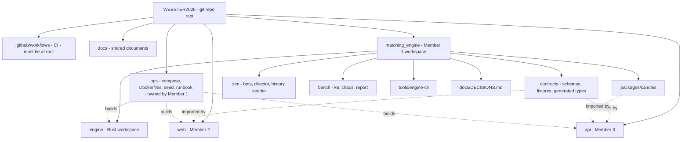

# Member 1 folder structure review and complete target layout

## 1. Verdict

Your `matching_engine/` folder is **correct and usable**. Inside it, `engine/`, `contracts/`, `docs/DECISIONS.md`, `package.json`, `.nvmrc` and `.gitignore` all match the plan, and `matching_engine/` plays the role of the plan's `darkhold/` root. Relative paths inside it (for example the Rust tests reaching `contracts/`) stay valid.

**Three things must change**, and a few small files are missing. Everything else stays.

| # | Change | Why | Priority |
|---|---|---|---|
| 1 | `.github/workflows/ci.yml` goes at the **git repo root**, not inside `matching_engine/` | GitHub only reads workflows from the repository root | Required |
| 2 | `ops/` (Compose, Dockerfiles, seed data, runbook, smoke test) goes at the **repo root** | It builds `api/` and `web/` too, so it is not Member 1 only. Nesting it forces `../../api` paths | Strongly recommended |
| 3 | Remove `api` and `web` from the `workspaces` list in `matching_engine/package.json` | Those folders are not inside `matching_engine/`. npm workspaces cannot point outside their root | Required |
| 4 | Add missing Step 0 files: `tsconfig.base.json`, `.editorconfig`, `README.md` | Step 0 is not complete without them | Required |
| 5 | Rename `docs/mem1.md` to `docs/member1_guide.md`, and add the integration contract as `docs/engine_backend_contract.md` | Members 2 and 3 need to find the contract at the shared level | Recommended |
| 6 | In `engine/Cargo.toml`, list only workspace members that exist (`crates/darkhold-core` for now) | Cargo fails if a listed member folder is missing | Required |

**Decision: keep `contracts/` inside `matching_engine/`.** It must stay there because the npm workspaces and the Rust test path depend on it. Members 2 and 3 import from `matching_engine/contracts/`. If you hoist it to the repo root at merge time, only two paths change:
- the Rust schema test path (`../../../contracts` becomes `../../../../contracts`),
- the workspace entry (that needs a root-level workspace, which is why I advise against it).

## 2. Where everything lives



## 3. What you already have (checked against your screenshot)

| Item | Status | Note |
|---|---|---|
| `docs/matching_engine_plan.md` (repo root docs) | OK | Keep |
| `docs/mem1.md` | Rename | To `member1_guide.md` |
| `matching_engine/docs/DECISIONS.md` | OK | Step 0 |
| `matching_engine/contracts/` | Collapsed, verify | Check against Section 6 |
| `engine/Cargo.toml` (workspace) and `engine/rust-toolchain.toml` | OK | Run all `cargo` commands from `matching_engine/engine` |
| `crates/darkhold-core/Cargo.toml` | OK | |
| `src/` with `types`, `error`, `command`, `config`, `event`, `reply`, `fingerprint`, `lib` | OK | All eight Step 2 files present |
| `tests/schemas.rs` and `tests/support/` | OK | Verify `support/mod.rs` exists |
| `matching_engine/package.json`, `.nvmrc`, `.gitignore` | OK | Fix workspaces (change 3) |
| `tsconfig.base.json`, `.editorconfig`, `README.md` | **Missing** | Create (change 4) |
| `Cargo.lock` | Not yet | Appears after the first build. **Commit it** |
| All files showing `U` | Untracked | `git add` them on your branch |

**Step gates to confirm before moving on.**
- Step 1 done when: the contracts `validate` script passes and `generate` produced `generated/types.ts`.
- Step 2 done when: `cargo test -p darkhold-core` passes, including the schema test for events and replies.

**Path rule for `tests/schemas.rs`:** locate `contracts/` from the crate folder (`CARGO_MANIFEST_DIR` plus `../../../contracts`). Never use an absolute path or the working directory.

## 4. Complete target structure

Legend: `(done)` you already have it. `(S#)` is the build step from the coding plan where it gets created. `(opt)` means optional.

### 4.1 Repository root

```text
WEBSTER2026/
├── .github/
│   └── workflows/
│       └── ci.yml                         (S15) engine, packages, contracts, smoke, bench-smoke jobs
│                                          cargo steps use working directory matching_engine/engine,
│                                          npm steps use matching_engine
├── docs/
│   ├── matching_engine_plan.md            (done) coding plan, single source of truth
│   ├── member1_guide.md                   rename of mem1.md
│   ├── engine_backend_contract.md         add: integration contract for Member 3
│   └── blueprint.md                       (opt) main project blueprint
├── ops/                                   (S15) cross-team, Member 1 owns
│   ├── docker-compose.yml
│   ├── docker-compose.dev.yml
│   ├── .env.example
│   ├── engine.Dockerfile                  build context is the repo root, copies matching_engine/engine
│   ├── sim.Dockerfile                     copies matching_engine/sim, packages, contracts
│   ├── RUNBOOK.md
│   ├── seed/
│   │   ├── generate.mjs                   (S11) deterministic generator
│   │   ├── assets.json                    (S11)
│   │   ├── accounts.json                  (S11)
│   │   ├── bench-accounts.json            (S11)
│   │   ├── candles.seeded.json            (S11) output of the history seeder
│   │   └── README.md                      loading order for Member 3's seed command
│   └── scripts/
│       ├── smoke.mjs                      (S15)
│       ├── reset-demo.sh                  (S15)
│       └── wait-healthy.sh               (S15)
├── api/                                   Member 3
├── web/                                   Member 2
└── matching_engine/                       Member 1 workspace (below)
```

### 4.2 `matching_engine/` top level

```text
matching_engine/
├── package.json                           (done) workspaces: contracts, packages/*, sim, bench, tools/*
│                                          add each workspace only once its folder exists
├── tsconfig.base.json                     (S0) missing
├── .editorconfig                          (S0) missing
├── .nvmrc                                 (done) Node 20
├── .gitignore                             (done) must ignore: engine/target, node_modules, dist,
│                                          .env, any WAL data folder (data/), bench/results/*
│                                          except .gitkeep, .DS_Store
├── README.md                              (S0) missing: layout, how to run cargo and npm, owners
├── docs/
│   └── DECISIONS.md                       (done) one line per decision you had to make
├── contracts/                             (S1) see 4.3
├── engine/                                (S2 to S9) see 4.4
├── packages/
│   └── candles/                           (S10) see 4.5
├── sim/                                   (S12 to S14, S11 for history) see 4.6
├── bench/                                 (S17) see 4.7
└── tools/
    └── engine-cli/                        (S6 minimal, S9 full) see 4.8
```

### 4.3 `contracts/` (Step 1)

```text
contracts/
├── VERSION                                1.0.0
├── CHANGELOG.md
├── package.json                           ajv, ajv-formats, json-schema-to-typescript
├── error-codes.json                       engine rejects, engine transport codes, api codes (Member 3 appends)
├── schemas/
│   ├── command.submit-order.schema.json
│   ├── command.cancel-order.schema.json
│   ├── command.configure-asset.schema.json
│   ├── command.asset-status.schema.json   halt and resume
│   ├── reply.command.schema.json
│   ├── event.envelope.schema.json         oneOf every event type
│   ├── book.snapshot.schema.json
│   ├── sse.hello.schema.json
│   ├── order.outcome.schema.json
│   ├── open-orders.schema.json
│   ├── error.envelope.schema.json
│   ├── health.schema.json
│   ├── seeded-candles.schema.json
│   └── candle.schema.json
├── fixtures/
│   ├── engine/
│   │   ├── ids.json                       fixed uuids for orders A, B, C, D, M and so on
│   │   ├── scenarios/                     24 golden files (commands first at S1, expected output at S5)
│   │   │   ├── S01-limit-buy-rests.json
│   │   │   ├── S02-exact-cross.json
│   │   │   ├── S03-taker-partial.json
│   │   │   ├── S04-maker-partial.json
│   │   │   ├── S05-multi-level-sweep.json
│   │   │   ├── S06-fifo-same-price.json
│   │   │   ├── S07-price-priority.json
│   │   │   ├── S08-maker-price.json
│   │   │   ├── S09-market-ioc-remainder.json
│   │   │   ├── S10-market-no-liquidity.json
│   │   │   ├── S11-protection-price-limit.json
│   │   │   ├── S12-cancel-resting.json
│   │   │   ├── S13-cancel-partially-filled.json
│   │   │   ├── S14-cancel-after-fill.json
│   │   │   ├── S15-cancel-twice.json
│   │   │   ├── S16-cancel-unknown.json
│   │   │   ├── S17-self-trade-prevented.json
│   │   │   ├── S18-self-trade-after-fill.json
│   │   │   ├── S19-duplicate-same-payload.json
│   │   │   ├── S20-order-id-reused.json
│   │   │   ├── S21-validation-codes.json
│   │   │   ├── S22-halt-and-resume.json
│   │   │   ├── S23-tombstone-fifo.json
│   │   │   └── S24-event-order.json       (names are suggestions, the Sxx prefix is what matters)
│   │   └── errors/                        one example per transport error envelope
│   └── market/
│       └── candles.seeded.json            (S11) generated, committed
├── scripts/
│   ├── validate-fixtures.mjs
│   └── generate-types.mjs
└── generated/
    └── types.ts                           generated, committed, CI fails if stale
```

### 4.4 `engine/` (Steps 2 to 9)

```text
engine/
├── Cargo.toml                             (done) workspace, members added as crates appear
├── Cargo.lock                             generated, commit it
├── rust-toolchain.toml                    (done)
├── README.md                              (S9)
└── crates/
    ├── darkhold-core/                     pure library, no tokio, no I/O
    │   ├── Cargo.toml                     (done)
    │   ├── src/
    │   │   ├── lib.rs                     (done)
    │   │   ├── types.rs                   (done)
    │   │   ├── error.rs                   (done)
    │   │   ├── command.rs                 (done)
    │   │   ├── config.rs                  (done)
    │   │   ├── event.rs                   (done)
    │   │   ├── reply.rs                   (done)
    │   │   ├── fingerprint.rs             (done)
    │   │   ├── book.rs                    (S3)
    │   │   ├── matcher.rs                 (S3)
    │   │   ├── validate.rs                (S4)
    │   │   ├── outcome.rs                 (S4)
    │   │   ├── view.rs                    (S4)
    │   │   └── engine.rs                  (S4) the deterministic state machine
    │   ├── tests/
    │   │   ├── support/
    │   │   │   ├── mod.rs                 (S2) helpers, fixed epoch e-test0001
    │   │   │   └── reference.rs           (S5) naive reference matcher, shares no code with book.rs
    │   │   ├── schemas.rs                 (done)
    │   │   ├── golden.rs                  (S5)
    │   │   ├── scenarios.rs               (S5)
    │   │   ├── properties.rs              (S5)
    │   │   ├── model.rs                   (S5)
    │   │   └── replay.rs                  (S5)
    │   └── benches/
    │       └── matching.rs                (S5) criterion micro benchmarks
    │
    ├── darkhold-engine/                   binary plus library (tokio shell)
    │   ├── Cargo.toml                     (S6)
    │   ├── src/
    │   │   ├── main.rs                    (S6) wiring and boot sequence only
    │   │   ├── lib.rs                     (S6) exposes modules for the bench crate
    │   │   ├── config.rs                  (S6) environment parsing
    │   │   ├── jobs.rs                    (S6) Job and Query types
    │   │   ├── core_thread.rs             (S6, WAL added S7) the sequencer loop
    │   │   ├── time.rs                    (S6) the only wall-clock read
    │   │   ├── ring.rs                    (S6) event ring for SSE resume
    │   │   ├── state.rs                   (S6)
    │   │   ├── shutdown.rs                (S6)
    │   │   ├── wal.rs                     (S7)
    │   │   ├── recovery.rs                (S7)
    │   │   ├── book_slot.rs               (S8) latest book snapshot per asset
    │   │   ├── metrics.rs                 (S8)
    │   │   └── http/
    │   │       ├── mod.rs                 (S6) router
    │   │       ├── auth.rs                (S6) X-Engine-Token middleware
    │   │       ├── errors.rs              (S6)
    │   │       ├── commands.rs            (S6)
    │   │       ├── events.rs              (S6) SSE
    │   │       ├── queries.rs             (S8)
    │   │       └── health.rs              (S8)
    │   └── tests/
    │       ├── http_tests.rs              (S6)
    │       ├── sse_tests.rs               (S6, guards at S9)
    │       ├── ring_tests.rs              (S6)
    │       ├── wal_tests.rs               (S7)
    │       ├── recovery_tests.rs          (S7)
    │       └── crash_tests.rs             (S9)
    │
    └── darkhold-bench/                    (S16)
        ├── Cargo.toml
        └── src/
            ├── main.rs                    subcommands core, core-wal, http
            ├── gen.rs                     seeded command generator
            ├── runner_core.rs             S1
            ├── runner_core_wal.rs         S1b
            ├── runner_http.rs             S2
            ├── hist.rs
            └── report.rs
```

### 4.5 `packages/candles/` (Step 10)

```text
packages/candles/
├── package.json                           name @darkhold/candles
├── tsconfig.json
├── tsup.config.ts
├── vitest.config.ts
├── src/
│   ├── index.ts
│   ├── types.ts
│   ├── intervals.ts
│   ├── bucket.ts
│   ├── aggregator.ts
│   └── rebuild.ts
└── tests/
    ├── bucket.test.ts
    ├── aggregator.test.ts                 rollover, gaps, duplicates, flush, restore
    └── rebuild.test.ts
```

### 4.6 `sim/` (Steps 11 to 14)

```text
sim/
├── package.json
├── tsconfig.json
├── vitest.config.ts
├── .env.example
├── assets.profile.json                    asset to HIGH, MEDIUM, THIN
├── src/
│   ├── main.ts                            (S12)
│   ├── config.ts                          (S12)
│   ├── params.ts                          (S12) every tunable constant lives here
│   ├── rng.ts                             (S12) seeded xoshiro128**
│   ├── clock.ts                           (S12)
│   ├── scheduler.ts                       (S12)
│   ├── accounts.ts                        (S12)
│   ├── apiClient.ts                       (S12) only file that knows Member 3's REST field names
│   ├── assets.ts                          (S12)
│   ├── marketFeed.ts                      (S12)
│   ├── ownState.ts                        (S12)
│   ├── log.ts                             (S12)
│   ├── metrics.ts                         (S12)
│   ├── regime.ts                          (S13)
│   ├── personas/                          (S13)
│   │   ├── base.ts
│   │   ├── marketMaker.ts
│   │   ├── noiseTrader.ts
│   │   ├── momentumTrader.ts
│   │   ├── profitTaker.ts
│   │   ├── canceler.ts
│   │   └── auctionSniper.ts               (opt)
│   ├── director/                          (S14)
│   │   ├── scenarios.ts
│   │   └── director.ts
│   ├── control/
│   │   └── server.ts                      (S14)
│   └── history/                           (S11)
│       ├── generator.ts
│       ├── profiles.ts
│       ├── writer.ts
│       └── cli.ts
└── tests/
    ├── rng.test.ts
    ├── scheduler.test.ts
    ├── marketMaker.test.ts
    ├── noiseTrader.test.ts
    ├── momentum.test.ts
    ├── profitTaker.test.ts
    ├── canceler.test.ts
    ├── history.test.ts
    └── control.test.ts
```

### 4.7 `bench/` (Step 17)

```text
bench/
├── package.json
├── REPORT_TEMPLATE.md
├── k6/
│   ├── config.json
│   ├── s3-full-path.js
│   ├── s4-burst.js
│   ├── s5-soak.js
│   └── lib/
│       ├── rng.js
│       ├── auth.js
│       └── orders.js
├── scripts/
│   ├── collect-metrics.mjs
│   ├── wait-drain.mjs
│   ├── run-recon.mjs
│   ├── chaos-kill-engine.sh
│   ├── chaos-restart-api.sh
│   ├── run-s3.sh
│   ├── run-s6.sh
│   └── report.mjs
├── analysis/
│   └── plots.py                           (opt) the only Python file in the project
└── results/
    └── .gitkeep                           results are committed only when you publish them on purpose
```

### 4.8 `tools/engine-cli/` (Steps 6 and 9)

```text
tools/engine-cli/
├── package.json                           binary engine-cli
├── src/
│   ├── index.ts                           commands: configure, submit, cancel, halt, resume,
│   │                                      book, order, open-orders, tail, health, metrics
│   └── client.ts
└── tests/
    └── args.test.ts
```

## 5. Path adjustments caused by this layout

The coding plan was written as if `matching_engine/` were the repo root and `ops/` lived next to `engine/`. With the layout above, apply these substitutions when implementing:

| Plan says | Use instead |
|---|---|
| `ops/seed/...` from code in `matching_engine/` | `../ops/seed/...` (run npm scripts from `matching_engine/`) |
| `seed:history` default output `ops/seed/candles.seeded.json` | `../ops/seed/candles.seeded.json` relative to `matching_engine/` |
| CI `engine` job | working directory `matching_engine/engine` |
| CI `packages`, `contracts` jobs | working directory `matching_engine` |
| `engine.Dockerfile` | build context is the repo root, copy `matching_engine/engine` |
| `sim.Dockerfile` | copy `matching_engine/sim`, `matching_engine/packages/candles`, `matching_engine/contracts` |
| Compose build contexts | `./api`, `./web`, `./matching_engine/...` from the repo root `ops/` file (use `..` relative to `ops/`) |
| Workspace list in `matching_engine/package.json` | `contracts`, `packages/*`, `sim`, `bench`, `tools/*` only |
| Docs references to `docs/DECISIONS.md` | `matching_engine/docs/DECISIONS.md` |

## 6. Commands for the fixes (run from the repo root)

```bash
mv docs/mem1.md docs/member1_guide.md
mkdir -p .github/workflows ops/seed ops/scripts
touch matching_engine/tsconfig.base.json matching_engine/.editorconfig matching_engine/README.md
git add -A
```

Then:
1. Edit `matching_engine/package.json`: remove `api` and `web` from `workspaces`.
2. Check that `engine/Cargo.toml` lists only `crates/darkhold-core` as a member.
3. Add the interaction contract markdown as `docs/engine_backend_contract.md`.
4. Run `cargo test -p darkhold-core` from `matching_engine/engine` and the contracts `validate` script from `matching_engine`. When both pass, Steps 1 and 2 are done and Step 3 (`book.rs`, `matcher.rs`) is next.

## 7. Ownership summary

| Location | Owner | Others touch it? |
|---|---|---|
| `matching_engine/**` | Member 1 | Members 2 and 3 read `contracts/` and `packages/candles/` only |
| `ops/**`, `.github/**` | Member 1 | Members 2 and 3 add their own service entries and CI jobs through pull requests |
| `docs/**` | Shared | Everyone |
| `api/**` | Member 3 | No |
| `web/**` | Member 2 | No |