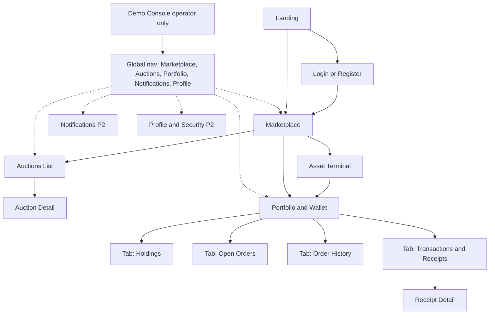
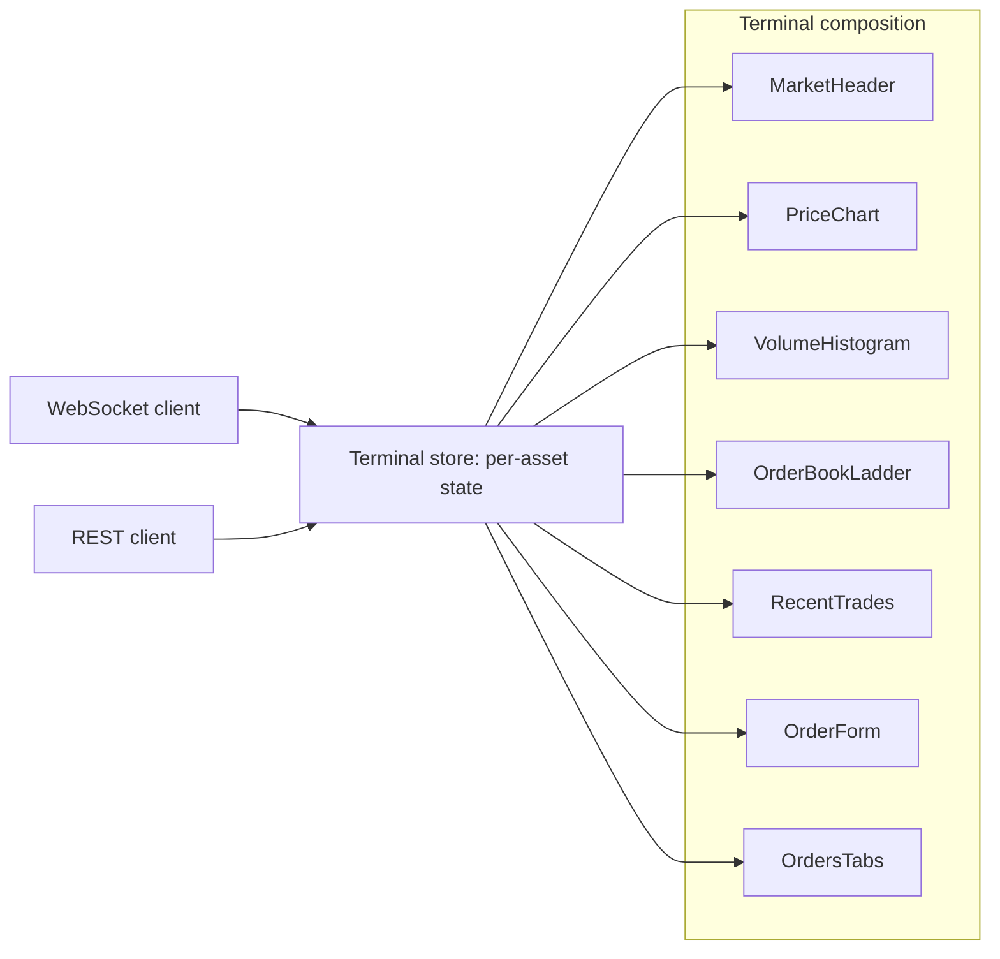
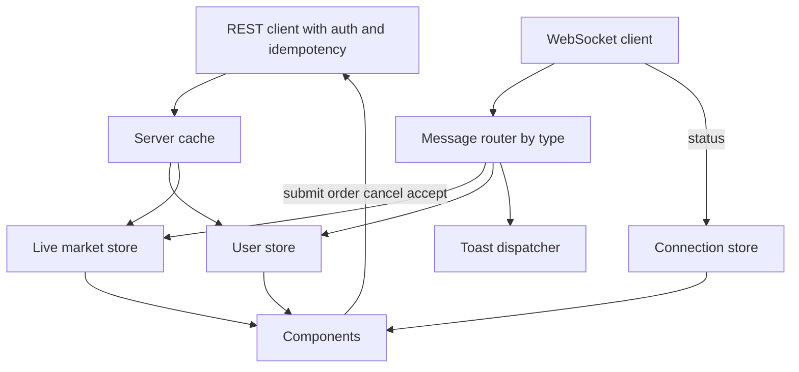
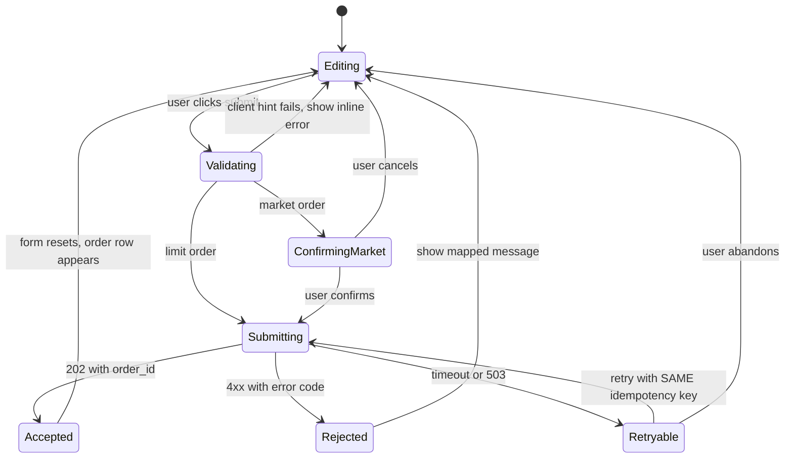
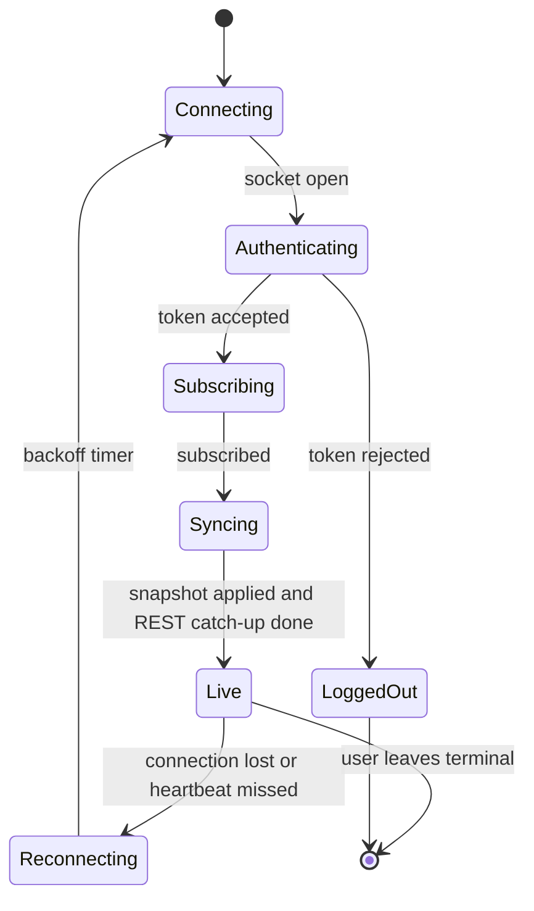

# THE DARKHOLD EXCHANGE — FRONTEND AND USER EXPERIENCE SPECIFICATION

> Owner: Member 2. Stack: Next.js, TypeScript, Tailwind, shadcn/ui, TradingView Lightweight Charts, REST plus WebSocket.
> Effort unit: pd = focused developer-day at hackathon fidelity. Cut lines: **A** = Pass Tier, **B** = Victory Tier, **C** = Optional.
> The frontend contains **no business logic**. It displays server truth, gives input hints, and explains errors. The server (`api`) is authoritative for ceilings, balances, reservations, and settlement.

---

## 1. UX principles

| # | Principle | Consequence in the UI |
|---|---|---|
| 1 | Server truth, never optimistic money | Balances, holdings, and order status always come from the server. No optimistic balance updates |
| 2 | Make exchange mechanics legible | Every term has a one-line tooltip (spread, best bid, partial fill, reserved, settling) |
| 3 | Show state transitions honestly | Distinct visual states for `PENDING_SUBMIT`, `OPEN`, `PARTIALLY_FILLED`, `FILLED`, `CANCELED`, `REJECTED`, and the trade chips "matched" vs "settling" vs "settled" |
| 4 | Label simulation everywhere | SIM badges on simulated trades, "Simulated history" shading on seeded candles, persistent "Includes simulated traders" notice |
| 5 | Never fabricate market data | No trades means no new candle and no price tick. Show data age ("no trades for 3m") instead |
| 6 | Explain every rejection | Each error code maps to a human message with the numbers that caused it |
| 7 | Degrade visibly | Disconnected, stale, and halted states are always shown, never silent |
| 8 | Safe by default | Confirm step for market orders, double-submit protection, no destructive action without feedback |
| 9 | One terminal, few pages | Smallest complete UX. Open orders, history, and transactions are tabs |
| 10 | Develop against mocks | Whole UI runs on fixtures and a mock server before the backend exists |

---

## 2. Information architecture



**Global shell (every authenticated page).**
- Top bar: logo, nav links, available balance (live), connection indicator (green connected, amber reconnecting, red offline), notification bell, user menu.
- Persistent footer strip: "Simulated market. Funds are simulated credits. Activity includes simulated traders."
- Toast region: order and settlement events.
- Global banners: asset halted, API unreachable, WebSocket disconnected.

**Priority ranking (by contribution to the demo).**

| Rank | Page | Priority | Cut | Effort |
|---|---|---|---|---|
| 1 | Asset Terminal | P0 | A | 6 pd |
| 2 | Marketplace | P0 | A | 1 pd |
| 3 | Portfolio and Wallet | P0 | A | 1.5 pd |
| 4 | Login and Register, app shell, mocks | P0 | A | 1.5 pd |
| 5 | Auctions list and detail | P0 | B | 1.5 pd |
| 6 | Demo Console | P0 | B | 1 pd |
| 7 | Toasts | P0 | A | 0.25 pd |
| 8 | Landing | P1 | B | 0.5 pd |
| 9 | Polish pass | P1 | B | 1.5 pd |
| 10 | Notification center, Profile and Security | P2 | C | 1 pd |

---

## 3. Visual and interaction design direction

**Theme.** Dark, high-contrast exchange dashboard with an occult "Darkhold" accent (deep crimson accent, parchment-toned secondary surfaces, monospaced numerals). The tone is dramatic in the shell and restrained inside the terminal so data stays readable.

**Design tokens (decide once, in Phase 0).**
- Colors: background, surface, border, text-primary, text-muted, accent, **bid/buy** (green family), **ask/sell** (red family), warning (amber), info, simulated (a distinct violet used only for SIM badges and seeded-history shading).
- Typography: display face for headings, a readable sans for UI, **tabular monospaced numerals for all prices and quantities** so columns align and flicker is minimal.
- Spacing and radius scale, elevation, focus ring.
- Color is never the only signal: buy/sell also carry text labels and icons.

**Motion.**
- Price flash (brief green or red background pulse) on last-price change.
- Order book rows fade in and out. Depth bars animate width.
- Candle updates are immediate. No easing on data.
- Respect reduced-motion preferences.

**Number formatting.**
- Prices are integer minor units on the wire. The UI formats them with a single shared formatter (currency symbol, fixed decimals).
- Quantities are integers.
- Large numbers use thousands separators. Percentages use one decimal.

---

## 4. Page-by-page specification

### 4.1 Landing (P1, Cut B, static)

- **Goal**: explain the product in one screen.
- **Shows**: headline, three value points (fair prices, real-time order book, Dutch auctions), "simulated market" notice, live ticker strip optional.
- **Actions**: Enter Marketplace, Login.
- **Data**: none (static). Optional public asset stats.
- **States**: static only.

### 4.2 Login and Register (P0, Cut A)

- **Goal**: obtain an account.
- **Shows**: email, password, inline password-policy hints, tab switch between login and register.
- **Actions**: register, login.
- **Data**: `POST /auth/register`, `POST /auth/login`.
- **Validation (client hints only)**: email format, password length. Server is authoritative.
- **Errors**: `EMAIL_TAKEN` shows inline on the email field. `UNAUTHENTICATED` shows a generic "email or password incorrect". `RATE_LIMITED` shows a countdown to retry.
- **Success**: redirect to Marketplace. Show starter credits in the top bar.
- **Loading**: submit button shows spinner and disables.

### 4.3 Marketplace (P0, Cut A)

- **Goal**: discover assets and pick one to trade.
- **Shows per asset card or row**: name, category, face value, **resale ceiling**, last price, change, best bid, best ask, available ask quantity, active-auction badge, liquidity hint, SIM activity badge.
- **Actions**: open terminal, open auction, filter by category, sort by price change or liquidity.
- **Data**: `GET /assets`, WebSocket `market` channel for stat ticks.
- **Real-time**: last price flashes, best bid and ask update live.
- **States**:
  - Loading: skeleton cards.
  - Empty: "No assets are listed yet."
  - Error: retry banner with request id.
  - Disconnected: prices show a "stale" badge and the page polls REST every 10 seconds.
  - Halted asset: card shows "Trading halted" and the terminal link opens read-only.
  - Thin market with no trades: shows last price with its age and a "Thin market" tag.

### 4.4 Asset Terminal (P0, Cut A) — see Section 5

### 4.5 Portfolio and Wallet (P0, Cut A)

- **Goal**: verify balances and ownership, manage orders.
- **Header cards**: available funds, reserved funds, total, holdings count.
- **Tabs**:
  - **Holdings**: per asset available and reserved units, market value at last price, quick links to sell or auction.
  - **Open Orders**: orders in `OPEN` or `PARTIALLY_FILLED` with fill progress and cancel button.
  - **Order History**: terminal-state orders (`FILLED`, `CANCELED`, `REJECTED`) with reason and average price.
  - **Transactions**: settled trades and auction sales with ledger transaction id and receipt link.
- **Actions**: cancel order, open receipt, navigate to asset.
- **Data**: `GET /me/wallet`, `/me/holdings`, `/me/orders`, `/me/transactions`, WebSocket `user:{id}`.
- **Receipt detail**: trade id, asset, quantity, price, counterparty (anonymized, SIM flag), timestamps for matched and settled, ledger transaction id, balances before and after.
- **States**:
  - Empty holdings: "No holdings yet. Browse the marketplace."
  - Settling rows show a "settling" chip with tooltip "Matched and final, settlement in progress."
  - Settlement failed rows show an amber state with "Funds remain reserved, support notified."
  - After cancel: row moves to history, reserved funds drop in the header.

### 4.6 Auctions list (P0, Cut B)

- **Goal**: find an auction to buy from.
- **Shows**: asset, current price (live), start price, floor, quantity, time remaining, status.
- **Actions**: open detail, filter by status.
- **Data**: `GET /auctions`, WebSocket `auction:{id}` per visible card (limit subscriptions).
- **States**: empty ("No active auctions"), sold or expired items show their final state.

### 4.7 Auction detail (P0, Cut B)

- **Goal**: accept the current price.
- **Shows**: large current price, countdown to next price step, decay curve with a "now" marker, start price, floor, ceiling note, quantity, seller badge, total cost, available balance.
- **Action**: **Accept at current price**. The request sends the displayed price as `max_price` and a fresh idempotency key.
- **Behavior**: the price display is client-side interpolated from the last `AuctionPriceUpdate` but is **only a display**. The server computes the real price.
- **Outcomes**:
  - Success: receipt panel, holdings updated, confetti-free confirmation.
  - `AUCTION_ALREADY_SOLD`: "Someone accepted just before you."
  - `INSUFFICIENT_FUNDS`: shows needed vs available, link to wallet.
  - `AUCTION_NOT_ACTIVE`: shows final status.
  - `PRICE_MOVED` (should not occur for a decaying price): refresh and retry.
- **Disconnected**: price shows stale badge and acceptance still works through REST.

### 4.8 Create auction (inside Auctions, P1, Cut B)

- **Form**: asset (from holdings), quantity, start price, floor price, step seconds, end time.
- **Client hints**: start must be at or below the ceiling (shown inline), floor at most start, preview of the decay curve.
- **Errors**: `PRICE_ABOVE_CEILING`, `INSUFFICIENT_HOLDINGS`, validation errors.

### 4.9 Notifications (P2)

- MVP: **toasts only** (Cut A).
- Optional (Cut C): notification center with persisted list and unread count.

### 4.10 Profile and security (P2, Cut C)

- Account email, password change, active session list, connection and rate-limit information.

### 4.11 Demo Console (P0, Cut B, operator role only)

- **Goal**: make the demo deterministic and verifiable.
- **Panels**:
  - Simulator: state (running, paused), mode (continuous, demo), start, pause.
  - Scenarios: wake market, sell wall, pump, scalper attempt, auction drop.
  - Health: engine status, consumer offset vs engine `seq`, pending settlement count, settlement lag, event-loop lag.
  - Reconciliation: run button, last verdict, per-check results R1 to R8.
  - Benchmark: latest report summary with link to the evidence artifact.
  - Controls: halt or resume asset, kill engine (chaos, optional), reset demo.
- **Data**: `/admin/*`, `/metrics`, `/healthz`.
- **States**: destructive actions require a confirm dialog. Results appear inline with timestamps.

---

## 5. Trading terminal specification

### 5.1 Layout

```text
+--------------------------------------------------------------------------+
| HEADER: asset name, category, SIM badge, halted banner if applicable      |
| Face value | Resale ceiling | Last price | Change | Best bid | Best ask   |
| Spread                                                                    |
+------------------------------------------+-------------------------------+
| CHART PANEL                              | ORDER BOOK (Level 2)          |
| Candlesticks + volume histogram          | Asks (top), spread row,       |
| Interval toggle: 5s | 1m                 | Bids (bottom), depth bars,    |
| Seeded history shading + label           | cumulative qty                |
| Live indicator and data age              |                               |
+------------------------------------------+-------------------------------+
| RECENT TRADES                            | ORDER FORM                    |
| time, price, qty, side, SIM tag          | Buy | Sell   Limit | Market   |
|                                          | qty, price, est cost/proceeds |
|                                          | ceiling hint, balance, submit |
+------------------------------------------+-------------------------------+
| TABS: Open Orders | Order History | Activity                              |
+--------------------------------------------------------------------------+
```



### 5.2 Panel behavior

**Market header.**
- Shows face value and ceiling with a tooltip: "Resale cap is X% of face value. Orders above it are rejected."
- Last price flashes on change and shows data age after 30 seconds without trades.
- Spread = best ask minus best bid. Shows "no spread" if either side is empty.

**Chart.**
- Candlesticks plus volume histogram on a shared time axis.
- Initial load: `GET /assets/:id/candles` for the selected interval.
- Live updates: `CandleUpdate` messages **upsert by open time** (replace the candle with the same open time, otherwise append).
- Seeded candles (`origin=SEEDED_SIM`) are visually shaded with a legend "Simulated history". A vertical "Live from here" marker separates them from engine candles.
- Interval toggle switches between 5s and 1m and refetches.
- Gaps (no trades) remain gaps. No flat carry-forward candles.
- Last-price line follows the last real trade.
- Empty state: "No trades yet for this asset."

**Order book ladder.**
- Top 15 levels per side from `BookSnapshot`, with price, quantity, cumulative quantity, and depth bars.
- Replace the whole book on each snapshot (snapshots are authoritative, latest wins).
- Ignore a snapshot whose `as_of_seq` is older than the one already applied.
- Click a price to prefill the order form.
- Highlight the user's own resting orders on the ladder with a marker.
- Empty ask side: "No sellers". Empty bid side: "No buyers".

**Recent trades.**
- Initial: `GET /assets/:id/trades`. Live: `TradeTick` appended, trimmed to a fixed number.
- Each row: time, price, quantity, aggressor side color, **SIM tag** when simulated.
- Dedup by `seq`.

**Order form.**
- Tabs: Buy and Sell. Type: Limit and Market.
- **Limit**: quantity, price. Shows estimated total (buy) or proceeds (sell), the ceiling, and warns inline if price is above the ceiling.
- **Market**: quantity plus **worst acceptable price** (price protection), prefilled with a suggested value from the current book and capped at the ceiling for buys. Shows the maximum cost that will be reserved.
- Available balance (buy) or available units (sell) shown next to the input, with a "max" shortcut.
- Client hints (non-authoritative): tick size, quantity bounds, ceiling, balance sufficiency, holding cap.
- Submit flow in Section 7.
- Disabled states have an explanatory tooltip: no balance, no units, asset halted, disconnected (warn, do not block).

**Tabs below.**
- **Open orders** for this asset with fill progress, cancel buttons, status chips.
- **Order history** for this asset.
- **Activity**: recent toasts and settlement events for this asset.

### 5.3 Terminal situation matrix

| Situation | Behavior |
|---|---|
| User has no balance | Buy button disabled with "Insufficient available funds", link to Portfolio. Server still validates |
| User owns no units | Sell button disabled with "You hold none of this asset" |
| No sell orders | Ask side "No sellers", market buy disabled with tooltip, limit buy allowed and rests |
| No buy orders | Bid side "No buyers", market sell disabled with tooltip, limit sell allowed |
| Market has no trades | Last price shows last known value with age. Chart unchanged. No fabricated candle |
| Order rejected | Inline error under the form plus toast, human text with numbers |
| Rejected by ceiling | "Resale cap for this asset is {ceiling} ({pct}% of face value {face}). Lower your price." |
| Order accepted | Toast "Order accepted", row appears as `OPEN` immediately after server ack |
| Order partially fills | Progress bar on the order row, toast per fill, remainder stays `OPEN` |
| Order fully fills | Row moves to history, toast "Order filled" |
| Market order cannot fill fully | Final state shows executed quantity, average price, and reason ("No more liquidity within your price limit") |
| User cancels | Row shows "Canceling", then `CANCELED`. If already filled, toast "Already filled" and the row refreshes |
| WebSocket disconnects | Amber banner "Live data disconnected, reconnecting". Panels get a stale badge. Form stays usable with a stale-price warning |
| WebSocket reconnects | Banner clears after snapshot and REST catch-up complete |
| Trade matched, settlement pending | "Matched, settling" chip. Balances remain as server reports |
| Settlement fails | Row shows "Settlement delayed, funds remain reserved". Asset-level halted banner if the asset is halted |
| Asset halted | Red banner, order form disabled, book and chart read-only |
| Engine busy | Toast "The market is busy, please retry" with auto-enabled retry after `Retry-After` |
| Session expired | Redirect to login preserving the intended terminal URL |

---

## 6. Client state architecture

### 6.1 State layers

| Layer | Content | Tool category | Lifetime |
|---|---|---|---|
| Server cache | REST responses (assets, candles, orders, wallet) | Query cache library with stale-while-revalidate | Per session |
| Live market store | Per-asset book, trades, last candle, `as_of_seq` | Lightweight store, one slice per subscribed asset | While terminal is open |
| User store | Wallet, holdings, orders, from REST plus `user:{id}` events | Same store family | Per session |
| Connection store | WebSocket status, last message time, reconnect attempts | Small global store | Per session |
| UI state | Form inputs, tabs, dialogs | Local component state | Per component |
| Auth | Access token (memory), user profile | Memory, plus refresh strategy per team decision | Per session |

### 6.2 Data flow



### 6.3 Merge rules (prevent flicker and stale overwrites)

| Data | Rule |
|---|---|
| Book | Apply a snapshot only if its `as_of_seq` is greater than the current one. Replace wholesale |
| Trades | Dedup by `seq`. Keep order by `seq` |
| Candles | Upsert by (interval, open time) |
| Orders | Status only advances (PENDING_SUBMIT, OPEN, PARTIALLY_FILLED, FILLED, CANCELED). Ignore older updates |
| Wallet and holdings | Replace from server responses and `user` events. Never compute locally |
| Settlement | `SettlementCompleted` flips the chip from "settling" to settled |

---

## 7. Core interaction flows

### 7.1 Order submission flow (client side)



**Rules.**
- Generate the idempotency key **when the user first clicks submit** and reuse it for any retry of that same submission. Generate a new key for a new submission.
- Disable the submit button while `Submitting` (double-click protection).
- On a timeout, do **not** assume failure. Retry with the same key, or check the order list. The server deduplicates.
- Market orders require a confirm step showing worst price and maximum reserved cost.
- After `Accepted`, fills arrive over WebSocket. The 202 response does not mean filled.

### 7.2 Cancel flow

1. Click cancel. The row shows "Canceling...".
2. Send the cancel with an idempotency key.
3. `200 CANCELED` leads to the row moving to history. `409 ORDER_NOT_CANCELABLE` shows "Already filled or completed" and refreshes the order.
4. Reserved funds or units in the header update from the server after the event.

### 7.3 Auction accept flow

1. Click accept. The request sends the displayed price as `max_price` plus a new key.
2. Show an in-progress state on the button.
3. Success shows the receipt. Conflict errors show the mapped message.
4. After any outcome, refetch the auction and wallet.

### 7.4 WebSocket connection lifecycle



**Rules.**
- Exponential backoff with jitter, capped.
- Heartbeat: missing pong triggers reconnect.
- On reconnect: re-authenticate, resubscribe, accept the fresh `BookSnapshot`, then call REST for trades, candles, open orders, and wallet to close the gap. No event replay is expected.
- Subscribe only to channels for the visible page. Unsubscribe on leave. Cap subscriptions (for example on the auctions list).
- Private channel `user:{id}` is subscribed once per session.

---

## 8. Error and message mapping

| Error code | User-facing message (with numbers where available) | UI placement |
|---|---|---|
| `VALIDATION_FAILED` | Field-specific text from `details` | Inline on the field |
| `UNAUTHENTICATED` | "Please sign in again." | Redirect to login |
| `FORBIDDEN` | "You do not have access to this action." | Toast |
| `RATE_LIMITED` | "Too many requests. Try again in {n} seconds." | Toast with countdown |
| `INSUFFICIENT_FUNDS` | "You need {needed} but have {available} available." | Inline in form |
| `INSUFFICIENT_HOLDINGS` | "You have {available} units available." | Inline in form |
| `PRICE_ABOVE_CEILING` | "Resale cap is {ceiling} ({pct}% of face value {face})." | Inline in form |
| `ASSET_NOT_TRADABLE` | "Trading is halted for this asset." | Banner |
| `HOLDING_CAP_EXCEEDED` | "Limit of {cap} units per account for this asset." | Inline in form |
| `MAX_OPEN_ORDERS` | "You have reached the open-order limit ({n})." | Inline in form |
| `SELF_TRADE_PREVENTED` | "This order would trade against your own order." | Inline in form |
| `NO_LIQUIDITY` | "No liquidity within your price limit." | Toast and order row |
| `ORDER_NOT_CANCELABLE` | "This order is already filled or completed." | Toast |
| `ENGINE_BUSY` | "The market is busy. Retrying shortly." | Toast, automatic retry after `Retry-After` |
| `ENGINE_UNAVAILABLE` | "Trading is temporarily unavailable." | Banner |
| `AUCTION_NOT_ACTIVE` | "This auction has ended." | Inline |
| `AUCTION_ALREADY_SOLD` | "Another buyer accepted just before you." | Inline |
| `PRICE_MOVED` | "The price changed. Review and try again." | Inline |
| `IDEMPOTENCY_CONFLICT` | "This request conflicts with an earlier one. Refresh and try again." | Toast |
| Unknown or 5xx | "Something went wrong. Reference {request_id}." | Toast with copyable id |

All messages come from one central mapping so wording stays consistent.

---

## 9. Loading, empty, error, and disconnected states (global rules)

| State | Rule |
|---|---|
| Loading | Skeletons that match final layout. No layout shift when data arrives |
| Empty | Friendly one-line explanation plus a next action |
| Error | Plain message, request id, retry button |
| Disconnected | Banner plus stale badges. Polling fallback only on Marketplace and Portfolio |
| Stale data | Show data age after a threshold. Never present stale numbers as live |
| Halted | Red banner, forms disabled, read-only data |
| Optimistic UI | **Allowed only for UI chrome** (button states, "Canceling..." label). Never for balances or order fills |

---

## 10. Responsive behavior and accessibility

**Responsive.**
- Desktop (primary): full terminal grid.
- Tablet: chart on top, book and form side by side below.
- Mobile (best effort): stacked panels with a tab switcher (Chart, Book, Trades, Trade form). The order form opens as a bottom sheet.

**Accessibility.**
- Full keyboard operation of the order form and tabs.
- Visible focus rings.
- Color-independent buy/sell cues (text and icons).
- ARIA live region for toasts and order status changes.
- Order book is announced as a table with labeled columns, with throttled live announcements to avoid spam.
- Respect reduced motion.
- Minimum contrast on dark theme.

---

## 11. Mock strategy and contract discipline

- Develop against a **mock server** driven by the shared fixtures in `contracts/`.
- Fixtures cover: assets, candles (seeded and live), book snapshots with `as_of_seq`, trades with SIM flags, orders in every status, wallet and holdings, auctions in every status, every error code.
- A **scripted WebSocket mock** replays scenarios: normal flow, partial fill, cancel race, disconnect and reconnect, settlement pending then completed, asset halted.
- Frontend fixtures are validated against the same JSON Schemas as the backend. Contract drift fails CI.
- Switch between mock and real backend with one environment setting.
- Feedback loop: any contract gap found is raised against the schema, never patched locally.

---

## 12. Frontend module structure (conceptual)

```text
web/
  app/                    Routes: landing, auth, marketplace, asset terminal,
                          portfolio, auctions, auction detail, admin console
  components/
    shell/                Top bar, connection indicator, banners, toasts
    market/               MarketHeader, PriceChart, VolumeHistogram,
                          OrderBookLadder, RecentTrades
    trading/              OrderForm, MarketConfirmDialog, OrdersTabs, OrderRow
    portfolio/            WalletCards, HoldingsTable, TransactionsTable, Receipt
    auctions/             AuctionCard, DecayCurve, AcceptPanel, CreateAuctionForm
    admin/                SimControl, ScenarioButtons, HealthPanel, ReconPanel
    ui/                   shadcn/ui primitives, SIM badge, StatusChip, DataAge
  lib/
    api-client/           Typed client generated from contracts
    ws/                   Connection manager, channel subscriptions, router
    stores/               Market, user, connection stores with merge rules
    format/               Price, quantity, time, percent formatters
    errors/               Error code to message mapping
  mocks/                  Mock server and scripted WebSocket scenarios
```

---

## 13. Frontend work breakdown

| ID | Work item | Cut | Effort | Depends on | Demo critical |
|---|---|---|---|---|---|
| F29 | App shell, auth screens, API client, mock server, design tokens | A | 1.5 pd | contracts | Yes |
| F30 | Marketplace | A | 1 pd | F29 | Yes |
| F31a | Chart and volume with seeded-history styling | A | 1 pd | F29 | Yes |
| F31b | Order book ladder | A | 1 pd | F29 | Yes |
| F31c | Order form with validation hints, ceiling messaging, market confirm | A | 1 pd | F29 | Yes |
| F31d | Recent trades and open orders panel | A | 0.75 pd | F29 | Yes |
| F31e | WebSocket manager, stores, merge rules, reconnect | A | 1.25 pd | F29, WS contract | Yes |
| F31f | Edge states from the situation matrix | A | 1 pd | F31a to F31e | Yes |
| F32 | Portfolio, wallet, history, receipts | A | 1.5 pd | F29 | Yes |
| F36 | Toasts | A | 0.25 pd | F31e | Yes |
| F33 | Auctions list and detail | B | 1.5 pd | auction contract | Yes |
| F34 | Demo Console | B | 1 pd | admin endpoints | Yes |
| F35 | Landing | B | 0.5 pd | F29 | Nice |
| F38 | Polish: responsive, empty and loading states, motion | B | 1.5 pd | F31 | Yes |
| F37 | Notification center, profile and security | C | 1 pd | F24 | No |

**Totals.** Cut A about 10.25 pd. Cut B about +4.5 pd. Cut C about +1 pd.

**Build order.** App shell and mocks, Marketplace, terminal skeleton on mocks, chart, book, form, WebSocket integration, Portfolio, toasts, edge states, then auctions, console, polish.

---

## 14. Frontend acceptance criteria

| Area | Criterion |
|---|---|
| Mock-first | Entire Cut A UI runs against the mock server with no backend |
| Contract | Fixtures validate against shared schemas in CI |
| Terminal live data | Book, trades, and candles update without page reload |
| Book merge | Older snapshot never overwrites newer (by `as_of_seq`) |
| Candle merge | Live update replaces candle with same open time, never duplicates |
| No fabrication | With no trades, no new candle or price tick appears and data age increases |
| Simulation labeling | SIM badge on simulated trades, "Simulated history" shading, persistent simulated-market notice |
| Order form | Ceiling, balance, units, and cap hints appear before submit. Every rejection shows its mapped message with numbers |
| Double submit | Rapid double-click produces one request. Retry reuses the same idempotency key |
| Order status | Statuses only advance. Partial fills show progress. Cancel race shows correct final state |
| Settlement display | "Matched, settling" chip becomes settled on `SettlementCompleted`. Failed settlement shows a clear delayed state |
| Reconnect | After forced disconnect, banner appears, then clears, and state equals REST truth without manual refresh |
| Halted asset | Form disabled, banner shown, data read-only |
| Auction | Countdown and price display update live. Accept shows each outcome message correctly |
| Portfolio | Balances equal server values at all times. Reserved vs available are both visible |
| Accessibility | Keyboard-only completion of buy, sell, cancel. Toasts announced. Contrast checks pass |
| Demo | Terminal flow from steps 1 to 9 of the demo script runs twice without UI errors |

---

## 15. Frontend risks and mitigations

| Risk | Mitigation |
|---|---|
| WebSocket state bugs (stale or duplicate data) | Strict merge rules, `as_of_seq`, snapshot-on-reconnect, scripted WS mock scenarios |
| Contract drift with backend | Shared schemas, CI validation, change process through `contracts/` |
| Terminal complexity delays everything else | Build panels independently on mocks. Cut polish before cutting terminal features |
| Chart performance with frequent updates | Throttle book rendering to snapshot rate, update only the last candle |
| Users misinterpret simulated data | Persistent labels, shading, footer notice |
| Optimistic UI hides settlement problems | No optimistic balances, explicit settling and failed states |
| Auction price display drift vs server price | Treat client price as display only, server price decides, show clear outcome messages |